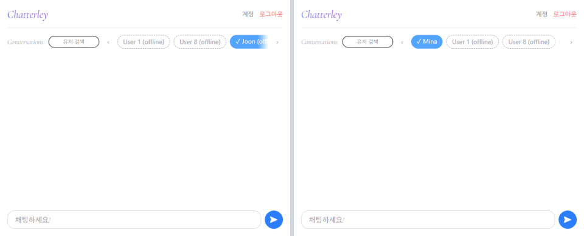
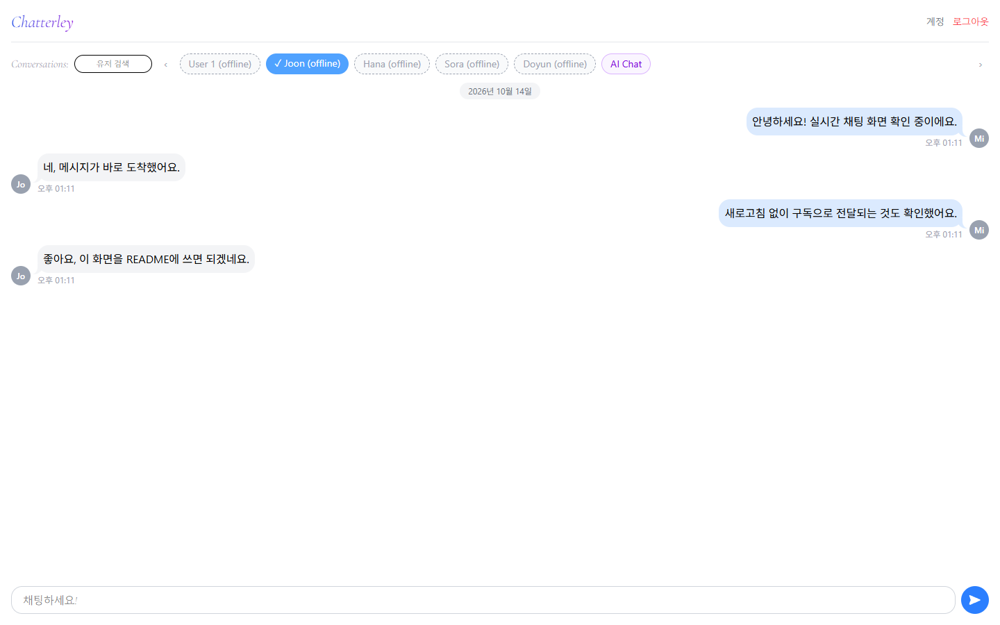
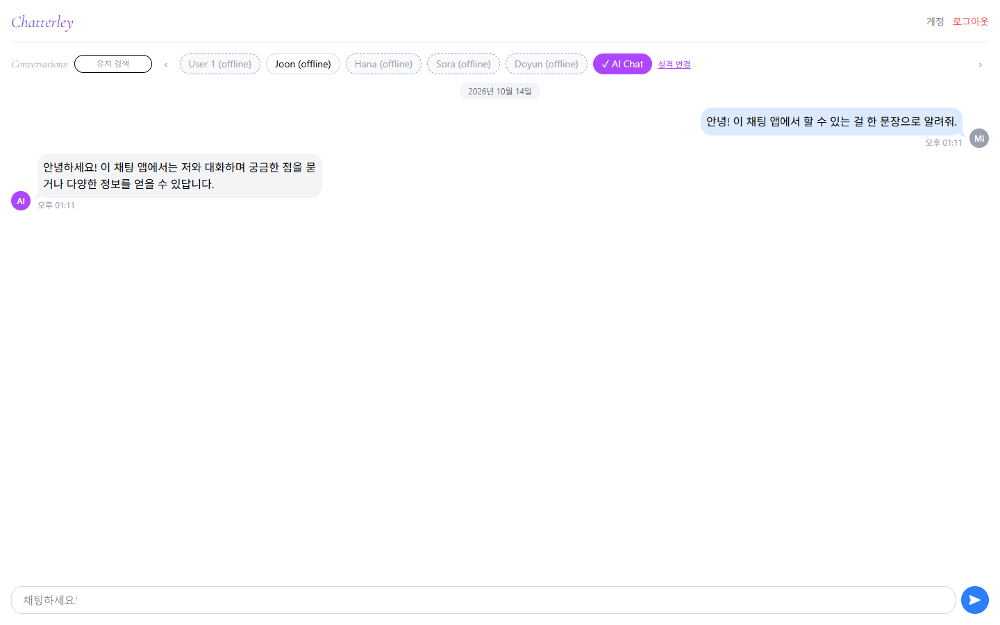
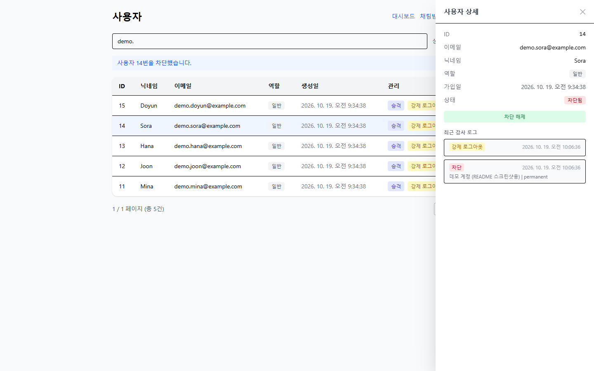
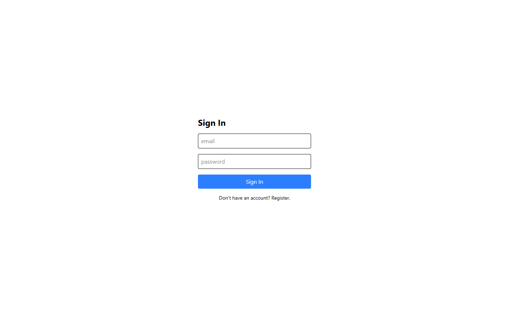
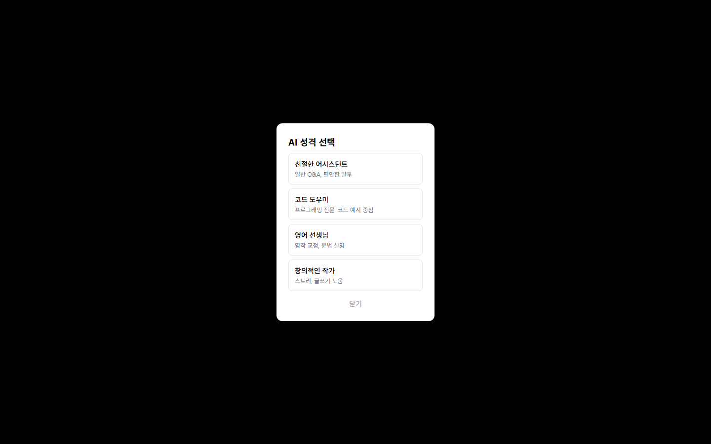
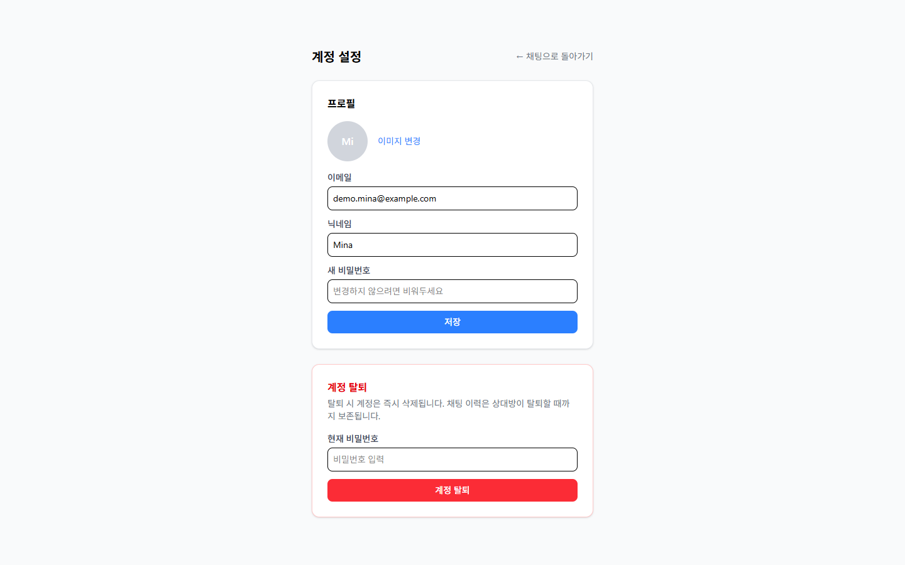
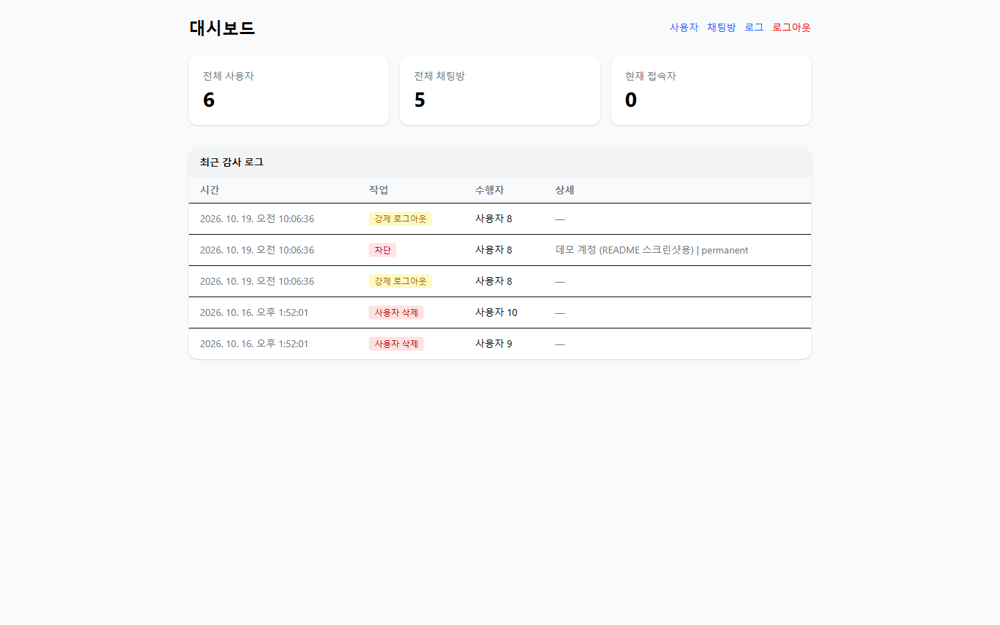
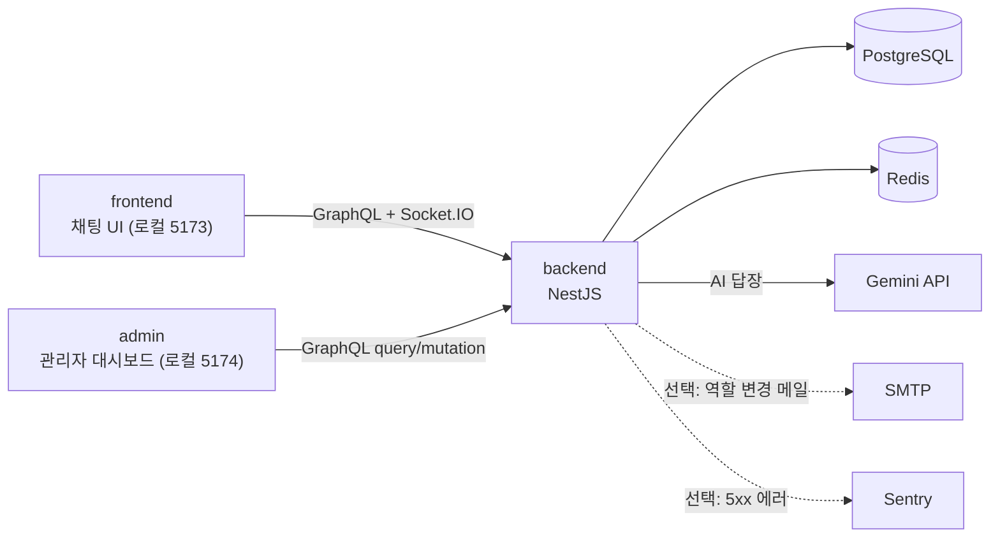
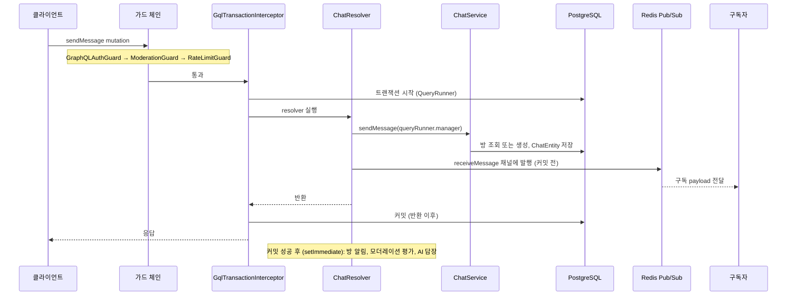

> English version: [README.md](README.md)

# Chatterley — 실시간 채팅 애플리케이션
1:1 실시간 채팅에 AI 대화 상대, 행동 기반 모더레이션, 별도 관리자 패널을 붙인 개인 프로젝트임. 실시간 채팅의 전송 경로, 인증, 어뷰징 대응을 직접 구현해 보는 것이 목적인 학습·포트폴리오 프로젝트이며, 백엔드 중심으로 설계하고 구현함.


## 개요
**스택**: NestJS · TypeScript · GraphQL(Apollo) · Socket.IO · Redis · PostgreSQL(TypeORM) · React · Vite · Docker · Gemini

- 메시지: `sendMessage` GraphQL mutation으로 전송하고 `receiveMessage` subscription으로 수신함. 저장은 `GqlTransactionInterceptor`가 트랜잭션으로 묶음([ADR 0003](ADR/0003-database-transaction-strategy.ko.md), [ADR 0004](ADR/0004-graphql-socketio-api-layer-split.ko.md)). Socket.IO는 연결 인증, 방 생성 알림, 중복 로그인 강제 종료만 담당함
- 인증: JWT 액세스 토큰은 메모리에만, 리프레시 토큰은 httpOnly 쿠키에 보관함. 역할 기반 접근 제어(RBAC)와 권한 액션 감사 로그를 둠
- 모더레이션: 중복·도배·속도 위반 스트라이크가 경고 → 뮤트 → 기간제 밴 → 영구 밴으로 에스컬레이션되고, admin이 되돌릴 수 있음
- AI 채팅: Google Gemini 2.5 Flash, 선택 가능한 성격 4종. 출력 토큰 상한, 대화 이력 절단, 재시도 상한, 방별 Redis 락을 둠. AI의 이름 `Chattey`는 시스템 프롬프트(`backend/src/ai/constants/system-prompts.ts`)에서 지정한 별칭이고 서비스명 Chatterley와 다름
- Admin 패널: 유저·방 관리, 모더레이션 액션, 감사 로그 CSV export를 위한 별도 React 앱
- 테스트: backend Jest, frontend Vitest, admin Vitest 단위 테스트와 CI의 Playwright e2e(frontend, admin)를 둠. 개수와 실행 일자는 [검증 상태](#검증-상태) 참고
- 이력: 2026-01부터 730개 커밋(`d684b19` 기준)에 걸쳐 혼자 반복 개발함. 전체 이력은 [CHANGELOG.ko.md](CHANGELOG.ko.md) 참고
- 문서: [ARCHITECTURE.ko.md](ARCHITECTURE.ko.md) · [ADR/](ADR/) · [ROADMAP.ko.md](ROADMAP.ko.md) · [CONTRIBUTING.ko.md](CONTRIBUTING.ko.md)

개발 중 실제로 겪은 사고와 버그, 설계 결정은 [기술적 의사결정과 트러블슈팅](#기술적-의사결정과-트러블슈팅)에 문제 → 원인 → 해결 → 검증 결과로 정리함.


## 스크린샷
로컬 스택(backend, Postgres, Redis, Vite 개발 서버)에서 라이트 테마, 가로 1440px로 촬영함.
현재 배포는 중단한 상태([호스팅 상태](#호스팅-상태) 참고)라 배포 환경에서는 확인하지 않음.
계정과 메시지는 앱의 실제 API로 만든 일회용 데모 데이터임. 앱에 언어 전환 기능이 없어 영/한 README가 같은 이미지를 씀. UI는 전체가 한국어임. 시각이 보이는 캡처는 브라우저 시간대를 UTC로 고정해 찍어 메시지·로그 시각이 UTC 기준으로 표시됨. 이미지를 누르면 원본이 열림.

[](docs/images/demo-realtime-chat.gif)<br>**실시간 전달** — 데모 계정 두 개를 나란히 띄워, 메시지가 새로고침 없이 `receiveMessage` GraphQL 구독으로 도착하는 모습. 메시지 시각은 UTC 기준임(촬영 시 브라우저 시간대를 고정함).

[](docs/images/02-chat.png)<br>**1:1 채팅** — 메시지는 `receiveMessage` GraphQL 구독으로 도착함

[](docs/images/04-ai-chat.png)<br>**AI 채팅** — 실제 Gemini 답장이며 사람 메시지와 같은 채널로 전달됨

[](docs/images/07-admin-users-panel.png)<br>**Admin 유저** — 밴된 계정의 상세 패널과 최근 감사 이력

| | |
|---|---|
| [](docs/images/01-signin.png)<br>**로그인** — 액세스 토큰은 메모리, 리프레시 토큰은 httpOnly 쿠키에 보관함 | [](docs/images/03-ai-personality.png)<br>**AI 성격 선택** — 첫 AI 채팅은 첫 메시지 전에 4가지 성격 중 하나를 고르도록 함 |
| [](docs/images/05-account.png)<br>**계정** — 프로필 수정과 계정 탈퇴(현재 비밀번호 필요) | [](docs/images/06-admin-dashboard.png)<br>**Admin 대시보드** — 총계와 최근 감사 로그(별도 admin 앱) |

이 촬영본의 알려진 한계: AI 성격 선택 화면의 대화상자 배경이 불투명한 검정으로 표시됨.
오버레이가 쓰는 `bg-opacity-40`을 Tailwind 4가 제공하지 않기 때문임.


## 호스팅 상태
백엔드(Railway)는 비용 문제로 중단했고, 프론트엔드·admin의 Vercel 배포도 중단한 상태임. 마지막 자동 배포 성공은 2026-05-27이고 [`deploy.yml` 실행 이력](https://github.com/Bluecode77732/Chat-project/actions/workflows/deploy.yml)에서 확인할 수 있음. `deploy` job은 수동 실행 전용(`workflow_dispatch`)임.

프론트엔드(`frontend/vercel.json`)와 admin 패널은 각각 Vercel 프로젝트로 구성되어 있으나 두 배포 모두 중단한 상태임. GitHub의 Vercel 상태는 `main`에서 2026-10-19에 `success`였고, `dev` 커밋에서는 2026-10-26부터 `Deployment was blocked`로 표시됨. 라이브 URL은 싣지 않음.

앱은 [빠른 시작](#빠른-시작)으로 로컬에서 실행할 것.


## 내 역할과 AI 활용 범위
- **개발 형태**: 1인 개발임.
- **설계 결정 방식**: 처음에는 Socket.IO만으로 구현함. GraphQL로도 양방향 통신이 가능하다는 정보를 접하고 새 기술을 도입해 보고 싶어서, AI에게 구조 설명을 듣고 필요한 구현 요소를 검토한 뒤 직접 판단해 메시지 경로를 GraphQL로 옮김([사례 1](#기술적-의사결정과-트러블슈팅)). 나머지 설계 결정은 아래와 같이 진행함.
  - **트랜잭션 인터셉터**: `QueryRunner`에서 커밋이 끝난 뒤에 DB에 반영되게 하고, 반복되는 로직을 인터셉터로 분리하며, `QueryRunner`의 원자성으로 안전한 트랜잭션을 만들기 위해 도입함. 자료를 직접 찾아보며 구현했고 부족한 부분은 AI의 보충을 받음
  - **Redis 사용 방식**: DB를 대체하지 않는 캐시·휘발성 상태 저장소로 씀(영속 저장소는 PostgreSQL뿐). 최근 메시지 캐시로 DB 조회를 줄이고, 세션·온라인 상태, 속도 제한, 락, Pub/Sub를 맡김. 트랜잭션 인터셉터와 마찬가지로 자료를 직접 찾아보며 구현했고 부족한 부분은 AI의 보충을 받음
  - **모더레이션 단계**: 모듈 하나를 끝낼 때마다 중간 점검 기간을 두는데, 그때 다음에 구현할 요소를 AI와 논의하다가 알게 됨. 필수 기능인지, 앱과의 적절성·타당성·실무성 등을 조사한 뒤 구현 방안을 검토하고, 다른 파일에 미치는 범위를 최대한 줄이는 방안으로 수정함
- **AI(Claude Code)에게 맡긴 작업**: 코드 작성·수정, 코드 리뷰·원인 분석, 테스트 작성, 문서 작성
- **검증 방식**: AI가 작성한 코드를 직접 읽고 수정함. 로컬과 브라우저에서 직접 실행해 확인함. 테스트와 CI로 확인함. 구현과 다른 AI 세션에서 리뷰를 받음
- **AI 작업 규칙**: 저장소 루트의 [CLAUDE.md](CLAUDE.md)에 AI가 따르는 규칙(금지 패턴, 변경 범위, 구현 전 확인 절차)을 정리해 둠
- **AI 제안을 거절하거나 수정한 사례**: [CLAUDE.md](CLAUDE.md)를 두기 전에는 AI가 불필요한 엔티티에 데코레이터를 붙이거나 `any`, `null`, `!` 같은 타입을 무분별하게 쓰는 경우가 있어, 코드를 직접 보고 고침. 이 패턴들은 이후 CLAUDE.md의 금지 패턴에 들어 있음
- **코드 없이 설명할 수 있는 부분**: `sendMessage` 흐름, 트랜잭션 커밋 타이밍, 가드 체인([흐름](#흐름), [ARCHITECTURE.md](ARCHITECTURE.ko.md) 참고)


## 프로젝트 동기
- 이미 동작하던 앱에서 메시지 경로를 Socket.IO 직접 전송에서 GraphQL Mutation/Subscription으로 옮기며, 운영 중인 시스템을 바꾸는 비용을 직접 겪어 봄([사례 1](#기술적-의사결정과-트러블슈팅))
- Basic/Bearer/JWT, RBAC 가드까지 인증·인가를 처음부터 끝까지 구현하고, 직접 발견한 XSS/localStorage 토큰 저장 취약점을 고침
- 개발 DB 노출 사고를 봉쇄 → 교체 → 정리 순서로 대응하고 기록으로 남김([사례 2](#기술적-의사결정과-트러블슈팅))
- 기능 데모에서 멈추지 않고 행동 기반 모더레이션, 별도 Admin 패널, CI/CD(GitHub Actions + Railway/Vercel)까지 구현함


## 기술 스택
핵심 설계와 직접 관련된 기술만 적음. 전체 의존성은 각 패키지의 `package.json`과 [ARCHITECTURE.md](ARCHITECTURE.ko.md#기술-스택)에 있음.

### 기술별 역할과 코드 위치
- **백엔드** — NestJS 11, TypeScript, Node.js 24 · `backend/src/`
  - DI 기반 모듈 경계로 auth/chat/user/ai/moderation/audit-log 등을 나눈 단일 배포 모놀리스. 리졸버 하나였던 규모에서 모듈 10개 안팎으로 커지는 동안 결합도를 낮게 유지함
  - 정적 타이핑은 초기에 반복해서 겪은 `undefined` 프로퍼티 접근 버그를 컴파일 시점에 잡기 위함이고, 논블로킹 I/O는 연결이 많은 채팅 워크로드에 맞음
- **API** — GraphQL(Apollo), graphql-ws · `backend/src/chat/chat.resolver.ts`, `backend/src/graphql/`
  - 메시지 전송 mutation과 방별 수신 subscription. 처음에는 Socket.IO로 직접 보내다가 메시지 저장에 트랜잭션 보장을 주려고 프로젝트 중반에 옮김([사례 1](#기술적-의사결정과-트러블슈팅))
- **실시간** — Socket.IO, `@socket.io/redis-adapter` · `backend/src/chat/chat.gateway.ts`
  - 연결 시 JWT 인증, 방 생성 알림, 중복 로그인 시 `forceLogout`. 어댑터가 없으면 방 브로드캐스트가 서버 인스턴스 간에 전달되지 않음
- **DB** — PostgreSQL, TypeORM · `backend/src/migrations/`, `backend/src/data-source.ts`
  - 유저·방·메시지·감사 로그가 서로 얽힌 관계형 데이터. 스키마는 마이그레이션으로만 바꿔 변경을 리뷰할 수 있게 함(`synchronize: false`)
- **캐시·Pub/Sub** — Redis(ioredis) · `backend/src/redis/redis.service.ts`, `backend/src/graphql/pubsub.service.ts`
  - 세션·온라인 상태, 방별 최근 메시지 캐시, 속도 제한, 모더레이션 상태, AI 락, GraphQL Pub/Sub
  - 인증용: 액세스 토큰 블랙리스트, 역할 캐시(`user_cache`), 리프레시 세션 ID(`auth:session`)
- **인증** — Passport JWT, bcrypt · `backend/src/auth/`
  - 액세스 토큰은 메모리, 리프레시 토큰은 httpOnly 쿠키. 역할 가드는 REST와 GraphQL 모두에서 상속이 아니라 조합으로 구성함
- **AI** — Gemini(`@google/genai`) · `backend/src/ai/`
  - 방별 성격에 따른 답장. 출력 토큰, 대화 이력, 재시도 상한을 설계 단계에서 둠
- **프론트엔드·관리자** — React, Vite, Zustand, Apollo Client · `frontend/src/`, `admin/src/`
  - 채팅 UI, 인메모리 토큰, 자동 토큰 갱신. 관리자는 별도 앱
- **테스트·CI** — Jest, Vitest, Playwright, Docker Compose, GitHub Actions · `backend/src/**/*.spec.ts`, `frontend/e2e/`, `admin/e2e/`, `docker-compose.yml`, `.github/workflows/deploy.yml`
  - 서비스 단위 테스트, 컴포넌트·스토어 테스트, e2e, 로컬 풀스택, 문서 정합성 검사

### 프론트엔드
백엔드와의 엔드투엔드 통합을 보여주기 위해 필요한 기능만 갖춘 React + TypeScript 클라이언트임.

- 스택: React 19.2.5, TypeScript ~6.0.2, Vite 8.0.10, Tailwind CSS 4.2.4, Zustand 5.0.12, Apollo Client 4.1.9, Socket.IO Client 4.8.3
- 인증: 액세스 토큰은 메모리(Zustand), 리프레시 토큰은 백엔드가 설정하는 httpOnly 쿠키 — localStorage에 저장하지 않음
- 실시간: Socket.IO로 연결/방 관리, GraphQL Mutation/Subscription으로 메시지 처리
- 보안: DOMPurify를 통한 XSS 방지, CORS 설정에 맞춘 요청, 보호된 페이지를 위한 Route Guard
- 배포: Vercel 프로젝트로 구성했으나 현재 배포는 중단한 상태임(`frontend/vercel.json`, [호스팅 상태](#호스팅-상태))


## 기능
- 속도 제한: 유저당 15초에 10개 메시지(`RateLimitGuard`)
- 보안: Helmet 보안 헤더, frontend·admin의 Content-Security-Policy(Vercel `headers`), 로그인·회원가입 IP당 60초/10회 제한(초과 시 429). 근거는 [ADR 0020](ADR/0020-security-headers-and-auth-rate-limit.ko.md)
- 커서 기반 메시지 히스토리와 무한 스크롤
- 프로필: 선택적 닉네임(고유, 20자 이하)과 프로필 이미지(jpeg/png/webp, 2MB 이하)
- 접근성·UX: `/` 키로 입력창 포커스, 모더레이션 알림용 `aria-live` 리전

### 핵심 기능별 동작과 구현 위치
- **메시지 송수신** — `sendMessage` mutation, `receiveMessage(roomId)` subscription (`chat.resolver.ts`). 메시지를 보내면 상대 화면에 새로고침 없이 도착함
  - 저장은 `GqlTransactionInterceptor`가 resolver 반환 이후 커밋하고, 커밋에 의존하는 로직은 `ctx.req.transactionCommitted`를 기다림
  - Redis Pub/Sub은 at-most-once이고 발행은 커밋 전에 일어남([사례 1](#기술적-의사결정과-트러블슈팅))
- **인증·세션** — `POST /auth/signin`, `POST /auth/token/refreshaccess`, `frontend/src/auth/session-guard.ts`. 로그인 후 새로고침해도 유지되고, 다른 탭에서 다른 계정으로 로그인하면 이 탭이 로그아웃됨
  - 갱신 호출은 `refreshAccessTokenSafely()` 하나로 모이고 동시 호출은 요청 하나를 공유함
  - 한 유저당 활성 소켓은 하나이며, 다른 인스턴스에 연결된 이전 소켓도 어댑터를 거쳐 종료함(인스턴스 2개로 확인함, [한계](#향후-확장-계획) 참고)
- **AI 채팅** — `setAiPersonality` mutation, `AiService.handleReply()`. AI 계정과 대화하고 방마다 성격을 고름
  - 방별 Redis 락, 출력 토큰·대화 이력·재시도 상한(상세는 [AI](#ai))
- **모더레이션** — `ModerationService`, `ModerationGuard`, `POST /user/:id/unban`. 도배하면 경고, 뮤트, 밴 순으로 제재됨
  - 임계값은 환경 변수로 조정함. 밴은 HTTP·GraphQL 요청, 소켓 연결, 토큰 갱신에서 거부됨
  - 이미 열린 GraphQL 구독은 밴 이후 그 구독자에게 다음 메시지가 전달될 때 종료되며 그 메시지는 전달되지 않음([한계](#향후-확장-계획)). 모든 조치가 감사 로그에 남음
- **관리자 패널** — `admin/src/`, `GET /audit-log`, `GET /audit-log/export`. 유저·방을 관리하고 감사 로그를 CSV로 내려받음
  - 별도 앱이고 query·mutation만 사용함(실시간 클라이언트 없음)


## 아키텍처
### 시스템 구성도

admin은 실시간 클라이언트(`graphql-ws`, `socket.io-client`)가 없어 채팅에는 참여하지 않음. SMTP와 Sentry는 환경 변수가 비어 있으면 동작하지 않는 선택 연동임([backend/.env.example](backend/.env.example)).
### 프로젝트 구조
pnpm 모노레포이며 `backend/`, `frontend/`, `admin/` 세 패키지로 이루어짐. 핵심 코드를 찾기 위한 경로만 적음. 전체 디렉터리 트리는 [ARCHITECTURE.md](ARCHITECTURE.ko.md#모노레포-구조) 참고.

| 경로 | 역할 | 먼저 볼 파일 |
|---|---|---|
| `backend/src/chat/` | 메시지 전송·수신, 소켓 연결, 트랜잭션 | `chat.resolver.ts`, `chat.gateway.ts`, `chat.service.ts`, `interceptor/gql-transaction.interceptor.ts` |
| `backend/src/graphql/`, `backend/src/redis/` | Pub/Sub, 세션·캐시·속도 제한 | `pubsub.service.ts`, `redis.service.ts` |
| `backend/src/auth/` | JWT 인증, 역할 기반 가드 | `strategy/jwt.strategy.ts`, `guard/` |
| `backend/src/moderation/` | 스트라이크 누적, 뮤트·밴 집행 | `moderation.service.ts`, `moderation.guard.ts` |
| `backend/src/ai/` | Gemini 답장, 방별 성격 | `ai.service.ts`, `constants/system-prompts.ts` |
| `backend/src/user/`, `backend/src/audit-log/` | 유저 관리, 권한 액션 감사 로그 | `user.service.ts`, `audit-log.service.ts` |
| `backend/src/migrations/` | TypeORM 마이그레이션(스키마 변경은 이곳으로만) | `data-source.ts` |
| `backend/src/app.module.ts`, `main.ts` | 모듈 조립, 환경 변수 검증, 부팅 설정 | |
| `frontend/src/` | 채팅 UI | `api/apollo.ts`, `auth/session-guard.ts`, `socket/socket.ts`, `store/auth.store.ts`, `pages/chat-page.tsx` |
| `admin/src/` | 관리자 대시보드 | `pages/`, `auth/session-guard.ts` |
| `frontend/e2e/`, `admin/e2e/` | Playwright e2e | |
| `ADR/`, `scripts/` | 설계 결정 기록, 문서 정합성 검사 스크립트 | |

### Redis
- 세션·온라인 상태는 `user:{id}` 해시와 `online_users` 집합에 TTL(`SESSION_TTL_SEC`)과 함께 저장되어 모든 서버 인스턴스가 같은 값을 봄. Socket 객체는 직렬화할 수 없어 Redis에 넣지 않고, 연결된 소켓은 각 프로세스의 Socket.IO 서버가 가지고 있음. 이유와 대체한 인메모리 Map은 [기술적 의사결정과 트러블슈팅](#기술적-의사결정과-트러블슈팅)의 사례 5 참고
- `RedisPubSub` 싱글톤 (`pubsub.service.ts`): GraphQL 뮤테이션과 활성 구독 간의 브리지 역할. `receiveMessage :${roomId}` 채널로 발행하면, 연결된 모든 `receiveMessage` 구독자가 실시간으로 메시지를 수신함.
- `PubSubService.publish()`는 발행 시점에 부수효과로 `SessionCacheService.cacheMessage()`를 호출해 메시지를 캐싱함. 사람 메시지와 AI 메시지 모두 이 지점에서만 캐싱되며, 리졸버나 `AiService`가 직접 `cacheMessage()`를 호출하지 않음.

### 엔티티 (TypeORM)
```
UserEntity
  id          PK
  email       unique
  nickname    nullable, unique, 최대 20자 — 다른 사용자에게 표시되는 이름
  profileImage nullable text (base64 data URI, jpeg/png/webp, 최대 ~2MB)
  password    API 응답에서 제외
  isAI        boolean (시드된 AI 시스템 계정에만 true)
  role        enum: user (0) | admin (1) | superadmin (2)
  status      enum: active | banned (모더레이션 상태, 모더레이션 섹션 참고)
  bannedUntil nullable timestamp — null이면 영구 밴 또는 밴 상태 아님
  chats    =< ChatEntity   (OneToMany)
  rooms    >< RoomEntity   (ManyToMany, RoomEntity 측 조인 테이블)

ChatEntity
  id          PK
  message     string
  participant >= UserEntity  (ManyToOne — 발신자)
  room        >= RoomEntity  (ManyToOne)

RoomEntity
  id            PK
  participants >< UserEntity   (ManyToMany 소유자, @JoinTable)
  chats        =< ChatEntity   (OneToMany)

AiRoomEntity — AI 성격 정보를 RoomEntity와 분리하려고 별도 엔티티로 둠
(자세한 이유는 ARCHITECTURE.md의 엔티티 절 참고)
  id          PK
  room        -- RoomEntity  (OneToOne, onDelete: CASCADE)
  personality string (해당 방의 현재 AI 성격)

EntityBase (네 엔티티 모두 상속)
  created     CreateDateColumn — API 응답에서 제외
  updated     UpdateDateColumn — API 응답에서 제외
```


## 흐름
모든 채팅 메시지는 **GraphQL Mutation 경로**로만 전송·전달됨. Socket.IO(`ChatGateway`)는
WebSocket 연결 생명주기만 담당하며, 채팅 메시지를 다루는 `@SubscribeMessage` 핸들러가 없고
어떤 메시지도 emit하지 않음.

### Socket.IO 연결 생명주기
1. 클라이언트가 `chat.gateway.ts`의 handleConnection으로 WebSocket 연결
  1.1. `AuthService.parseBearerToken()`으로 JWT 토큰 인증
  1.2. `ChatService.registerClient()`가 Redis에 `userId` => `socketId`를 기록
  1.3. `ChatService.joinRooms()`로 클라이언트를 기존 방에 참여시킴
  1.4. 세션 충돌 시, 해당 유저의 이전 소켓은 `forceLogout`을 받고 연결 해제됨

2. 방 생성 알림
  2.1. `ChatService`가 새 `RoomEntity`를 생성하면(두 사용자 간 첫 메시지), 수신자 소켓에
       `CreateRoom`을 emit하여 클라이언트가 새 방에 참여할 수 있게 함

3. 클라이언트 연결 해제
  3.1. `chat.gateway.ts`에서 `handleDisconnect` 실행
  3.2. `ChatService.removeClient()`가 Redis의 현재 세션이 이 소켓일 때만 offline으로 바꿈(더 새로운 세션이 이미 대체했다면 무시)

### GraphQL Mutation 경로 (`sendMessage`)

1. 가드 체인을 거침. 순서가 중요함: `RateLimitGuard`가 속도 제한 예산을 쓰기 전에 `ModerationGuard`가 뮤트/밴된 사용자를 걸러냄
2. `GqlTransactionInterceptor`가 resolver 실행 전에 `QueryRunner`를 열고 트랜잭션을 시작해 `@GqlQueryRunnerDecorator()`로 주입함
3. `ChatService.sendMessage()`가 발신자·수신자 검증, 방 조회 또는 생성, `ChatEntity` 저장을 같은 트랜잭션에서 처리함
4. resolver가 `PubSubService.publish()`로 `receiveMessage :${roomId}` 채널에 발행하고 반환함. 발행은 커밋 전에 일어남. `publish()`는 부수효과로 방별 메시지 캐시에도 기록하며, 사람 메시지와 AI 메시지 모두 이 한 곳에서만 캐싱함
5. 인터셉터가 resolver 반환 이후에 커밋함. 커밋에 의존하는 작업은 `ctx.req.transactionCommitted`를 기다리고, 이 Promise는 커밋이 성공해야 resolve됨
6. 커밋 이후(`setImmediate`)에 방 알림, 모더레이션 평가, 수신자가 AI일 때의 답장 생성(Redis 락 → 대화 이력 → Gemini → 저장 → 같은 채널로 발행)이 실행됨. AI 답장도 사람 메시지와 같은 채널로 나감
7. 구독자는 Redis Pub/Sub을 거쳐 `receiveMessage(roomId)` subscription으로 받음

### 인증 토큰 생명주기
두 토큰은 의도적으로 서로 다른 곳에 저장함. 수명이 짧은 `accessToken`은 메모리에만
(Zustand, `persist`에서 제외), 수명이 긴 `refreshToken`은 JavaScript가 읽을 수 없도록 백엔드가 설정한
httpOnly 쿠키에 보관함. 근거는 [ADR 0001](ADR/0001-jwt-auth-token-strategy.ko.md) 참고.

1. 로그인 — `POST /auth/signin` (Basic 인증)
  1.1. 백엔드가 응답 body로 `accessToken`을 반환하고, `refreshToken`은 httpOnly 쿠키로 설정
       (`secure`, `sameSite: 'none'` — 프론트엔드와 백엔드가 서로 다른 출처이기 때문)
  1.2. 프론트엔드는 `setTokens(accessToken, userId)` 호출; 토큰은 `localStorage`에 기록되지 않음
  1.3. 리프레시 토큰은 `jti`를 가지며, 백엔드가 이를 Redis에 `auth:session:{userId}`로 저장함
       (TTL은 리프레시 토큰 수명). 이후 로그인이 이 값을 교체하고, 이전 리프레시 토큰은
       "Session Superseded"로 거부됨

2. 인증된 요청
  2.1. `authLink`가 요청 시점에 `useAuthStore.getState().accessToken`을 읽어
       `Authorization: Bearer` 헤더 설정

3. 자동 갱신 — 페이지 새로고침(메모리가 비어 있음) 또는 `errorLink`가 401을 감지했을 때
  3.1. 모든 호출 지점은 `refreshAccessTokenSafely()`(`session-guard.ts`)를 거치며, 동시 호출자는
       진행 중인 요청 하나를 공유
  3.2. `POST /auth/token/refreshaccess`를 `credentials: 'include'`로 전송 — 브라우저가 쿠키를
       자동 첨부하므로 JavaScript가 리프레시 토큰을 읽는 일이 없음
  3.3. 새 `accessToken`이 body로 돌아와 다시 메모리에 저장됨
  3.4. 갱신 결과가 이 탭이 마지막으로 인증했던 계정과 다르면
       (`sessionStorage['chat:sessionUserId']`), 사용자 모르게 신원을 바꾸는 대신 해당 탭을 로그아웃시킴

4. 로그아웃 — `POST /auth/signOut`
  4.1. 백엔드가 액세스 토큰을 블랙리스트에 등록하고 `res.clearCookie('refreshToken')` 호출 —
       토큰이 이미 만료됐거나 유효하지 않아도 쿠키는 삭제됨
  4.2. 프론트엔드는 Zustand 스토어를 비우고 리다이렉트


## 기술적 의사결정과 트러블슈팅
각 사례는 문제 → 원인 → 해결 → 검증 결과 순서로 씀. **검증 결과**에는 코드, 테스트, 실행으로 확인한 것만 적고, 설계상 기대와 실제 측정은 구분해서 표시함. 성능 수치는 측정한 적이 없어 쓰지 않음. 실행 확인은 2026-10-22 로컬 Docker 환경(Windows 10, Docker 28.5.1, 커밋 `d684b19`) 기준임.

### 사례 1: Socket.IO에서 GraphQL로 메시지 경로 이관
- **문제**: 처음에는 Socket.IO 핸들러가 메시지를 받아 저장하고 전달함. 방 생성과 메시지 저장처럼 여러 테이블에 쓰는 작업을 하나의 트랜잭션으로 묶을 방법이 소켓 핸들러에는 없었음.
- **원인**: 소켓 핸들러에는 요청 단위로 트랜잭션 수명(`QueryRunner` 열기, 커밋, 롤백, `release()`)을 맡아 줄 계층이 없음. 호출 지점마다 직접 관리하면 `release()` 누락으로 커넥션이 풀에서 새는 위험이 있다고 [ADR 0003](ADR/0003-database-transaction-strategy.ko.md)에 기록함.
- **해결**:
  - 전송을 `sendMessage` mutation, 수신을 `receiveMessage` subscription으로 옮기고 `GqlTransactionInterceptor`가 트랜잭션 수명을 맡도록 함. Socket.IO에는 연결 인증, 방 생성 알림, `forceLogout`만 남김
  - 두 경로를 함께 두는 안은 같은 이벤트의 중복·순서 역전 위험 때문에 배제함([ADR 0004](ADR/0004-graphql-socketio-api-layer-split.ko.md))
  - 이미 동작하던 앱에서 진행해, 구 Socket.IO 메시지 핸들러를 지운 2026-06-11까지 약 4.5개월 두 경로가 공존함([ROADMAP.ko.md](ROADMAP.ko.md))
- **검증 결과**:
  - `gql-transaction.interceptor.spec.ts`가 성공 경로(커밋이 끝나기 전에는 결과를 내보내지 않음), 오류 경로(롤백 후 `release` 1회, `InternalServerErrorException`), 커밋 자체가 실패한 경우를 검증함
  - 로컬 Docker 실행에서 가입 → `sendMessage` → 다른 계정의 `receiveMessage` 구독 수신 → `getMessages`를 API 수준으로 확인함
  - 한계: resolver가 커밋 전에 발행하므로 커밋이 실패하면 구독자가 이미 받은 메시지가 저장되지 않을 수 있음(코드 구조상의 가능성이며 재현하지 않음). 커밋 이후 작업(방 알림, 모더레이션 평가, AI 답장)은 `transactionCommitted`가 커밋 성공 시에만 resolve되므로 커밋이 실패하면 실행되지 않음
  - 한계: `sendMessage`는 비멱등이라 타임아웃 뒤 클라이언트가 재시도하면 같은 메시지가 중복 저장될 수 있음(`chat.resolver.ts` 주석)
  - 한계: Redis Pub/Sub은 at-most-once라 구독하지 않은 동안 발행된 메시지는 다시 전달되지 않음(ADR 0004에서 수용한 한계). 이관 전후 성능은 측정하지 않음

### 사례 2: 개발 DB·Redis 포트 외부 노출 사고
- **문제**: 개발 중 PostgreSQL(5432), Redis(6379), 백엔드(3000)가 인터넷에서 접근 가능한 상태였고, 자동화된 랜섬웨어 봇이 PostgreSQL 기본 자격증명으로 접속해 개발 DB를 삭제한 뒤 요구문을 남김.
- **원인**: `docker-compose.yml`의 포트가 `0.0.0.0`으로 바인딩되어 있었고, 공인 IP가 붙은 Ethernet 어댑터의 Windows 방화벽 프로필이 "Private(신뢰)"이라 Docker Desktop 규칙이 모든 포트의 인바운드를 허용함.
- **해결**:
  - 순서는 봉쇄 → 교체 → 정리. 접근 경로를 먼저 막고(포트 바인딩 `127.0.0.1`, 개발 환경 호스트 loopback 제한, 방화벽 프로필 Public 전환은 직접 수행), 그다음 DB·Redis 비밀번호와 JWT 시크릿을 교체하고, 마지막에 공격자가 만든 DB를 정리함. 정리를 먼저 하면 봇이 바로 다시 만들 수 있음
  - 공격자가 만든 테이블의 내용은 AI가 읽지 않고 사람이 직접 확인함(프롬프트 인젝션 방지)
  - 재발 방지로 Redis `requirepass`를 켜고, `ENV=prod`에서 비밀번호 없는 `REDIS_URL`은 부팅을 막음. 상세는 [AI 보조 개발 사례](#ai-보조-개발-사례)와 [ADR 0013](ADR/0013-local-dev-network-binding.ko.md) 참고
- **검증 결과**:
  - 설정은 코드에서 확인함: `docker-compose.yml`의 `127.0.0.1` 바인딩과 `requirepass`, `main.ts`의 loopback 분기, `app.module.ts`의 `REDIS_URL` 비밀번호 검증
  - 로컬 Docker 실행에서 `docker compose ps`가 3000, 5432, 6379를 모두 `127.0.0.1`에만 바인딩한 것으로 표시함
  - 한계: 외부 네트워크에서의 포트 스캔은 하지 않았고, 비밀번호·시크릿 교체는 사건 당시 기록에 의존함

### 사례 3: AI 응답 캐시 손상 (`Invalid time value`)
- **문제**: AI 재시도·폴백 기능을 브라우저에서 수동 검증하던 중, 백엔드를 재시작하고 소켓이 재연결되어 방 메시지를 캐시에서 다시 읽을 때 `CombinedGraphQLErrors: Invalid time value`가 발생함.
- **원인**: `AiService`가 자기 답장을 직접 캐싱하고, `PubSubService`의 발행 훅이 같은 답장을 한 번 더 캐싱함. 두 번째 캐시는 `@Exclude()`가 붙은 `created` 필드가 빠진 사본이라, 읽을 때 `new Date(undefined)`(내부 값 NaN)가 되어 GraphQL `DateTime` 스칼라의 `toISOString()`이 예외를 던짐. 이전 캐싱 리팩터링이 `ai.service.ts`를 건드리지 않아 생긴 누락임을 `git show --stat`으로 확인함.
- **해결**: `AiService`가 원본 엔티티를 발행하도록 바꿔 사람 메시지 경로와 맞추고, 중복된 직접 캐싱 호출을 지움. 캐싱은 `PubSubService.publish()` 한 곳에서만 일어남.
- **검증 결과**:
  - `redis.service.spec.ts`에 `created`가 없는 캐시 항목이 Invalid Date가 되는 동작을 고정하는 케이스가 있음. `pubsub.service.spec.ts`는 발행 시 캐시 동작을 검증함
  - 현재 `backend/src/ai/`에는 `cacheMessage` 호출이 없음(검색으로 확인함)
  - `pnpm test` 통과(개수는 [검증 상태](#검증-상태) 참고)
  - 한계: 수정 뒤 같은 브라우저 시나리오(백엔드 재시작 후 새로고침)를 따로 재현해 확인하지는 않았고, 이후 앱을 사용하는 동안 동일한 오류가 나타나지 않았음.

### 사례 4: 마이그레이션 생성이 ON DELETE CASCADE를 되돌리는 문제
- **문제**: `pnpm migration:generate`가 ManyToMany 조인 테이블 FK `FK_501a0aef55632e3cf2894bda97f`(`room_entity_participants_user_entity`)를 `ON DELETE NO ACTION`으로 다시 만들어, 유저 삭제 시 방 참여 기록 정리에 쓰는 `ON DELETE CASCADE`가 조용히 되돌아감. 되돌아가면 유저 삭제가 FK 위반으로 실패함([CLAUDE.md](CLAUDE.md)).
- **원인**: 해당 ManyToMany 관계에 `onDelete`가 선언되어 있지 않아, TypeORM이 DB의 CASCADE를 선언과 다른 상태로 보고 되돌리는 변경을 생성함.
- **해결**:
  - 생성된 마이그레이션에서 해당 FK 줄을 지우는 수동 리뷰 절차를 둠([CLAUDE.md](CLAUDE.md), [ADR 0003](ADR/0003-database-transaction-strategy.ko.md))
  - 사람이 놓칠 수 있어 정적 가드 `migration-cascade-guard.spec.ts`를 추가함. 이 가드는 마이그레이션 `up()`의 소스를 텍스트로 스캔해 CASCADE가 유지되는지 확인하고, `pnpm test`에 포함되어 로컬과 CI에서 걸림. 프로덕션에서는 돌리지 않음(부팅 시점엔 이미 마이그레이션이 적용된 뒤라 늦음)
  - 보호할 FK를 늘리려면 spec의 `GUARDED_FKS` 배열에 항목을 추가함
- **검증 결과**:
  - 해당 spec이 포함된 `pnpm test` 통과
  - 한계: 실행 중인 DB에서 FK의 삭제 동작(`confdeltype`)을 조회하는 확인은 이번에 하지 않음

### 사례 5: 메모리 소켓 맵에서 Redis 세션으로
- **문제**: `userId → Socket` 매핑을 프로세스 메모리 Map에만 두면 서버를 재시작할 때 사라지고, 인스턴스가 늘어나면 다른 인스턴스에서 접속 위치와 온라인 여부를 알 수 없음.
- **원인**: Map은 프로세스 로컬 상태이고 Socket 객체는 직렬화할 수 없어 그대로 공유할 수 없음.
- **해결**: 이전 인메모리 `clientConnection` Map을 Redis 기반 세션 캐시로 대체함(`redis.service.ts` 주석).
  - `user:{id}` 해시(`socketId`, `status`)에 TTL(`SESSION_TTL_SEC`, 기본 86400초)을 두고, 온라인 목록은 `online_users` 집합에 둠. `hset`, `expire`, `sadd`는 MULTI/EXEC로 묶어 TTL 없는 키가 남지 않게 함
  - 서버 시작 시와 5분마다 `online_users`를 `user:{id}`와 대조해 정리함(유령 유저 방지). 무조건 지우지 않는 이유는 다른 인스턴스에 연결된 유저까지 지우게 되기 때문임
  - 새 소켓을 현재 세션으로 먼저 기록한 뒤 이전 소켓에 `forceLogout`을 보내고, `removeClient`는 현재 세션이 그 소켓일 때만 offline으로 바꿈([ADR 0014](ADR/0014-single-active-session.ko.md))
  - 방 브로드캐스트는 `@socket.io/redis-adapter`로 인스턴스 간에 전달함

  현재 코드(`backend/src/redis/redis.service.ts`)의 온라인 등록:
  ```ts
  async sethUserOnline(userId: number, socketId: string) {
    const key = `user:${userId}`;
    const ttl = this.configService.get<number>('SESSION_TTL_SEC', 86400);
    await this.redis
      .multi()
      .hset(key, 'socketId', socketId, 'status', 'online')
      .expire(key, ttl)
      .sadd('online_users', String(userId))
      .exec();
  }
  ```
- **검증 결과**:
  - 코드로 확인한 것: 위 구조, `chat.gateway.ts`의 어댑터 연결, `redis.service.spec.ts`와 `chat.service.spec.ts` 단위 테스트
  - 설계상 기대(미검증): 어댑터가 없으면 `server.to(room).emit(...)`이 같은 프로세스에 연결된 클라이언트에만 전달됨
  - 실측(2026-10-26, 인스턴스 2개를 같은 Postgres·Redis에 붙여 실행):
    - 수정 전에는 같은 계정이 다른 인스턴스에서 두 번째로 접속해도 첫 소켓에 `forceLogout`이 가지 않고 끊기지도 않았음. `kickPreviousSession`이 현재 프로세스의 소켓만 조회했기 때문이며, 같은 이유로 다른 인스턴스에 연결된 소켓은 밴으로도 끊기지 않았음
    - 조회를 어댑터를 거치는 `server.in(socketId)`로 바꾼 뒤 같은 시나리오에서 첫 소켓이 `forceLogout`을 받고 끊기며, 밴도 다른 인스턴스의 소켓에 닿음
    - `forceLogout`이 끊김보다 먼저 도착하는지 20회 반복해 20회 모두 확인함(로컬 한 환경의 관찰이며 순서를 보장하는 것은 아님)
    - 부하와 성능은 측정하지 않았고, 성능이 좋아졌다는 수치는 없음


## AI 보조 개발 사례
두 사건의 경위와 해결은 [기술적 의사결정과 트러블슈팅](#기술적-의사결정과-트러블슈팅)의 사례 2·3에 있음. 여기에는 AI 도구를 쓴 방식과 얻은 교훈만 적음.

### 라이브 테스트 중 인프라 보안 위협 탐지
- **AI가 한 일**: Swagger와 curl로 API를 직접 호출하던 라이브 테스트 중 Docker Compose 설정을 검토해 `0.0.0.0` 바인딩과 방화벽 프로필 조합의 노출을 찾음. 포트 바인딩(`127.0.0.1`), `main.ts` 호스트 제한, Redis `requirepass`를 수정하고 DB·Redis 비밀번호와 JWT 시크릿을 교체함. 방화벽 프로필을 Public으로 바꾸는 것은 안내만 하고 사용자가 직접 수행함
- **AI가 하지 않은 일 — 프롬프트 인젝션 방지**: 공격자가 만든 `readme_to_recover.readme` 테이블 내용을 SQL로 읽지 않음. 공격자가 DB에 AI 지시문을 심었을 수 있고, AI 도구가 그 내용을 컨텍스트에 올리는 순간 의도치 않은 명령이 실행될 수 있기 때문임. 테이블의 위치와 존재만 설명하고 내용 확인은 사용자에게 맡겼으며, 확인 결과 표준적인 비트코인 요구문이었음
- **교훈**: AI 보조 라이브 테스트가 코드 리뷰와 CI만으로는 드러나지 않는 배포 환경 취약점을 탐지함. AI 도구가 외부에서 생성된 콘텐츠(DB 행, 업로드 파일)를 직접 읽는 것은 프롬프트 인젝션 경로가 되므로 사람이 확인해야 함. 대응 순서는 **봉쇄 → 로테이션 → 정리**이고, 순서가 바뀌면 정리가 무의미해짐

### 라이브 브라우저 테스트 중 발견한 AI 응답 캐시 손상
- **AI가 한 일**: `psql`로 DB의 `created` 컬럼을 직접 조회해 데이터 손상을 배제하고, `@nestjs/graphql`의 `DateTime` 스칼라 구현을 읽어 예외 조건을 확인하고, 캐시 쓰기 지점 두 곳(`ai.service.ts`, `pubsub.service.ts`)을 추적함. 과거 캐싱 리팩터링 커밋에 `git show --stat`을 실행해 중복이 의도된 설계가 아니라 누락임을 확인한 뒤, `AiService`가 원본 엔티티를 발행하도록 고치고 회귀 테스트를 추가함
- **교훈**: 라이브 브라우저 테스트가 단위 테스트로는 못 잡는 서비스 간 버그를 드러냄. 기존 목(mock)이 정확히 손상이 생기는 계층(`PubSubService`의 발행 시 캐시)을 격리하고 있었기 때문임. 의심되는 커밋에 `git show --stat`을 실행하면 "불완전한 리팩터링의 누락"인지 "의도된 설계"인지 추측 없이 확인할 수 있음


## 빠른 시작
- 요구 사항
  - Node.js 24.x(`.nvmrc`), pnpm >= 10(고정 버전은 [CONTRIBUTING.ko.md](CONTRIBUTING.ko.md#사전-준비물) 참고)
  - Docker >= v28.xx — 아래 A 경로는 로컬에 PostgreSQL·Redis를 따로 설치하지 않아도 됨
  - `GEMINI_API_KEY`는 필수 환경 변수라 없으면 부팅이 실패함([`app.module.ts`](backend/src/app.module.ts)). AI 답장을 실제로 쓰려면 Gemini API 키가 필요함

### A. Docker로 backend + PostgreSQL + Redis 실행
**1. 의존성 설치** (frontend, admin 실행에 필요함)
```bash
pnpm install
```

**2. 프로젝트 루트에 `.env.docker` 생성** (git이 추적하지 않는 파일임). 아래 값은 모두 자리표시자이므로 직접 채울 것.
```env
ENV=dev
DB_TYPE=postgres
DB_HOST=postgres
DB_PORT=5432
DB_USERNAME=postgres
DB_PASSWORD=<임의의 비밀번호>
DB_DATABASE=chatdb
POSTGRES_USER=postgres
POSTGRES_PASSWORD=<DB_PASSWORD와 같은 값>
POSTGRES_DB=chatdb
REDIS_PASSWORD=<임의의 비밀번호>
REDIS_URL=redis://:<REDIS_PASSWORD 값>@redis:6379
HASH_ROUNDS=12
REFRESH_TOKEN_SECRET=<임의의 긴 문자열>
ACCESS_TOKEN_SECRET=<임의의 긴 문자열>
REFRESH_TOKEN_SECRET_EXPIRES_IN=604800
ACCESS_TOKEN_SECRET_EXPIRES_IN=900
USER_CACHE_TTL_SEC=300
SESSION_TTL_SEC=86400
MESSAGE_CACHE_TTL_SEC=86400
CORS_ORIGIN=http://localhost:5173,http://localhost:5174
GEMINI_API_KEY=<Gemini API 키>
```
`NODE_ENV`와 `RUNTIME_ENV`는 compose가 설정하므로 적지 않아도 됨([docker-compose.yml](docker-compose.yml)). `POSTGRES_*`와 `REDIS_PASSWORD`는 `postgres`/`redis` 컨테이너가 같은 파일에서 읽음. 만료 시간은 초 단위 숫자만 허용함(`7d` 같은 문자열은 부팅 검증에서 거부됨). 전체 변수 목록은 [backend/.env.example](backend/.env.example) 참고.

**3. 서비스 시작**
```bash
docker compose up -d --build
```
컨테이너가 시작될 때 마이그레이션이 자동으로 실행되므로 따로 실행하지 않음. 부팅 확인: `http://localhost:3000/health`가 `{"status":"ok"}`를 반환함.

**4. 프론트엔드 실행** (별도 터미널)
```bash
cp frontend/.env.example frontend/.env.local
cd frontend && pnpm dev
```
→ http://localhost:5173

**5. Admin 패널 실행** (별도 터미널, admin/superadmin 계정이 필요함)
```bash
cp admin/.env.example admin/.env.local
cd admin && pnpm dev
```
→ http://localhost:5174 — 최초 superadmin은 DB에 직접 만들어야 함([Admin 계정 생성](#admin-계정-생성) 참고).

**종료**: `docker compose down`은 컨테이너만 내리고 데이터(볼륨)는 유지함. `docker compose down -v`는 PostgreSQL·Redis 볼륨까지 삭제하므로 데이터가 사라짐.

### B. 수동 실행 (로컬 PostgreSQL 18과 Redis가 있는 경우)
```bash
pnpm install
cp backend/.env.example backend/.env     # 값을 채움. DB_TYPE은 postgres, DB_HOST·REDIS_URL은 로컬 주소
pnpm --filter backend build               # migration:run이 dist/data-source.js를 쓰므로 먼저 빌드해야 함
pnpm migration:run
docker run -d -p 6379:6379 --name redis-chat redis:latest   # 이미 만들었으면 docker start redis-chat
cd backend && pnpm start:dev
```
PostgreSQL에 DB를 만드는 절차는 이 문서에서 다루지 않음. frontend와 admin은 A 경로의 4, 5단계와 같음.

### 검증 상태
2026-10-22, Windows 10, Docker 28.5.1 / Compose 2.40.0, Node 24.8.0, pnpm 10.33.0, 커밋 `d684b19`에서 격리된 임시 클론으로 확인함.

| 항목 | 상태 |
|---|---|
| A 경로: 컨테이너 기동, 마이그레이션 자동 실행, `/health` | 확인함 |
| 가입, 로그인, `sendMessage`, `receiveMessage` 구독 수신, `getMessages` | API 수준으로 확인함 |
| superadmin INSERT 후 관리자 로그인과 `GET /user` | 확인함 |
| frontend, admin 개발 서버 | 응답(200)만 확인함. 브라우저에서 로그인·채팅 화면은 확인하지 않음 |
| B 경로 | `build` 후 `migration:run`까지 확인함. `start:dev`와 빈 DB에서의 최초 마이그레이션은 확인하지 않음 |
| Playwright e2e | 이번 로컬 실행에서는 실행하지 않음. CI의 2026-10-19 main push 실행([#39287345174](https://github.com/Bluecode77732/Chat-project/actions/runs/39287345174))에서는 `e2e`와 `admin-e2e` job이 모두 success였음. 다만 `ai-chat.spec.ts`는 Gemini 키가 없어도 폴백 메시지로 통과하므로 실제 Gemini 답장을 검증하지는 않음 |
| AI 실제 답장, 모더레이션 동작 | 이번 실행에서는 확인하지 않음 |
| 단위 테스트 | backend 14 suites 258 tests, frontend 4 files 21 tests, admin 3 files 14 tests 통과(2026-10-27 `dev` `bd1213f`에서 재실행) |

**테스트 실행**
```bash
pnpm test                         # backend Jest
pnpm --filter frontend test       # frontend Vitest
pnpm --filter admin test          # admin Vitest
cd backend && pnpm test:cov       # backend 커버리지
```
e2e(Playwright)는 `pnpm --filter frontend e2e`, `pnpm --filter admin e2e`로 실행하며 CI에서 돌아감.

**Swagger UI** — 백엔드를 실행한 상태에서 http://localhost:3000/document

**채팅 확인** — Altair/Postman으로 직접 해 보는 절차는 [CONTRIBUTING.ko.md](CONTRIBUTING.ko.md#graphql-api-직접-호출)를 참고하세요.

### 문제 해결
실행 중 자주 만나는 문제와 해결책임.
- Redis 연결 문제
  - 로그: "GraphQLModule dependencies initialized"
  - 로그: "Redis Error: AggregateError [ECONNREFUSED]"
  - 로그: "Error: connect ECONNREFUSED ::IPv6 주소:포트"
  
  - 해결책 
    - ✅ 터미널에서 `docker start redis-chat` 실행

- `pnpm migration:run`에서 `Unable to open file ... dist/data-source.js`
  - 해결책
    - ✅ 먼저 `pnpm --filter backend build`로 빌드할 것. `migration:run`은 빌드 산출물(`dist/data-source.js`)을 읽음


## 향후 확장 계획
**현재 한계**
- Redis Pub/Sub은 at-most-once라 구독하지 않은 동안 발행된 메시지는 다시 전달되지 않음([ADR 0004](ADR/0004-graphql-socketio-api-layer-split.ko.md))
- 메시지 발행이 커밋 전에 일어나서, 커밋이 실패하면 구독자가 이미 받은 메시지가 저장되지 않을 수 있음(코드 구조상의 가능성이며 재현하지 않음)
- `sendMessage`가 비멱등이라 타임아웃 뒤 클라이언트가 재시도하면 같은 메시지가 중복 저장될 수 있음
- 방 생성·조회 로직이 정확히 두 명을 전제로 해서 그룹 채팅은 지원하지 않음([ROADMAP.ko.md](ROADMAP.ko.md))
- `GEMINI_API_KEY`가 필수 환경 변수라 키 없이는 부팅되지 않음
- 배포를 중단한 상태라 배포 환경에서의 동작은 확인하지 않음
- 밴된 사용자의 `receiveMessage` 구독은 밴 즉시가 아니라 그 구독자에게 다음 메시지가 전달될 때 종료됨(그 메시지는 전달되지 않음). 메시지마다 `isUserBanned`로 DB를 조회하므로 구독자 수와 메시지 수에 비례한 조회 비용이 있고, 이 비용은 측정하지 않음
- 관리자 강제 로그아웃(`UserService.forceLogout`)은 소켓만 끊고 열린 GraphQL 구독은 닫지 않으며, 이미 발급된 액세스 토큰도 폐기하지 않음
- 다중 인스턴스 부하는 측정하지 않음
- 최초 superadmin은 DB에 직접 INSERT해야 함
- `admin-e2e` job은 아직 blocking이 아니고 Windows `test` job은 실패해도 통과 처리됨([deploy.yml](.github/workflows/deploy.yml))
- frontend와 admin에는 에러 트래킹이 없음(backend만 Sentry 적용)

**미구현 백로그** (우선순위가 정해진 계획이 아니며 상세는 [ROADMAP.ko.md](ROADMAP.ko.md) 참고)
- 대화 목록의 마지막 메시지와 안 읽은 메시지 수
- 그룹 채팅
- 사용자 측 방·대화 삭제
- 입력 중 표시
- `receiveMessage` 구독의 속도 제한
- 강제 로그아웃 시 열린 GraphQL 구독 종료
- frontend·admin 에러 트래킹


## API 문서
### Swagger UI
***모든 기능을 테스트하려면 먼저 회원가입을 해야 함.***
REST(`Auth`, `User`, `Audit Log`)의 엔드포인트별 파라미터와 응답 스키마는 백엔드를 로컬에서 실행한 뒤 Swagger UI(`http://localhost:3000/document`)에서 확인함.

### 주요 엔드포인트
**REST** — 파라미터와 스키마는 Swagger에 있으므로 여기에는 Swagger에서 드러나지 않는 권한과 제한만 적음.

| 엔드포인트 | 권한 | 제한·동작 |
|---|---|---|
| `GET /health` | 없음 | liveness 체크. DB/Redis는 확인하지 않고 `{ status: 'ok' }`만 반환함(의존성 장애가 컨테이너 재시작을 유발하지 않도록) |
| `POST /auth/register`, `POST /auth/signin` | 없음 | IP당 60초/10회 속도 제한(초과 시 429). Basic 인증 헤더로 전달함 |
| `POST /auth/signOut` | 로그인 | 현재 액세스 토큰을 블랙리스트 처리하고 리프레시 토큰 쿠키를 삭제함(토큰이 이미 만료/무효해도 쿠키는 삭제됨) |
| `POST /auth/token/refreshaccess` | 리프레시 쿠키 | 액세스 토큰 갱신 |
| `GET /user` | admin | `humanOnly`는 시드된 AI 계정과 모더레이션 시스템 계정을 제외함 |
| `GET /user/:id`, `PATCH /user/:id` | 본인 또는 admin | 닉네임은 20자 이하이며 고유해야 함(중복이면 400). 프로필 이미지는 base64 data URI, jpeg/png/webp, 2MB 이하 |
| `DELETE /user/:id` | 본인 또는 admin | 시드된 AI 계정과 모더레이션 시스템 계정은 삭제 불가 |
| `PATCH /user/:id/role` | superadmin | 계정 생성은 `POST /auth/register`로만 가능함 |
| `POST /user/:id/force-logout`, `/ban`, `/unban` | admin | `ban`은 `durationSec`을 생략하면 영구 밴이고 활성 세션도 즉시 종료함. `unban`은 밴·뮤트·스트라이크를 해제함 |
| `GET /audit-log` | admin | `userId`는 actor 또는 target으로 매칭함 |
| `GET /audit-log/export` | admin | 같은 필터 결과를 CSV로 내보내며 최대 10,000행임(권한 관련 데이터라 양이 적어 커서 스트리밍 대신 단순한 상한을 선택함) |

**채팅 (GraphQL)** — 전체 스키마는 NestJS가 코드에서 생성하는 `backend/src/schema.gql`에 있음. 채팅 메시지는 GraphQL로만 오가고, Socket.IO는 연결 인증과 `CreateRoom` 알림만 처리함. Altair/Postman 사용 절차는 [CONTRIBUTING.ko.md](CONTRIBUTING.ko.md#graphql-api-직접-호출)에 있음.

- `getMessages(roomId, cursor)`는 커서 이전 메시지를 최대 15개 반환함. `getAllRooms`, `deleteRoom`은 admin 전용임


## 상세 레퍼런스
핵심 설계를 읽는 데 필수는 아닌 도메인 설명과 운영 참고 사항임. 환경 변수 전체는 [backend/.env.example](backend/.env.example), 배포·Docker 구성은 [ARCHITECTURE.md의 배포 토폴로지](ARCHITECTURE.ko.md#배포-토폴로지), 설정·테스트 정책은 [CONTRIBUTING.ko.md](CONTRIBUTING.ko.md)를 참고함.

### 역할
- 세 가지 역할: `user` (0, 기본값), `admin` (1), `superadmin` (2).
- 모든 가입 사용자는 `user` 역할을 부여받아 메시지 전송이 가능함.
- `admin` 역할은 상위 권한을 가지며, 모든 사용자 계정 조회·수정·삭제, 강제 로그아웃, 감사 로그 조회가 가능함.
- `superadmin` 역할은 역할 변경 권한을 추가로 보유함. 다른 사용자의 역할 승격·강등은 superadmin만 가능함.
- 최초 superadmin은 DB에 직접 INSERT하여 생성함. 이후 admin은 Admin 패널에서 승격 가능함.
- `MAX_ADMIN_COUNT` 환경 변수(기본값: 5)로 `admin` 역할 계정 수를 제한함. superadmin은 이 상한에 포함되지 않음.
- 역할이 변경될 때마다 `MailService`를 통해 대상 유저에게 이메일을 발송함(non-blocking — 발송 실패는 로그만 남기고 역할 변경 자체를 막지 않음).

**서버측 불변식**(호출자와 무관하게 항상 강제되며, UI 제약이 아님):
- 마지막 남은 `superadmin`은 강등 불가 — `updateRole`이 차단해 시스템이 superadmin 0명 상태가 되는 것을 방지
- `admin` 역할 계정은 `MAX_ADMIN_COUNT` 상한
- 시드된 AI 답장 계정과 모더레이션 시스템 계정은 삭제 불가 — `UserService.remove()`가 거부(AI 답장 또는 모더레이션 알림 기능이 조용히 깨지는 것을 방지)
- force-logout/ban/unban/delete와 달리, `updateRole`은 자신과 같거나 높은 역할의 대상을 막지 않음 — superadmin이 다른 superadmin을 강등시킬 수 있음. 이는 의도된 동작임 — 아래 [탈취된 superadmin 계정 봉쇄](#탈취된-superadmin-계정-봉쇄) 참고.


### 탈취된 superadmin 계정 봉쇄
정책: superadmin 계정을 항상 최소 2명 유지함. 1명뿐이면 그 계정이 탈취돼도 아무도 강등시킬
수 없음 — 위의 마지막-superadmin 불변식이 이를 막고, 조치할 다른 superadmin도 없기 때문임.
2명 이상이면 봉쇄는 DB 접근이 필요한 상황이 아니라 평범한 앱 내 작업이 됨.

1. 다른(탈취되지 않은) superadmin 계정으로 Admin 패널에 로그인할 것.
2. Users에서 탈취된 계정을 찾아 **Demote (superadmin)**을 클릭할 것. 대상의 다음 요청부터
   즉시 `admin`으로 강등됨 — 여전히 유효한 액세스 토큰이 있어도, 권한 판정은 그 토큰이
   아니라 매 요청마다 DB/캐시에서 다시 조회한 role을 기준으로 하기 때문임(위 [역할](#역할)
   참고). 액세스 토큰 만료를 기다릴 필요가 없음.
3. 강등된 뒤에는 평범한 admin 작업(**Force logout**, **Ban**, **Delete**)을 그대로 쓸 것.
4. 신뢰할 수 있는 계정을 다시 superadmin으로 승격해 최소 2명 기준을 복구할 것.
5. 감사 로그(해당 사용자 ID의 `ROLE_CHANGE` / `FORCE_LOGOUT` / `USER_BANNED` 항목)를 검토해
   탈취돼 있던 동안 그 계정이 무엇을 했는지 확인할 것.

superadmin이 1명뿐이고 그 계정이 탈취된 경우엔 앱 내 대응 경로가 없음 — `ACCESS_TOKEN_SECRET`
/`REFRESH_TOKEN_SECRET`을 교체해(공격자 세션을 포함한 모든 세션이 재인증하도록 강제) DB에서
직접 그 행을 고쳐야 함. 이게 바로 "최소 2명 유지" 정책이 막으려는 상황임.


### 모더레이션
자동으로 에스컬레이션되고 admin이 되돌릴 수 있는 행동 기반 어뷰징 탐지 시스템임. `sendMessage` 경로와 auth/socket 계층에서 동작하며 별도의 신고 UI는 없음. 탐지·누적·집행 로직은 모두 `ModerationService`에 있고, `ModerationGuard`는 뮤트/밴된 사용자를 `sendMessage`에서 걸러내는 역할만 함.

- **스트라이크 소스**
  - *중복/도배* — 동일한 메시지(정규화됨)를 60초 내에 3회 전송하면 스트라이크 1회 추가
  - *속도* — `RateLimitGuard`(10건/15초)에 걸리면 스트라이크 1회 추가(동일 가중치)
- **에스컬레이션 사다리** — 스트라이크는 24시간 롤링 윈도우 내에서 누적됨(모든 임계값은 환경 변수로 조정 가능):
  - **3 스트라이크 → 경고** — 방에 System 계정 메시지가 게시됨(가운데 정렬된 알림으로 렌더링)
  - **5 스트라이크 → 임시 뮤트** — 10분, Redis 기반; 연결은 유지되지만 전송 불가
  - **7 스트라이크 → 기간제 밴** — 7일; 재범(두 번째 `USER_BANNED`)은 **영구** 밴이 됨
- **집행** — 밴된 사용자는 `jwt.strategy`(HTTP/GraphQL), `handleConnection`(소켓), 토큰 갱신 시점에서 거부되어, 여전히 유효한 토큰으로는 새 연결·요청·갱신을 할 수 없음. 밴 이전에 열어 둔 GraphQL 구독은 그 구독자에게 다음 메시지가 전달될 때 `isUserBanned`로 다시 확인해 종료하며 그 메시지는 전달하지 않음(2026-10-26 로컬 실행으로 확인함. 이 확인은 구독을 시작할 때의 권한 확인과 별개로 메시지마다 실행됨). 뮤트는 전송만 차단함.
- **복구 및 감사** — `POST /user/:id/unban`(admin)이 밴/뮤트/스트라이크를 해제하고 auth 캐시를 무효화함. 모든 액션은 감사 로그 항목(`USER_MUTED` / `USER_BANNED` / `USER_UNBAN`)을 남김.
- **저장소** — `user_entity.status`(`active` | `banned`)와 `bannedUntil`이 영구 밴을 뒷받침하고, 스트라이크와 뮤트는 Redis 전용(`moderation:*` 키, 전부 TTL 있음)임. 시작 전 `AddModerationColumns` 마이그레이션을 실행하세요.

여덟 가지 임계값은 모두 기본값이 있는 선택 `MODERATION_*` 환경 변수임(이름은 [backend/.env.example](backend/.env.example) 참고).

> 이 절에 인용된 기본값은 네 곳(여기, CLAUDE.md, `backend/.env.example`, 코드)에 중복되어 있음. `backend/src/moderation/constants/moderation.constants.ts`의 `MODERATION_DEFAULTS`가 단일 진실 공급원이므로, 값을 바꿀 때는 그곳을 먼저 수정한 뒤 나머지 세 곳을 다시 동기화하세요.

**감사 로그 액션 값** — 모든 권한 액션은 아래 중 하나를 감사 기록에 남김(`GET /audit-log?action=`으로 필터 가능, [주요 엔드포인트](#주요-엔드포인트) 참고):

| 액션 | 기록 주체 |
|---|---|
| `ROLE_CHANGE` | `PATCH /user/:id/role` |
| `FORCE_LOGOUT` | `POST /user/:id/force-logout`, 또는 수동/기간제 밴 시 자동 |
| `USER_DELETE` | `DELETE /user/:id` |
| `USER_BANNED` | 자동 밴 임계값 도달, 또는 `POST /user/:id/ban` |
| `USER_MUTED` | 자동 뮤트 임계값 도달 |
| `USER_UNBAN` | `POST /user/:id/unban` |

수동 검증 절차(밴·언밴·감사 로그)는 [CONTRIBUTING.ko.md](CONTRIBUTING.ko.md#수동-모더레이션-검증)에 있음.

### Admin 계정 생성
최초 superadmin은 데이터베이스에 직접 생성해야 함. API 엔드포인트에서 `user` 이상의 역할을 부여하지 않아 공격 면을 최소화함.

**1단계 — bcrypt 해시 생성** (`.env`의 `HASH_ROUNDS` 값과 동일하게 설정):
```bash
node -e "const b=require('bcrypt'); b.hash('yourPassword', 12).then(h=>console.log(h))"
```
`bcrypt`는 `backend/` 디렉터리에서만 해석되므로 저장소 루트가 아니라 `backend/`에서 실행할 것. docker compose 스택에서는 컨테이너 안에서 실행함(비밀번호는 환경 변수 `PW`로 전달):
```bash
echo "require('bcrypt').hash(process.env.PW, 12).then(h => console.log(h))" | docker compose exec -T -e PW='yourPassword' -w /app/backend chat node -
```

**2단계 — DB에 직접 INSERT** (Railway 쿼리 실행기, DB 클라이언트, 또는 docker compose 스택에서는 `docker compose exec -T postgres psql -U <POSTGRES_USER> -d <POSTGRES_DB>`에 SQL을 표준입력으로 전달):
```sql
INSERT INTO user_entity (email, password, role, "isAI")
VALUES ('superadmin@example.com', '<1단계에서 생성한 해시>', 2, false);
```

역할 숫자: `user = 0`, `admin = 1`, `superadmin = 2`


### Admin 패널
admin/superadmin 계정용 별도 React 앱(`admin/`)임. 로컬에서는 `http://localhost:5174`([빠른 시작](#빠른-시작) 참고)에서 실행되고, 자체 Vercel 프로젝트로 구성되어 있으나 현재 배포는 중단한 상태임([ARCHITECTURE.md의 배포 토폴로지](ARCHITECTURE.ko.md#배포-토폴로지) 참고).

- **Dashboard** — 총 유저 수(`humanOnly`, AI 계정과 모더레이션 시스템 계정 제외), 총 방 수, 현재 접속자 수, 최근 감사 로그 5건
- **Users** — 페이지네이션/정렬/검색을 지원하는 목록이며 모더레이션 상태(active/banned)로 필터할 수 있음. 행을 클릭하면 모더레이션 상태와 최근 감사 이력을 담은 상세 패널이 열림.
  - 승격·강등: `user`와 `admin` 사이의 역할 변경(superadmin 전용)
  - 강제 로그아웃, 수동 밴(선택적 사유, 영구 또는 기간제)/언밴, 삭제: 자신보다 명확히 낮은 등급만 대상으로 할 수 있음
  - **Demote (superadmin)**: superadmin이 동료 superadmin 계정에 추가로 쓸 수 있는 액션([탈취된 superadmin 계정 봉쇄](#탈취된-superadmin-계정-봉쇄) 참고)
  - AI/모더레이션 시스템 계정은 삭제할 수 없음([역할](#역할) 불변식 참고)
- **Rooms** — 페이지네이션/검색 지원 목록; 행을 클릭하면 상세 패널(방 ID, 생성일, 참여자)이 열림. 방 삭제 가능
- **Logs** — 액션/유저/날짜 범위로 필터한 감사 로그; **Export CSV**는 현재 필터를 파일로 다운로드(API와 동일하게 10,000행 캡)

### AI
Google Gemini 2.5 Flash 기반이고 `AiService`(답장 생성)와 `AiRoomService`(방별 성격 선택·조회)로 나뉨. AI 대화 상대의 이름은 시스템 프롬프트에 지정한 별칭 `Chattey`이며(`backend/src/ai/constants/system-prompts.ts`) 서비스명 Chatterley와 다름.

- **성격 4종**: `FRIENDLY`(일반 Q&A), `CODING`(프로그래밍과 코드 예시), `ENGLISH`(영작 교정), `CREATIVE`(스토리텔링·브레인스토밍). 성격별 시스템 프롬프트는 `SYSTEM_PROMPTS` 맵에서 키로 조회함
- **비용 상한**: `gemini-2.5-flash`, `maxOutputTokens` 300, 대화 이력은 최근 10개, 재시도는 최대 3회(지수 백오프). 시스템 프롬프트로 답변을 5줄 이하로 유도함
- **중복 방지**: 방별 Redis 락(`ai:lock:{roomId}`, TTL 30초, NX). 락을 얻지 못하면 답장을 대기시키지 않고 건너뛰며, 락은 `finally`에서 해제함
- **전달**: `generateContent()`로 전체 응답을 한 번에 받아 사람 메시지와 같은 `receiveMessage :${roomId}` 채널로 발행함. 답장은 커밋 이후(`setImmediate`)에 트리거되어 실패해도 발신자의 메시지 응답에는 영향이 없음
- **실패 시**: 재시도를 모두 소진하면 고정 폴백 메시지(`AI_REPLY_FAILURE_MESSAGE`)를 보냄. 정상 답장은 호출마다 문구가 달라질 수 있어 테스트가 정확한 문구를 단정하면 안 됨

### 테스트
서비스 계층 중심의 Jest 유닛 테스트, frontend·admin의 Vitest, 양쪽 앱의 Playwright e2e로 구성함. 커버리지는 서비스 계층을 중심으로 측정하고, 정책(측정 제외 대상, `bcrypt` 목)은 [CONTRIBUTING.ko.md](CONTRIBUTING.ko.md#테스트-컨벤션)에 있음. 실행 명령은 [빠른 시작](#빠른-시작) 참고.

#### 테스트 커버리지
테스트 개수는 [검증 상태](#검증-상태)에 있음.

**커버리지 결과** (% Stmts 기준, `pnpm test:cov` — 2026-10-26 재측정, Chat Service 외에는 2026-07-16 값과 동일)
- Auth Service: 98.29%
- Chat Service: 98.44%
- Redis Service: 96.34%
- User Service: 100%
- AI Service: 96.7%
- AI Room Service: 100%
- Moderation Service: 99.21%
- Audit Log Service: 97.56%
- Mail Service: 100%

마이그레이션이 `ON DELETE CASCADE`를 되돌리지 않는지 막는 정적 가드(`migration-cascade-guard.spec.ts`)는 [사례 4](#기술적-의사결정과-트러블슈팅)에 있음.


## 관련 문서
- [ARCHITECTURE.ko.md](ARCHITECTURE.ko.md) — 모듈 의존성 그래프, 가드 체인, 배포 토폴로지
- [CONTRIBUTING.ko.md](CONTRIBUTING.ko.md) — 로컬 설정, 브랜치/커밋 컨벤션, PR 체크리스트
- [CHANGELOG.ko.md](CHANGELOG.ko.md) — 전체 커밋 이력
- [ROADMAP.ko.md](ROADMAP.ko.md) — 미구현 백로그 상세
- [backend/.env.example](backend/.env.example) — 환경 변수 전체 목록
- [ADR/](ADR/) — 아키텍처 결정 기록(한글판 `*.ko.md` 포함)


## 라이선스
MIT — [LICENSE](LICENSE) 참고.
