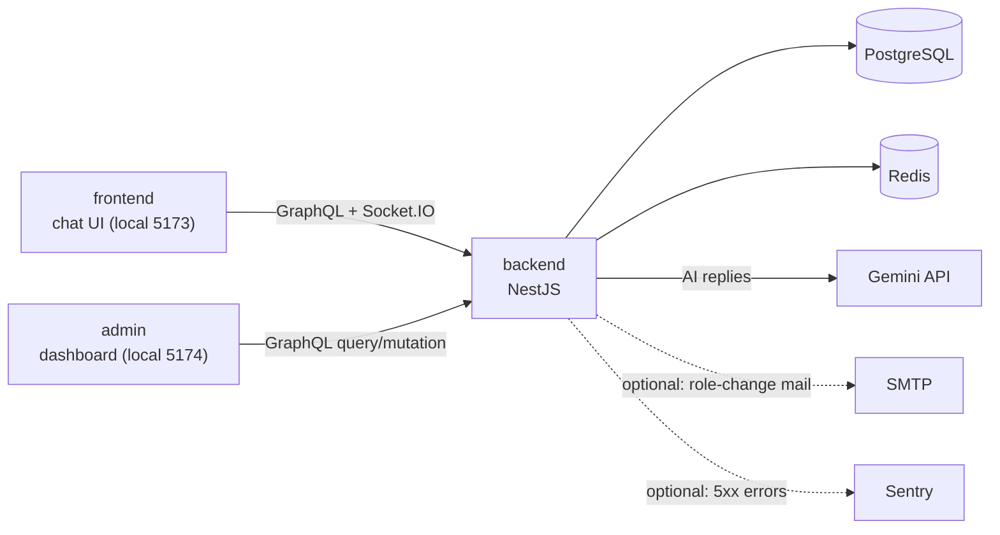
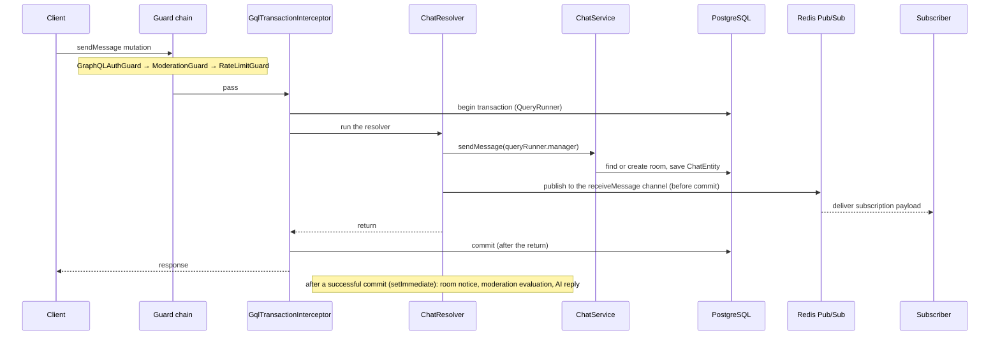

> 한국어 버전: [README.ko.md](README.ko.md)

# Chatterley — Real-Time Chat Application
A one-to-one real-time chat with an AI companion, behavioral moderation, and a separate admin panel, built solo. It is a learning and portfolio project: the goal is to build the message delivery path, authentication, and abuse handling of a real-time chat by hand, with the weight on the backend.


## Overview
**Stack**: NestJS · TypeScript · GraphQL (Apollo) · Socket.IO · Redis · PostgreSQL (TypeORM) · React · Vite · Docker · Gemini

- Messages: sent with the `sendMessage` GraphQL mutation and received through the `receiveMessage` subscription. Writes are wrapped in a transaction by `GqlTransactionInterceptor` ([ADR 0003](ADR/0003-database-transaction-strategy.md), [ADR 0004](ADR/0004-graphql-socketio-api-layer-split.md)). Socket.IO only handles connection auth, room-creation notices, and forced logout on a second login
- Authentication: the JWT access token lives in memory only, the refresh token in an httpOnly cookie. Role-based access control (RBAC) and an audit log for privileged actions
- Moderation: duplicate, flood, and velocity strikes escalate warn → mute → timed ban → permanent ban, and an admin can reverse them
- AI chat: Google Gemini 2.5 Flash with four selectable personalities. Capped output tokens, truncated history, a retry ceiling, and a per-room Redis lock. The AI's name `Chattey` is an alias set in the system prompt (`backend/src/ai/constants/system-prompts.ts`), different from the service name Chatterley
- Admin panel: a separate React app for user/room management, moderation actions, and audit-log CSV export
- Tests: backend Jest 13 suites / 254 tests, frontend Vitest 21 tests, and admin Vitest 14 tests pass (local run on 2026-10-22, commit `d684b19`). Playwright e2e for frontend and admin runs in CI ([Test Coverage](#test-coverage))
- History: built solo over 730 commits since 2026-01 (as of `d684b19`). Full history in [CHANGELOG.md](CHANGELOG.md)
- Docs: [ARCHITECTURE.md](ARCHITECTURE.md) · [ADR/](ADR/) · [ROADMAP.md](ROADMAP.md) · [CONTRIBUTING.md](CONTRIBUTING.md)

The incidents, bugs, and design decisions met along the way are written up in [Technical Decisions and Troubleshooting](#technical-decisions-and-troubleshooting) as problem → cause → fix → verification.


## Screenshots
Captured on a local stack (backend, Postgres, Redis, Vite dev servers), light theme, 1440 px wide.
Hosting is currently stopped (see [Hosting Status](#hosting-status)), so none of this was checked on a
deployed environment. Accounts and messages are throwaway demo data created through the app's own API.
The app has no language switch, so both READMEs use the same images. The UI is Korean throughout. Captures that show times were taken with the browser time zone fixed to UTC, so message and log times are UTC. Click an image to open the full-size file.

[](docs/images/demo-realtime-chat.gif)<br>**Live delivery** — two demo accounts side by side; messages arrive without a reload through the `receiveMessage` GraphQL subscription. Message times are shown in UTC (the browser time zone was fixed for the recording).

[](docs/images/02-chat.png)<br>**One-to-one chat** — messages arrive through the `receiveMessage` GraphQL subscription

[](docs/images/04-ai-chat.png)<br>**AI chat** — a live Gemini reply, delivered through the same channel as human messages

[](docs/images/07-admin-users-panel.png)<br>**Admin users** — detail panel of a banned account with its recent audit entries

| | |
|---|---|
| [](docs/images/01-signin.png)<br>**Sign in** — access token is kept in memory, refresh token in an httpOnly cookie | [](docs/images/03-ai-personality.png)<br>**AI personality** — the first AI chat asks for one of four personalities before the first message |
| [](docs/images/05-account.png)<br>**Account** — profile edit and account deletion (current password required) | [](docs/images/06-admin-dashboard.png)<br>**Admin dashboard** — totals and recent audit logs (separate admin app) |

Known limitation of these captures: the dialog backdrop on the AI personality screen renders as solid
black. The overlay uses `bg-opacity-40`, which Tailwind 4 no longer provides.


## Hosting Status
Hosting is stopped for cost reasons. The last successful automatic deploy was on 2026-05-27; see the [`deploy.yml` run history](https://github.com/Bluecode77732/Chat-project/actions/workflows/deploy.yml). The `deploy` job is manual-only (`workflow_dispatch`). To run the app, follow [Quick Start](#quick-start) locally.


## My Role and AI Usage
- **Form of work**: solo project.
- **How design decisions were made**: the first version used Socket.IO only. After learning that GraphQL can also carry two-way traffic, and wanting to try the technology, I had the AI explain the structure, reviewed the pieces it required, and decided on my own to move the message path to GraphQL ([Case 1](#technical-decisions-and-troubleshooting)). The other design decisions went as follows.
  - **Transaction interceptor**: introduced so that the DB write happens after the `QueryRunner` commit, so the repeated logic lives in one interceptor, and so the `QueryRunner`'s atomicity gives a safe transaction. I researched it myself and implemented it, and the AI filled in what I was missing
  - **Redis design**: built to serve as a cache so requests do not have to reach the DB, and as a standby-DB-like server that takes load off the server when many users connect. As with the interceptor, I researched it myself and implemented it, and the AI filled in what I was missing
  - **Moderation ladder**: after finishing each module I take a review break, and I came across this while discussing the next thing to build with the AI. I looked into whether it was a must-have, whether it fit the app, was sound, and was practical, reviewed ways to implement it, and chose the approach that kept the effect on other files as small as possible
- **Work handed to the AI (Claude Code)**: writing and editing code, code review and root-cause analysis, writing tests, writing docs
- **How the output was verified**: reading and editing the AI's code by hand, running it locally and in the browser, tests and CI, and a review in a separate AI session from the one that wrote the code
- **AI working rules**: [CLAUDE.md](CLAUDE.md) at the repository root holds the rules the AI follows (forbidden patterns, change scope, confirm-before-implementing steps)
- **AI suggestions I rejected or changed**: before [CLAUDE.md](CLAUDE.md) existed, the AI sometimes put decorators on entities that did not need them or used types such as `any`, `null`, and `!` carelessly, and I read the code and fixed them by hand. Those patterns are in CLAUDE.md's forbidden list today
- **Parts I can explain without the code**: the `sendMessage` flow, when the transaction commits, and the guard chain (see [Flow](#flow) and [ARCHITECTURE.md](ARCHITECTURE.md))


## Project Motivation
- Moved the message path from direct Socket.IO to a GraphQL Mutation/Subscription split on an app that already worked, to feel what changing a live system really costs ([Case 1](#technical-decisions-and-troubleshooting))
- Built authentication and authorization end to end — Basic/Bearer/JWT and RBAC guards — including finding and fixing a self-discovered XSS/localStorage token-storage vulnerability
- Handled the exposed dev database as an incident, in the order contain → rotate → clean, and kept the record ([Case 2](#technical-decisions-and-troubleshooting))
- Went past a feature demo: a behavioral moderation pipeline, a separate admin panel, and CI/CD (GitHub Actions + Railway/Vercel)


## Stacks
Only the technologies tied directly to the core design are listed. Full dependencies are in [Total Installation](#total-installation) and [ARCHITECTURE.md](ARCHITECTURE.md#tech-stack).

### Role and Code Location by Technology
| Area | Technology | Role and why it was chosen | Code location |
|---|---|---|---|
| Backend | NestJS 11, TypeScript, Node.js 24 | A single-deployable monolith split by DI-based module boundaries into auth/chat/user/ai/moderation/audit-log and others, which kept coupling low as it grew from one resolver to about ten modules. Static typing catches at compile time the `undefined`-property bugs hit repeatedly early on. Non-blocking I/O suits a connection-heavy chat workload | `backend/src/` |
| API | GraphQL (Apollo), graphql-ws | The mutation to send a message and the per-room subscription to receive it. Messages first went straight over Socket.IO and were moved mid-project to get transactional guarantees around persistence ([Case 1](#technical-decisions-and-troubleshooting)) | `backend/src/chat/chat.resolver.ts`, `backend/src/graphql/` |
| Realtime | Socket.IO, `@socket.io/redis-adapter` | JWT auth on connect, room-creation notice, `forceLogout` on a second login. Without the adapter, room broadcasts don't cross server instances | `backend/src/chat/chat.gateway.ts` |
| Database | PostgreSQL, TypeORM | Relational data where users, rooms, messages, and the audit log depend on each other. Schema changes go through migrations only so they stay reviewable (`synchronize: false`) | `backend/src/migrations/`, `backend/src/data-source.ts` |
| Cache / Pub-Sub | Redis (ioredis) | Session and online state, per-room recent-message cache, rate limits, moderation state, AI lock, GraphQL Pub/Sub | `backend/src/redis/redis.service.ts`, `backend/src/graphql/pubsub.service.ts` |
| Auth | Passport JWT, bcrypt | Access token in memory, refresh token in an httpOnly cookie. Role guards are composed at both the REST and GraphQL layer, not subclassed | `backend/src/auth/` |
| AI | Gemini (`@google/genai`) | Replies driven by a per-room personality. Output-token, history, and retry caps were set at design time | `backend/src/ai/` |
| Frontend / Admin | React, Vite, Zustand, Apollo Client | Chat UI, in-memory token, silent token refresh. Admin is a separate app | `frontend/src/`, `admin/src/` |
| Tests / CI | Jest, Vitest, Playwright, Docker Compose, GitHub Actions | Service unit tests, component/store tests, e2e, local full stack, doc-integrity checks | `backend/src/**/*.spec.ts`, `frontend/e2e/`, `admin/e2e/`, `docker-compose.yml`, `.github/workflows/deploy.yml` |

### Frontend
A minimal React + TypeScript client built to demonstrate end-to-end integration with the backend.

- Stack: React 19.2.5, TypeScript ~6.0.2, Vite 8.0.10, Tailwind CSS 4.2.4, Zustand 5.0.12, Apollo Client 4.1.9, Socket.IO Client 4.8.3 ✔
- Auth: access token in memory (Zustand), refresh token in a backend-set httpOnly cookie — never in localStorage ✔
- Real-time: Socket.IO for connection/room management, GraphQL Mutation/Subscription for messaging ✔
- Security: XSS prevention via DOMPurify, CORS-compliant requests, Route Guard for protected pages ✔
- Deployment: configured to deploy as a Vercel project (`frontend/vercel.json`). Hosting is currently stopped (see [Hosting Status](#hosting-status))


## Features
- Rate limiting: 10 messages per 15 s per user (`RateLimitGuard`)
- Security: Helmet security headers, Content-Security-Policy on frontend and admin (Vercel `headers`), and IP-based rate limiting on sign-in and register (10 attempts per 60 s, 429 on exceed). The reasoning is in [ADR 0020](ADR/0020-security-headers-and-auth-rate-limit.md)
- Cursor-based message history with infinite scroll
- Profile: an optional nickname (unique, ≤20 chars) and profile image (jpeg/png/webp, ≤2MB)
- Accessibility and UX: `/` focuses the message input, and an `aria-live` region announces moderation notices

### Core Features and Where They Live
| Feature | What the user does | API / code | Worth noting |
|---|---|---|---|
| Messaging | A sent message shows up on the other side without a reload | `sendMessage` mutation, `receiveMessage(roomId)` subscription (`chat.resolver.ts`) | `GqlTransactionInterceptor` commits after the resolver returns, and logic that depends on the commit awaits `ctx.req.transactionCommitted`. Redis Pub/Sub is at-most-once, and the resolver publishes before the commit |
| Auth and session | Stays signed in across reloads. Signing in as another account in another tab logs this tab out | `POST /auth/signin`, `POST /auth/token/refreshaccess`, `frontend/src/auth/session-guard.ts` | Every refresh goes through `refreshAccessTokenSafely()` and concurrent calls share one request. One active socket per user (confirmed with a single instance only; see [Scale Up In Future](#scale-up-in-future)) |
| AI chat | Talks to the AI account and picks a personality per room | `setAiPersonality` mutation, `AiService.handleReply()` | Per-room Redis lock (`ai:lock:{roomId}`, 30 s TTL), `maxOutputTokens` 300, 10 messages of history |
| Moderation | Flooding gets a warning, then a mute, then a ban | `ModerationService`, `ModerationGuard`, `POST /user/:id/unban` | Thresholds are env-tunable. A ban is enforced over HTTP and GraphQL requests, socket connections, and token refresh. A GraphQL subscription that is already open keeps receiving after a ban ([limits](#scale-up-in-future)). Every action is audit-logged |
| Admin panel | Manage users and rooms, export the audit log as CSV | `admin/src/`, `GET /audit-log`, `GET /audit-log/export` | A separate app that only uses queries and mutations (no realtime client) |


## Architecture
### System Context Diagram

admin has no realtime client (`graphql-ws`, `socket.io-client`), so it never takes part in chat. SMTP and Sentry do nothing when their env vars are empty ([backend/.env.example](backend/.env.example)).
### Project Structure
A pnpm monorepo with three packages: `backend/`, `frontend/`, and `admin/`. Only the key paths for finding the core code are listed. See [ARCHITECTURE.md](ARCHITECTURE.md#monorepo-layout) for the full directory tree.

| Path | Role | Files to look at first |
|---|---|---|
| `backend/src/chat/` | Message send/receive, socket connection, transactions | `chat.resolver.ts`, `chat.gateway.ts`, `chat.service.ts`, `interceptor/gql-transaction.interceptor.ts` |
| `backend/src/graphql/`, `backend/src/redis/` | Pub/Sub, session, cache, rate limits | `pubsub.service.ts`, `redis.service.ts` |
| `backend/src/auth/` | JWT auth, role-based guards | `strategy/jwt.strategy.ts`, `guard/` |
| `backend/src/moderation/` | Strike accrual, mute and ban enforcement | `moderation.service.ts`, `moderation.guard.ts` |
| `backend/src/ai/` | Gemini replies, per-room personality | `ai.service.ts`, `constants/system-prompts.ts` |
| `backend/src/user/`, `backend/src/audit-log/` | User management, audit log of privileged actions | `user.service.ts`, `audit-log.service.ts` |
| `backend/src/migrations/` | TypeORM migrations (the only place schema changes go) | `data-source.ts` |
| `backend/src/app.module.ts`, `main.ts` | Module wiring, env validation, boot settings | |
| `frontend/src/` | Chat UI | `api/apollo.ts`, `auth/session-guard.ts`, `socket/socket.ts`, `store/auth.store.ts`, `pages/chat-page.tsx` |
| `admin/src/` | Admin dashboard | `pages/`, `auth/session-guard.ts` |
| `frontend/e2e/`, `admin/e2e/` | Playwright e2e | |
| `ADR/`, `scripts/` | Design decision records, doc-integrity check scripts | |

### Session Store (Redis)
- Redis: session and online state live in a `user:{id}` hash (`socketId`, `status`) and an `online_users` set. The TTL is `SESSION_TTL_SEC` (default 86400 s), and every server instance sees the same values
- Socket objects can't be serialized, so they are not put in Redis. Each process's Socket.IO server holds its connected sockets
- An in-memory `userId → Socket` Map (`clientConnection`) was used before and was replaced by a Redis session cache (`backend/src/redis/redis.service.ts`). The reasoning and structure are in case 5 of [Technical Decisions and Troubleshooting](#technical-decisions-and-troubleshooting)

### Redis Pub/Sub
- `RedisPubSub` singleton (`pubsub.service.ts`): bridges GraphQL mutations to active subscriptions. After commit the resolver publishes to a `receiveMessage :${roomId}` channel; all connected `receiveMessage` subscribers receive the message in real time.
- `PubSubService.publish()` also caches the published message via `SessionCacheService.cacheMessage()` as a side effect — this is the **only** place message caching happens, identically for human and AI messages. Callers (resolver, `AiService`) never call `cacheMessage()` directly.

### Entities (TypeORM)
```
UserEntity
  id          PK
  email       unique
  nickname    nullable, unique, max 20 chars — display name shown to other users
  profileImage nullable text (base64 data URI, jpeg/png/webp, max ~2MB)
  password    excluded from API responses
  isAI        boolean (true only for the seeded AI system account)
  role        enum: user (0) | admin (1) | superadmin (2)
  status      enum: active | banned (moderation state, see Moderation)
  bannedUntil nullable timestamp — null means permanent ban or not banned
  chats    =< ChatEntity   (OneToMany)
  rooms    >< RoomEntity   (ManyToMany, join table on RoomEntity side)

ChatEntity
  id          PK
  message     string
  participant >= UserEntity  (ManyToOne — sender)
  room        >= RoomEntity  (ManyToOne)

RoomEntity
  id            PK
  participants >< UserEntity   (ManyToMany owner, @JoinTable)
  chats        =< ChatEntity   (OneToMany)

AiRoomEntity — split out of RoomEntity for separation of concerns and cleaner ongoing
management (see ARCHITECTURE.md's Entities section for the full rationale)
  id          PK
  room        -- RoomEntity  (OneToOne, onDelete: CASCADE)
  personality string (active AI personality for this room)

EntityBase (inherited by all four)
  created     CreateDateColumn — excluded from API responses
  updated     UpdateDateColumn — excluded from API responses
```


## Flow
All chat messages are sent and delivered through the **GraphQL Mutation Path**. Socket.IO
(`ChatGateway`) only handles the WebSocket connection lifecycle — it has no
`@SubscribeMessage` handler for chat messages and emits none.

### Socket.IO Connection Lifecycle
1. Client connects WebSocket, `handleConnection` runs in `chat.gateway.ts`
  1.1. Authenticate JWT token via `AuthService.parseBearerToken()`
  1.2. `ChatService.registerClient()` records `userId` => `socketId` in Redis
  1.3. `ChatService.joinRooms()` joins the client to their existing rooms
  1.4. On a session conflict, the previous socket for that user receives `forceLogout` and is disconnected

2. Room creation notification
  2.1. When `ChatService` creates a new `RoomEntity` (first message between two users), it
       emits `CreateRoom` to the recipient's socket so their client can join the new room

3. Client disconnects
  3.1. `handleDisconnect` runs in `chat.gateway.ts`
  3.2. `ChatService.removeClient()` marks the user offline in Redis only if the current session is this socket (ignored if a newer session already replaced it)

### GraphQL Mutation Path (`sendMessage`)

1. The guard chain runs. The order matters: `ModerationGuard` filters out muted/banned users before `RateLimitGuard` spends their rate-limit budget
2. `GqlTransactionInterceptor` opens a `QueryRunner` and starts a transaction before the resolver runs, and injects it through `@GqlQueryRunnerDecorator()`
3. `ChatService.sendMessage()` validates sender and recipient, finds or creates the room, and saves the `ChatEntity` in that same transaction
4. The resolver publishes to the `receiveMessage :${roomId}` channel through `PubSubService.publish()` and returns. The publish happens before the commit. As a side effect `publish()` also writes to the per-room message cache, and human and AI messages are cached only there
5. The interceptor commits after the resolver returns. Anything that depends on the commit awaits `ctx.req.transactionCommitted`, which resolves only when the commit succeeds
6. After the commit (`setImmediate`) the room notice, the moderation evaluation, and, when the recipient is the AI, the reply generation (Redis lock → history → Gemini → save → publish to the same channel) run. The AI reply travels on the same channel as human messages
7. Subscribers receive the message through Redis Pub/Sub on the `receiveMessage(roomId)` subscription

### Auth Token Lifecycle
The two tokens live in deliberately different places: the short-lived `accessToken` in memory only
(Zustand, excluded from `persist`), the long-lived `refreshToken` in a backend-set httpOnly cookie
that JavaScript cannot read. See [ADR 0001](ADR/0001-jwt-auth-token-strategy.md) for the rationale.

1. Sign-in — `POST /auth/signin` (Basic auth)
  1.1. Backend returns `accessToken` in the response body and sets `refreshToken` as an httpOnly
       cookie (`secure`, `sameSite: 'none'` — frontend and backend are separate origins)
  1.2. Frontend calls `setTokens(accessToken, userId)`; no token is written to `localStorage`

2. Authenticated request
  2.1. `authLink` reads `useAuthStore.getState().accessToken` at request time and sets
       `Authorization: Bearer`

3. Silent refresh — on page reload (memory is empty) or on a 401 surfaced by `errorLink`
  3.1. Every call site goes through `refreshAccessTokenSafely()` (`session-guard.ts`); concurrent
       callers share one in-flight request
  3.2. `POST /auth/token/refreshaccess` is sent with `credentials: 'include'` — the browser attaches
       the cookie automatically, so JavaScript never reads the refresh token
  3.3. A fresh `accessToken` comes back in the body and goes into memory again
  3.4. If the refresh resolves to a different account than this tab last authenticated as
       (`sessionStorage['chat:sessionUserId']`), the tab is logged out instead of silently
       switching identity

4. Sign-out — `POST /auth/signOut`
  4.1. Backend blacklists the access token and calls `res.clearCookie('refreshToken')` — the cookie
       is cleared even if the token is already expired or invalid
  4.2. Frontend clears the Zustand store and redirects


## Technical Decisions and Troubleshooting
Each case reads problem → cause → fix → verification. **Verification** lists only what was confirmed through code, tests, or a run, and keeps design expectations apart from real measurements. No performance numbers are given because none were measured. Runs refer to the local Docker environment on 2026-10-22 (Windows 10, Docker 28.5.1, commit `d684b19`).

### Case 1: Moving the message path from Socket.IO to GraphQL
- **Problem**: At first a Socket.IO handler received, saved, and delivered messages. A socket handler had no way to wrap a write that touches several tables, such as creating a room and saving a message, in one transaction.
- **Cause**: A socket handler has no layer that owns the transaction lifecycle per request (open the `QueryRunner`, commit, roll back, `release()`). Managing it by hand at every call site risks a missed `release()` leaking connections out of the pool, as [ADR 0003](ADR/0003-database-transaction-strategy.md) records.
- **Fix**: Sending moved to the `sendMessage` mutation and receiving to the `receiveMessage` subscription, with `GqlTransactionInterceptor` owning the transaction lifecycle. Socket.IO kept only connection auth, room-creation notices, and `forceLogout`. Keeping both paths was rejected because the same event could be duplicated or arrive out of order ([ADR 0004](ADR/0004-graphql-socketio-api-layer-split.md)). The change was made on an app that already worked, and both paths coexisted for about 4.5 months until the old Socket.IO message handler was deleted on 2026-06-11 ([ROADMAP.md](ROADMAP.md)).
- **Verification**:
  - `gql-transaction.interceptor.spec.ts` covers the success path (no result is emitted before the commit finishes), the error path (rollback, one `release`, `InternalServerErrorException`), and the case where the commit itself fails
  - In a local Docker run, sign-up → `sendMessage` → delivery to another account's `receiveMessage` subscription → `getMessages` was confirmed at the API level
  - Limit: the resolver publishes before the commit, so if the commit fails a subscriber may already have received a message that was never saved (a possibility from the code structure, not reproduced). The work that must follow the commit (room notice, moderation evaluation, AI reply) does not run in that case, because `transactionCommitted` resolves only when the commit succeeds
  - Limit: `sendMessage` is not idempotent, so a client retry after a timeout can save the same message twice (a comment in `chat.resolver.ts`)
  - Limit: Redis Pub/Sub is at-most-once, so a message published while nobody is subscribed is not redelivered (a limit accepted in ADR 0004). Performance before and after the move was not measured

### Case 2: Dev DB and Redis ports exposed to the internet
- **Problem**: During development PostgreSQL (5432), Redis (6379), and the backend (3000) were reachable from the internet. An automated ransomware bot logged in to PostgreSQL with default credentials, wiped the dev database, and left a ransom note.
- **Cause**: The ports in `docker-compose.yml` were bound to `0.0.0.0`, and the Windows Firewall profile of the Ethernet adapter that held a public IP was set to "Private (trusted)", so a Docker Desktop rule allowed inbound traffic on every port.
- **Fix**: Close the access path first (port bindings to `127.0.0.1`, loopback-only host in development, and the firewall profile switched to Public by hand), then rotate the DB and Redis passwords and the JWT secrets, and only then clean up the attacker's database. Cleaning first would let the bot recreate it at once, so the order was contain → rotate → clean. The AI did not read the attacker's table; a person did (prompt-injection prevention). To keep it from happening again, Redis `requirepass` was turned on and boot is refused when `ENV=prod` has a `REDIS_URL` without a password. Details in [AI-Assisted Development Notes](#ai-assisted-development-notes) and [ADR 0013](ADR/0013-local-dev-network-binding.md).
- **Verification**:
  - The settings were confirmed in code: the `127.0.0.1` bindings and `requirepass` in `docker-compose.yml`, the loopback branch in `main.ts`, and the `REDIS_URL` password check in `app.module.ts`
  - In a local Docker run, `docker compose ps` showed 3000, 5432, and 6379 bound to `127.0.0.1` only
  - Limit: no port scan from an outside network was run, and the password/secret rotation rests on the record from the time

### Case 3: AI reply cache corruption (`Invalid time value`)
- **Problem**: While checking the AI retry/fallback feature by hand in a browser, restarting the backend made the socket reconnect and reload the room's messages from the cache, and `CombinedGraphQLErrors: Invalid time value` appeared.
- **Cause**: `AiService` cached its own reply directly, and the publish hook in `PubSubService` cached the same reply a second time. The second copy had lost its `@Exclude()`-decorated `created` field, so reading it back gave `new Date(undefined)` (NaN inside), and the GraphQL `DateTime` scalar's `toISOString()` threw. `git show --stat` on the earlier caching refactor showed that refactor never touched `ai.service.ts`, so the duplicate was a leftover and not a design choice.
- **Fix**: `AiService` now publishes the raw entity, as the human-message path does, and the duplicate direct caching call is gone. Caching happens in one place, `PubSubService.publish()`.
- **Verification**:
  - `redis.service.spec.ts` has a case that pins the behavior where a cache entry with no `created` field becomes an Invalid Date, and `pubsub.service.spec.ts` covers the cache-on-publish behavior
  - `backend/src/ai/` no longer contains a `cacheMessage` call (confirmed by search)
  - `pnpm test` passes 13 suites / 254 tests
  - Limit: the same browser scenario (restart the backend, then reload) was not replayed on purpose; the error did not show up again during later use of the app

### Case 4: A generated migration reverts ON DELETE CASCADE
- **Problem**: `pnpm migration:generate` re-emits the ManyToMany join-table FK `FK_501a0aef55632e3cf2894bda97f` (`room_entity_participants_user_entity`) as `ON DELETE NO ACTION`, which quietly reverts the `ON DELETE CASCADE` that user deletion uses to clear room membership. Once reverted, deleting a user fails on an FK violation ([CLAUDE.md](CLAUDE.md)).
- **Cause**: The ManyToMany relation declares no `onDelete`, so TypeORM sees the DB's CASCADE as different from the declaration and generates a change that reverts it.
- **Fix**: A step was set to strip that FK line from every generated migration. As a safety net for human slips there is a static guard, `migration-cascade-guard.spec.ts`, which scans the source of each migration's `up()` as text and requires the CASCADE to survive. It rides `pnpm test`, so it fires locally and in CI. It is not run in production, where migrations have already been applied by boot time. To guard more FKs, add an entry to the spec's `GUARDED_FKS` array.
- **Verification**:
  - `pnpm test` with that spec passes 13 suites / 254 tests
  - Limit: the FK's delete behavior (`confdeltype`) on a running DB was not queried in this run

### Case 5: From an in-memory socket map to a Redis session
- **Problem**: Keeping `userId → Socket` only in a Map in process memory loses it on a restart, and once there is more than one instance, the others can't tell where a user is connected or whether they are online.
- **Cause**: The Map is process-local state, and a Socket object can't be serialized, so it can't be shared as is.
- **Fix**: The old in-memory `clientConnection` Map was replaced by a Redis-backed session cache (comment in `redis.service.ts`).
  - A `user:{id}` hash (`socketId`, `status`) carries a TTL (`SESSION_TTL_SEC`, default 86400 s), and the online list is an `online_users` set. `hset`, `expire`, and `sadd` run in one MULTI/EXEC so no key without a TTL is left behind
  - At startup and every 5 minutes `online_users` is reconciled against `user:{id}` to drop ghost users. It does not delete unconditionally because that would also remove users connected to other instances
  - A new socket is recorded as the current session first, and only then does the previous socket get `forceLogout`. `removeClient` marks a user offline only when the current session is that socket ([ADR 0014](ADR/0014-single-active-session.md))
  - Room broadcasts cross instances through `@socket.io/redis-adapter`

  Current code (`backend/src/redis/redis.service.ts`) for going online:
  ```ts
  async sethUserOnline(userId: number, socketId: string) {
    const key = `user:${userId}`;
    const ttl = this.configService.get<number>('SESSION_TTL_SEC', 86400);
    await this.redis
      .multi()
      .hset(key, 'socketId', socketId, 'status', 'online')
      .expire(key, ttl)
      .sadd('online_users', String(userId))
      .exec();
  }
  ```
- **Verification**:
  - Confirmed in code: the structure above, the adapter wiring in `chat.gateway.ts`, and the unit tests in `redis.service.spec.ts` and `chat.service.spec.ts`
  - Design expectation (not verified): without the adapter, `server.to(room).emit(...)` reaches only clients connected to the same process
  - Measurement (2026-10-26, two instances attached to the same Postgres and Redis): when the same account logs in a second time on another instance, the first socket gets no `forceLogout` and is not disconnected, because `kickPreviousSession` looks only at the current process's sockets; for the same reason a socket on another instance is not disconnected by a ban. Load and performance were not measured, and there is no number showing it got faster
  - Checking the stored values (standalone local container, no password): connect with `docker exec -it redis-chat redis-cli` and run `KEYS user:*`, `HGETALL user:<user ID>`, and `TTL user:<user ID>`. The Redis in docker compose has `requirepass` on and needs a password (use `redis-cli -a "$REDIS_PASSWORD"`, the same way the compose healthcheck does; this command was not run here)


## AI-Assisted Development Notes
The history and fixes of the two incidents are in cases 2 and 3 of [Technical Decisions and Troubleshooting](#technical-decisions-and-troubleshooting). This section covers only how the AI tool was used and what was learned.

### Case: Infrastructure Security Threat Detected During Live Testing
- **What the AI did**: During live API testing with Swagger and curl it reviewed the Docker Compose configuration and found the exposure from the `0.0.0.0` binding combined with the firewall profile. It fixed the port bindings (`127.0.0.1`), the `main.ts` host restriction, and Redis `requirepass`, and rotated the DB and Redis passwords and the JWT secrets. For the firewall profile it only gave guidance, and I switched it to Public myself
- **What the AI deliberately did not do — prompt-injection prevention**: it did not read the contents of the attacker's `readme_to_recover.readme` table with a SQL query. If the attacker had embedded instructions for an AI in the DB, loading that text into the AI's context could have caused unintended actions. It described where the table is and that it exists, and left the content check to me; it was a standard ransom demand
- **Takeaways**: AI-assisted live testing finds deployment-environment vulnerabilities that code review and CI alone miss. An AI tool reading externally created content (DB rows, uploaded files) directly is a prompt-injection path, so a person has to check it. The incident response order is **contain → rotate → clean**; reversing it makes the cleanup pointless

### Case: AI Reply Cache Corruption Found During Live Browser Testing
- **What the AI did**: it queried the DB's `created` column with `psql` to rule out corruption at the source, read `@nestjs/graphql`'s `DateTime` scalar to confirm the exact throw condition, and traced both cache-write sites (`ai.service.ts`, `pubsub.service.ts`). It ran `git show --stat` on the earlier caching refactor to confirm the duplicate was an oversight and not a design, then changed `AiService` to publish the raw entity and added regression tests
- **Takeaways**: live browser testing exposed a cross-service bug that unit tests never could, because the existing mocks isolated exactly the layer where the corruption happened (`PubSubService`'s cache-on-publish side effect). Running `git show --stat` on a suspected commit tells you objectively whether something is a leftover from an incomplete refactor or an intentional design, without guessing


## Quick Start
- Prerequisites
  - Node.js 24.x (`.nvmrc`), pnpm >= 10 (the pinned version is in [CONTRIBUTING.md](CONTRIBUTING.md#prerequisites))
  - Docker >= v28.xx — path A below needs no local PostgreSQL or Redis install
  - `GEMINI_API_KEY` is a required env var and boot fails without it ([`app.module.ts`](backend/src/app.module.ts)). A Gemini API key is needed to get real AI replies

### A. Run backend + PostgreSQL + Redis with Docker
**1. Install dependencies** (needed to run frontend and admin)
```bash
pnpm install
```

**2. Create `.env.docker` at the project root** (not tracked by git). Every value below is a placeholder; fill in your own.
```env
ENV=dev
DB_TYPE=postgres
DB_HOST=postgres
DB_PORT=5432
DB_USERNAME=postgres
DB_PASSWORD=<any password>
DB_DATABASE=chatdb
POSTGRES_USER=postgres
POSTGRES_PASSWORD=<same value as DB_PASSWORD>
POSTGRES_DB=chatdb
REDIS_PASSWORD=<any password>
REDIS_URL=redis://:<REDIS_PASSWORD value>@redis:6379
HASH_ROUNDS=12
REFRESH_TOKEN_SECRET=<any long random string>
ACCESS_TOKEN_SECRET=<any long random string>
REFRESH_TOKEN_SECRET_EXPIRES_IN=604800
ACCESS_TOKEN_SECRET_EXPIRES_IN=900
USER_CACHE_TTL_SEC=300
SESSION_TTL_SEC=86400
MESSAGE_CACHE_TTL_SEC=86400
CORS_ORIGIN=http://localhost:5173,http://localhost:5174
GEMINI_API_KEY=<your Gemini API key>
```
`NODE_ENV` and `RUNTIME_ENV` are set by compose, so leave them out ([docker-compose.yml](docker-compose.yml)). The `postgres` and `redis` containers read `POSTGRES_*` and `REDIS_PASSWORD` from the same file. Expiry values accept seconds as a number only (a string such as `7d` is rejected at boot). The full variable list is in [backend/.env.example](backend/.env.example).

**3. Start the services**
```bash
docker compose up -d --build
```
Migrations run automatically when the container starts, so don't run them by hand. To check boot, `http://localhost:3000/health` returns `{"status":"ok"}`.

**4. Run the frontend** (separate terminal)
```bash
cp frontend/.env.example frontend/.env.local
cd frontend && pnpm dev
```
→ http://localhost:5173

**5. Run the admin panel** (separate terminal; needs an admin/superadmin account)
```bash
cp admin/.env.example admin/.env.local
cd admin && pnpm dev
```
→ http://localhost:5174 — the first superadmin has to be created in the DB by hand (see [Admin Account Setup](#admin-account-setup)).

**Stopping**: `docker compose down` removes the containers and keeps the data (volumes). `docker compose down -v` also deletes the PostgreSQL and Redis volumes, so the data is lost.

### B. Manual run (with a local PostgreSQL 18 and Redis)
```bash
pnpm install
cp backend/.env.example backend/.env     # fill in the values. DB_TYPE is postgres; DB_HOST and REDIS_URL are local addresses
pnpm --filter backend build               # migration:run uses dist/data-source.js, so build first
pnpm migration:run
docker run -d -p 6379:6379 --name redis-chat redis:latest   # if it already exists: docker start redis-chat
cd backend && pnpm start:dev
```
Creating the database in PostgreSQL is not covered here. frontend and admin are the same as steps 4 and 5 of path A.

### Verification Status
Checked on 2026-10-22 on Windows 10, Docker 28.5.1 / Compose 2.40.0, Node 24.8.0, pnpm 10.33.0, commit `d684b19`, in an isolated temporary clone.

| Item | Status |
|---|---|
| Path A: containers start, migrations run automatically, `/health` | Confirmed |
| Sign-up, sign-in, `sendMessage`, `receiveMessage` subscription delivery, `getMessages` | Confirmed at the API level |
| Superadmin INSERT, then admin sign-in and `GET /user` | Confirmed |
| frontend and admin dev servers | Only the response (200) was checked. Sign-in and the chat screen in a browser were not |
| Path B | Confirmed up to `build` then `migration:run`. `start:dev` and the first migration on an empty DB were not |
| Playwright e2e | Not run in this local run. In CI, the 2026-10-19 main push run ([#39287345174](https://github.com/Bluecode77732/Chat-project/actions/runs/39287345174)) passed both the `e2e` and `admin-e2e` jobs. However `ai-chat.spec.ts` passes on the fallback message even without a Gemini key, so it does not verify a real Gemini reply |
| Real AI replies, moderation behavior | Not checked in this run |
| Unit tests | backend 13 suites / 254 tests, frontend 21 tests, admin 14 tests pass |

**Run the tests**
```bash
pnpm test                         # backend Jest
pnpm --filter frontend test       # frontend Vitest
pnpm --filter admin test          # admin Vitest
cd backend && pnpm test:cov       # backend coverage
```
e2e (Playwright) runs with `pnpm --filter frontend e2e` and `pnpm --filter admin e2e`, and runs in CI.

**Swagger UI** — with the backend running: http://localhost:3000/document

**Try the chat** — for how to send and receive by hand, see the GraphQL examples in [API Documentation](#api-documentation).

### Troubleshooting
List of Troubleshooting when the program runs
- Redis connection
  - Log: "GraphQLModule dependencies initialized"
  - Log: "Redis Error: AggregateError [ECONNREFUSED]"
  - Log: "Error: connect ECONNREFUSED ::IPv6 address:port"
  
  - Solution 
    - ✅ Open terminal to run `docker start redis-chat`

- Message saving failure in DB

  - Solution 
    - ✅ Take a look at `backend/src/chat/interceptor/gql-transaction.interceptor.ts`, which owns the transaction elements: `commitTransaction()`, `rollbackTransaction()`, `release()`. The commit runs after the resolver returns, so check that any post-commit logic awaits `ctx.req.transactionCommitted`.

- `pnpm migration:run` fails with `Unable to open file ... dist/data-source.js`
  - Solution
    - ✅ Build first with `pnpm --filter backend build`. `migration:run` reads the build output (`dist/data-source.js`)


## Scale Up In Future
**Current limits**
- Redis Pub/Sub is at-most-once, so a message published while nobody is subscribed is not delivered again ([ADR 0004](ADR/0004-graphql-socketio-api-layer-split.md))
- The message is published before the commit, so if the commit fails a subscriber may already have received a message that was never saved (a possibility from the code structure, not reproduced)
- `sendMessage` is not idempotent, so a client retry after a timeout can save the same message twice
- Room create/lookup logic assumes exactly two participants, so group chat is not supported ([ROADMAP.md](ROADMAP.md))
- `GEMINI_API_KEY` is a required env var, so the app does not boot without a key
- Hosting is stopped, so behavior on a deployed environment was not checked
- With more than one instance, evicting the previous session (`forceLogout`) and disconnecting a banned user's socket only reach sockets in the same process (confirmed with two instances). The repository's configuration runs one instance, so this has no effect today
- A GraphQL subscription that is already open keeps receiving new messages after a ban (confirmed with a single instance too)
- Load on multiple instances was not measured
- The first superadmin has to be inserted into the DB by hand
- The `admin-e2e` job is not blocking yet, and the Windows `test` job passes even when it fails ([deploy.yml](.github/workflows/deploy.yml))
- frontend and admin have no error tracking (Sentry covers the backend only)

**Unimplemented backlog** (not a committed priority order; details in [ROADMAP.md](ROADMAP.md))
- Last message and unread count on the conversation list
- Group chat
- User-facing room and conversation deletion
- "User is typing" indicator
- Rate limiting on the `receiveMessage` subscription
- Closing open GraphQL subscriptions on a ban or forced logout
- Session eviction that works with more than one instance (calls routed through the adapter)
- Error tracking for frontend and admin


## API Documentation
### Swagger UI
***You must register first to try all features.***
Parameters and response schemas for each REST endpoint (`Auth`, `User`, `Audit Log`) are in Swagger UI (`http://localhost:3000/document`) once the backend is running locally.

### Key Endpoints
**REST** — parameters and schemas are in Swagger, so this lists only the permissions and limits that Swagger does not show.

| Endpoint | Permission | Limits / behavior |
|---|---|---|
| `GET /health` | None | Liveness check. Returns `{ status: 'ok' }` without checking DB/Redis (a dependency outage should not force a container restart) |
| `POST /auth/register`, `POST /auth/signin` | None | 10 attempts per 60 s per IP (429 on exceed). Credentials go in a Basic auth header |
| `POST /auth/signOut` | Signed in | Blacklists the current access token and clears the refreshToken cookie (the cookie is cleared even if the token is already expired/invalid) |
| `POST /auth/token/refreshaccess` | Refresh cookie | Refreshes the access token |
| `GET /user` | admin | `humanOnly` excludes the seeded AI and moderation-system accounts |
| `GET /user/:id`, `PATCH /user/:id` | Own account or admin | Nickname ≤20 chars and must be unique (400 if taken). Profile image is a base64 data URI, jpeg/png/webp, ≤2MB |
| `DELETE /user/:id` | Own account or admin | The seeded AI and moderation-system accounts cannot be deleted |
| `PATCH /user/:id/role` | superadmin | Accounts are created only through `POST /auth/register` |
| `POST /user/:id/force-logout`, `/ban`, `/unban` | admin | `ban` is permanent when `durationSec` is omitted and also evicts any active session. `unban` clears ban, mute, and strikes |
| `GET /audit-log` | admin | `userId` matches as actor or target |
| `GET /audit-log/export` | admin | Exports the same filtered results as CSV, capped at 10,000 rows (low-volume privileged-action data, so a flat cap is simpler than cursor streaming) |

**Chat (GraphQL)** — the full schema is in `backend/src/schema.gql`, which NestJS generates from the code. Altair cannot test Mutations and Postman cannot test Subscriptions, so use the two tools together. Chat messages travel over GraphQL only; Socket.IO only handles connection auth and the `CreateRoom` notice.

- Altair (subscription): URL `http://localhost:3000/graphql`, subscription type WebSocket (graphql-ws), connection parameters `{ "authorization": "Bearer <token>" }`
  ```graphql
  subscription {
    receiveMessage(roomId: "19") {
      id
      message
      participant { id }
    }
  }
  ```
- Postman or any HTTP GraphQL client (mutation): header `authorization: Bearer <token>`
  ```graphql
  mutation SendMessage($input: CreateChatInput!, $recipientId: Int!) {
    sendMessage(input: $input, recipientId: $recipientId) {
      id
      message
      roomId
      createdAt
    }
  }
  ```
  Variables: `{ "input": { "message": "Sent from Postman" }, "recipientId": 2 }`
- `getMessages(roomId, cursor)` returns up to 15 messages before the cursor. `getAllRooms` and `deleteRoom` are admin only
- Socket.IO: connect to `ws://localhost:3000` with an `authorization: Bearer <token>` header and you receive a `CreateRoom` event when a new room is created


## Reference
Domain descriptions and operational notes that are not needed to follow the core design. The full set of environment variables is in [backend/.env.example](backend/.env.example), the Docker and deployment layout is in [ARCHITECTURE.md's Deployment Topology](ARCHITECTURE.md#deployment-topology), and the setup and test policy is in [CONTRIBUTING.md](CONTRIBUTING.md).

### Role
- Three roles: `user` (0, default), `admin` (1), and `superadmin` (2).
- All registered users receive `user` role and can send messages normally.
- `admin` role grants elevated access: view/update/delete any user account, force logout, view audit logs.
- `superadmin` role additionally controls role assignment. Only superadmin can promote or demote other users.
- First superadmin must be created via direct DB INSERT. Subsequent admins can be promoted via the admin panel.
- Every role change sends the target user an email via `MailService` (non-blocking — a delivery failure is logged but does not fail the role change).
- `MAX_ADMIN_COUNT` env var (default: 5) limits the number of `admin`-role accounts. Superadmin accounts are not counted toward this limit.

**Server-side invariants** (enforced regardless of caller, not just a UI restriction):
- The last remaining `superadmin` cannot be demoted — `updateRole` blocks it so the system can never end up with zero superadmins
- `admin`-role accounts are capped at `MAX_ADMIN_COUNT`
- The seeded AI reply account and moderation system account can never be deleted — `UserService.remove()` rejects it, since either would silently break AI replies or moderation notices
- Unlike force-logout/ban/unban/delete, `updateRole` does **not** reject a target with an equal or higher role — a superadmin can demote another superadmin. This is intentional: see [Compromised Superadmin Containment](#compromised-superadmin-containment) below.


### Compromised Superadmin Containment
Policy: always keep at least two `superadmin` accounts. With only one, a compromised
superadmin can't be demoted by anyone — the last-superadmin invariant above blocks it, and
there's no peer left to act. With two or more, containment is a normal in-app action, not a
DB-access situation:

1. Sign in to the admin panel as the *other* superadmin.
2. Users → find the compromised account → **Demote (superadmin)**. This drops it to `admin`
   immediately (the target's next request re-resolves its role from the DB/cache, not from
   its still-valid access token — see [Role](#role) above), not after the access token expires.
3. Once demoted, the usual admin actions apply: **Force logout**, **Ban**, or **Delete**.
4. Promote a trusted account back to superadmin to restore the two-account minimum.
5. Review the audit log (`ROLE_CHANGE` / `FORCE_LOGOUT` / `USER_BANNED` entries for that user
   ID) for what the account did while compromised.

If only one superadmin exists and it's the one compromised, there is no in-app path — rotate
`ACCESS_TOKEN_SECRET`/`REFRESH_TOKEN_SECRET` (forces every session, including the attacker's,
to re-authenticate) and fix the row directly in the database. This is exactly the scenario the
two-account policy exists to avoid.


### Moderation
Behavioral abuse detection that escalates automatically and is reversible by an admin. It runs on the `sendMessage` path plus the auth/socket layer — there is no separate reporting UI. Detection, accrual, and enforcement live in `ModerationService`; a thin `ModerationGuard` gates muted/banned users out of `sendMessage`.

- **Strike sources**
  - *Duplicate / flood* — the same message (normalized) sent 3× within 60s adds a strike.
  - *Velocity* — tripping the `RateLimitGuard` (10 msgs / 15s) adds a strike (weighted the same).
- **Escalation ladder** — strikes accrue in a rolling 24h window (all thresholds env-tunable):
  - **3 strikes → warning** — a System-account message is posted into the room (rendered as a centered notice).
  - **5 strikes → temporary mute** — 10 min, Redis-backed; the user stays connected but cannot send.
  - **7 strikes → timed ban** — 7 days; a repeat ban (a second `USER_BANNED`) becomes **permanent**.
- **Enforcement** — a banned user is rejected at `jwt.strategy` (HTTP/GraphQL), at `handleConnection` (socket), and at token refresh, so a still-valid token cannot open a new connection, make a request, or refresh. A GraphQL subscription opened before the ban is not closed, though, and keeps receiving new messages after the ban (confirmed in a local run on 2026-10-26; the permission check runs only when the subscription starts). A mute only blocks sending.
- **Recovery & audit** — `POST /user/:id/unban` (admin) clears ban/mute/strikes and invalidates the auth cache. Every action writes an audit entry (`USER_MUTED` / `USER_BANNED` / `USER_UNBAN`).
- **Storage** — `user_entity.status` (`active` | `banned`) and `bannedUntil` back persistent bans; strikes and mutes are Redis-only (`moderation:*` keys, all with TTL). Run the `AddModerationColumns` migration before starting.

Tunable env vars (optional; sensible defaults apply): `MODERATION_STRIKE_WINDOW_SEC`, `MODERATION_WARN_THRESHOLD`, `MODERATION_MUTE_THRESHOLD`, `MODERATION_MUTE_DURATION_SEC`, `MODERATION_BAN_THRESHOLD`, `MODERATION_BAN_DURATION_SEC`, `MODERATION_DUP_WINDOW_SEC`, `MODERATION_DUP_THRESHOLD`.

> The default values quoted throughout this section are mirrored in four places (here, CLAUDE.md, `backend/.env.example`, and the code). `MODERATION_DEFAULTS` in `backend/src/moderation/constants/moderation.constants.ts` is the single source of truth — change it there first, then re-sync the other three.

**Audit log action values** — every privileged action writes one of these to the audit trail (filterable via `GET /audit-log?action=`, see [Key Endpoints](#key-endpoints)):

| Action | Written by |
|---|---|
| `ROLE_CHANGE` | `PATCH /user/:id/role` |
| `FORCE_LOGOUT` | `POST /user/:id/force-logout`, or automatically on a manual/timed ban |
| `USER_DELETE` | `DELETE /user/:id` |
| `USER_BANNED` | Automatic ban-threshold escalation, or `POST /user/:id/ban` |
| `USER_MUTED` | Automatic mute-threshold escalation |
| `USER_UNBAN` | `POST /user/:id/unban` |

The manual verification steps (ban, unban, audit log) are in [CONTRIBUTING.md](CONTRIBUTING.md#manual-moderation-verification).

### Admin Account Setup
The first superadmin must be created directly in the database. No API endpoint assigns roles above `user`, keeping the attack surface minimal.

**Step 1 — Generate a bcrypt hash** (use the same `HASH_ROUNDS` value set in your `.env`):
```bash
node -e "const b=require('bcrypt'); b.hash('yourPassword', 12).then(h=>console.log(h))"
```
`bcrypt` only resolves inside the `backend/` directory, so run this in `backend/`, not at the repository root. On the docker compose stack, run it inside the container (the password goes in the `PW` env var):
```bash
echo "require('bcrypt').hash(process.env.PW, 12).then(h => console.log(h))" | docker compose exec -T -e PW='yourPassword' -w /app/backend chat node -
```

**Step 2 — Insert into the database** (Railway query runner, a DB client, or on the docker compose stack, pipe the SQL into `docker compose exec -T postgres psql -U <POSTGRES_USER> -d <POSTGRES_DB>`):
```sql
INSERT INTO user_entity (email, password, role, "isAI")
VALUES ('superadmin@example.com', '<hash from step 1>', 2, false);
```

Role values: `user = 0`, `admin = 1`, `superadmin = 2`

**Railway**
1. Open Railway Dashboard → your PostgreSQL service → **Query** tab
2. Run the INSERT statement above


### Admin Panel
A separate React app (`admin/`) for admin/superadmin accounts, run locally at `http://localhost:5174` (see [Quick Start](#quick-start)) and deployed as its own Vercel project (see [ARCHITECTURE.md's Deployment Topology](ARCHITECTURE.md#deployment-topology)).

- **Dashboard** — total users (`humanOnly`, excludes the AI and moderation-system accounts), total rooms, users currently online, and the 5 most recent audit log entries.
- **Users** — paginated, sortable, searchable list; filter by moderation status (active/banned). Clicking a row opens a detail panel with moderation status and recent audit history. Actions (superadmin only where noted): promote/demote between `user`/`admin`; force logout, manual ban (optional reason, permanent or timed) / unban, and delete are restricted to accounts with a strictly lower role; a superadmin additionally gets a separate **Demote (superadmin)** action on peer superadmin accounts (see [Compromised Superadmin Containment](#compromised-superadmin-containment)); the AI/moderation-system accounts can never be deleted (see [Role](#role) invariants).
- **Rooms** — paginated, searchable list; clicking a row opens a detail panel (room ID, created date, participants). Delete a room.
- **Logs** — audit log filtered by action, user, and date range; **Export CSV** downloads the current filter as a file (same 10,000-row cap as the API).

### AI
Powered by Google Gemini 2.5 Flash, split into `AiService` (reply generation) and `AiRoomService` (per-room personality). The AI companion's name is an alias, `Chattey`, set in the system prompt (`backend/src/ai/constants/system-prompts.ts`), different from the service name Chatterley.

- **Four personalities**: `FRIENDLY` (general Q&A), `CODING` (programming with code examples), `ENGLISH` (grammar correction), `CREATIVE` (storytelling and brainstorming). The per-personality system prompt is looked up by key in the `SYSTEM_PROMPTS` map
- **Cost caps**: `gemini-2.5-flash`, `maxOutputTokens` 300, the last 10 messages as history, and at most 3 attempts with exponential backoff. The system prompt steers answers to five lines or fewer
- **No duplicate replies**: a per-room Redis lock (`ai:lock:{roomId}`, 30 s TTL, NX). If the lock is not acquired the reply is skipped, not queued, and the lock is released in `finally`
- **Delivery**: `generateContent()` returns the whole answer at once, and it is published on the same `receiveMessage :${roomId}` channel as human messages. The reply is triggered after the commit (`setImmediate`), so a failure does not affect the sender's message response
- **On failure**: once the retries are used up, a fixed fallback message (`AI_REPLY_FAILURE_MESSAGE`) is sent. A normal reply can read differently on every call, so a test must not assert exact wording

### Test
Service-layer Jest unit tests, Vitest for frontend and admin, and Playwright e2e for both apps. Coverage is measured mainly on the service layer; the policy (what is excluded, the `bcrypt` mock) is in [CONTRIBUTING.md](CONTRIBUTING.md#testing-conventions). The commands are in [Quick Start](#quick-start).

#### Test Coverage
**Test Results**
- Test Suites: 13 passed, 13 total (254 tests, re-measured on 2026-10-22)
- frontend Vitest: 4 files, 21 tests pass / admin Vitest: 3 files, 14 tests pass

**Coverage Results** (% Stmts, `pnpm test:cov` — re-measured on 2026-10-22, same values as 2026-07-16)
- Auth Service: 98.29%
- Chat Service: 97.72%
- Redis Service: 96.34%
- User Service: 100%
- AI Service: 96.7%
- AI Room Service: 100%
- Moderation Service: 99.21%
- Audit Log Service: 97.56%
- Mail Service: 100%

The static guard that stops a migration from reverting `ON DELETE CASCADE` (`migration-cascade-guard.spec.ts`) is in [Case 4](#technical-decisions-and-troubleshooting).

### Total Installation
Dependencies (44)
- @apollo/server
- @as-integrations/express5
- @google/genai
- @nestjs/apollo
- @nestjs/common
- @nestjs/config
- @nestjs/core
- @nestjs/graphql
- @nestjs/jwt
- @nestjs/mapped-types
- @nestjs/passport
- @nestjs/platform-express
- @nestjs/platform-socket.io
- @nestjs/swagger
- @nestjs/typeorm
- @nestjs/websockets
- @sentry/nestjs
- @socket.io/redis-adapter
- @types/bcrypt
- @types/passport-jwt
- bcrypt
- class-transformer
- class-validator
- cookie-parser
- dotenv
- graphql
- graphql-redis-subscriptions
- graphql-subscriptions
- helmet
- ioredis
- joi
- jwt-decode
- nest-winston
- nodemailer
- passport
- passport-jwt
- pg
- reflect-metadata
- rxjs
- socket.io
- socket.io-client
- tsconfig-paths
- typeorm
- winston

DevDependencies (26)
- @eslint/eslintrc
- @eslint/js
- @nestjs/cli
- @nestjs/schematics
- @nestjs/testing
- @types/cookie-parser
- @types/express
- @types/jest
- @types/node
- @types/nodemailer
- @types/supertest
- @types/winston
- cross-env
- eslint
- eslint-config-prettier
- eslint-plugin-prettier
- globals
- jest
- prettier
- source-map-support
- supertest
- ts-jest (custom jest config)
- ts-loader
- ts-node
- typescript
- typescript-eslint


## Related Documents
- [ARCHITECTURE.md](ARCHITECTURE.md) — module dependency graph, guard chains, deployment topology
- [CONTRIBUTING.md](CONTRIBUTING.md) — local setup, branch/commit conventions, PR checklist
- [CHANGELOG.md](CHANGELOG.md) — full commit history
- [ROADMAP.md](ROADMAP.md) — unimplemented backlog in detail
- [backend/.env.example](backend/.env.example) — the full list of environment variables
- [ADR/](ADR/) — formal architecture decision records


## License
MIT — see [LICENSE](LICENSE).
