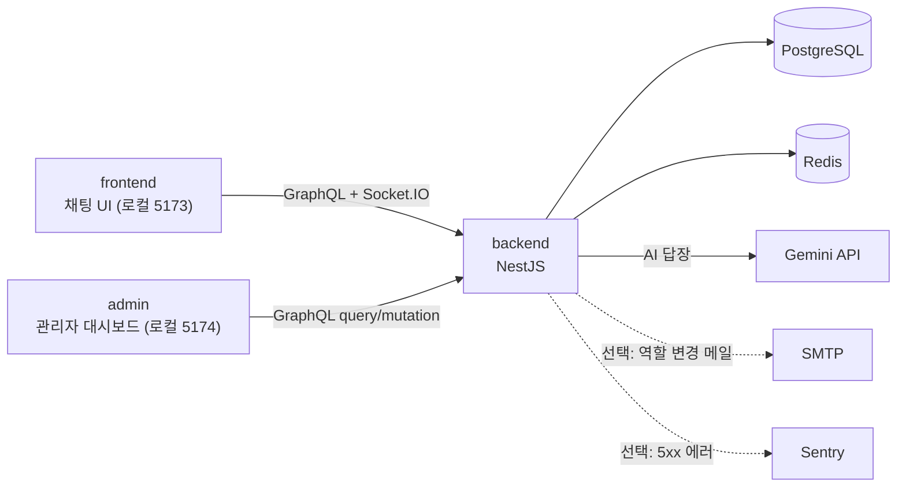
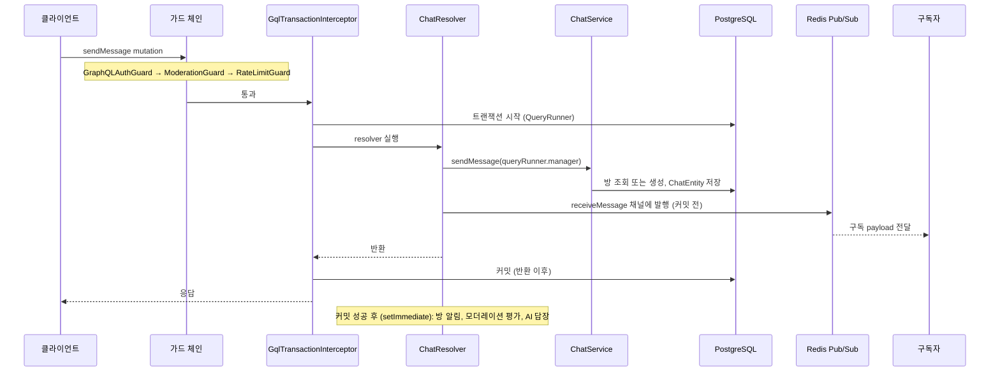

> English version: [README.en.md](README.en.md)

# Chatterley — 실시간 채팅 애플리케이션
1:1 실시간 채팅에 AI 대화 상대, 행동 기반 모더레이션, 별도 관리자 패널을 붙인 개인 프로젝트입니다. 실시간 메시지 전송 경로, 인증, 어뷰징 대응을 직접 설계·구현한 백엔드 중심의 학습·포트폴리오 프로젝트입니다.


## 개요
**스택**: NestJS · TypeScript · GraphQL(Apollo) · Socket.IO · Redis · PostgreSQL(TypeORM) · React · Vite · Docker · Gemini

- 메시지는 sendMessage GraphQL 뮤테이션으로 전송하고, receiveMessage 구독을 통해 실시간으로 받아옵니다. 메시지 저장은 GqlTransactionInterceptor가 트랜잭션 처리로 안전하게 묶어줍니다(자세한 내용은 [ADR 0003](ADR/0003-database-transaction-strategy.ko.md), [ADR 0004](ADR/0004-graphql-socketio-api-layer-split.ko.md) 문서를 참고하세요). Socket.IO는 연결 인증, 방 생성 알림, 그리고 중복 로그인 사용자 강제 로그아웃만 담당합니다.
- 인증 방식은 JWT 액세스 토큰은 메모리에서만 관리하고, 리프레시 토큰은 httpOnly 쿠키에 저장합니다. 역할 기반 접근 제어(RBAC)를 적용했으며, 권한별 액션에 대한 감사 로그도 기록됩니다.
- 모더레이션 시스템은 중복 메시지, 도배, 채팅 속도 위반에 대해 순차적으로 경고 → 뮤트 → 일정 기간 밴 → 영구 밴으로 제재가 강화됩니다. 필요시 관리자가 언제든지 이를 되돌릴 수 있습니다.
- AI 채팅 기능에는 Google Gemini 2.5 Flash가 적용되어 있고, 네 가지 성격 중에서 선택할 수 있습니다. 출력 토큰 수와 대화 이력, 재시도 횟수에 상한을 두었으며, 방마다 Redis로 락 처리를 합니다. AI 이름 Chattey는 시스템 프롬프트에서 지정한 별칭이고, 서비스명인 Chatterley와는 다릅니다.
- 별도의 Admin 패널(React 기반)에서 유저와 방 관리, 모더레이션, 감사 로그 CSV 내보내기를 지원합니다.
- 테스트는 backend는 Jest, frontend와 admin은 Vitest로 단위 테스트를 하고, CI에선 Playwright로 E2E 테스트를 자동 실행합니다(개수와 최근 실행 날짜는 ‘[검증 상태](#검증-상태)’ 문단을 참고하세요).
- 개발 이력은 2026년 1월부터 혼자서 커밋 730개를 쌓아왔습니다(최신 커밋 d684b19 기준). 전체 변경내역은 [CHANGELOG.ko.md](CHANGELOG.ko.md)에서 확인할 수 있습니다.
- 문서는 [ARCHITECTURE.ko.md](ARCHITECTURE.ko.md), [ADR/](ADR/), [ROADMAP.ko.md](ROADMAP.ko.md), [CONTRIBUTING.ko.md](CONTRIBUTING.ko.md)에 정리되어 있습니다.

실제 개발 과정에서 겪은 주요 사고와 버그, 설계 결정은 ‘[기술적 의사결정과 트러블슈팅](#기술적-의사결정과-문제-해결-과정)’ 단락에 문제 → 원인 → 해결 → 검증 결과 순으로 기록해 두었습니다.


## 스크린샷 안내
로컬 개발 스택(backend, Postgres, Redis, Vite 개발 서버) 환경에서 라이트 테마, 가로 1440px 기준으로 캡처했습니다. 현재 서비스는 [배포를 중단한 상태](#호스팅-현황)이기 때문에, 실제 배포 환경에서의 확인은 진행하지 않습니다. 계정과 메시지는 앱의 실제 API를 통해 생성한 일회성 데모 데이터입니다. 언어 전환 기능이 없어 영문/국문 README 모두 동일한 이미지를 사용합니다. UI 전체는 한국어로 구성되어 있습니다. 시간이 표시된 화면은 브라우저 타임존을 UTC로 고정해서 캡처했고, 메시지와 로그 시각도 UTC로 표기됩니다. 이미지는 클릭 시 원본으로 열립니다.

[](docs/images/demo-realtime-chat.gif)<br>**실시간 전달 데모** — 서로 다른 데모 계정 두 개를 나란히 띄우고, 한 쪽에서 메시지를 보내면 새로고침 없이 receiveMessage GraphQL 구독을 통해 다른 쪽에서 즉시 수신되는 모습입니다. 메시지 시각은 UTC 기준이며, 촬영 시점의 브라우저 시간대를 고정해서 기록했습니다.

[](docs/images/02-chat.png)<br>**1:1 채팅** — 메시지는 `receiveMessage` GraphQL 구독으로 도착합니다

[](docs/images/04-ai-chat.png)<br>**AI 채팅** — 실제 Gemini 답장이며 사람 메시지와 같은 채널로 전달됩니다

[](docs/images/07-admin-users-panel.png)<br>**Admin 유저** — 밴된 계정의 상세 패널과 최근 감사 이력

| | |
|---|---|
| [](docs/images/01-signin.png)<br>**로그인** — 액세스 토큰은 메모리, 리프레시 토큰은 httpOnly 쿠키에 보관합니다 | [](docs/images/03-ai-personality.png)<br>**AI 성격 선택** — 첫 AI 채팅은 첫 메시지 전에 4가지 성격 중 하나를 고르도록 합니다 |
| [](docs/images/05-account.png)<br>**계정** — 프로필 수정과 계정 탈퇴(현재 비밀번호 필요) | [](docs/images/06-admin-dashboard.png)<br>**Admin 대시보드** — 총계와 최근 감사 로그(별도 admin 앱) |

이 촬영본에서 확인된 한 가지 한계는, AI 성격 선택 화면의 대화상자 배경이 원래 의도와 다르게 불투명한 검정색으로 보인다는 점입니다. 오버레이에 사용된 `bg-opacity-40`을 Tailwind 4에서는 지원하지 않기 때문에 이런 현상이 나타났습니다.

## 호스팅 현황
백엔드는 Railway 운영비 문제로 서비스를 중단한 상태이고, 프런트엔드와 admin 패널 역시 Vercel에 배포했던 것까지 모두 종료했습니다. 마지막 자동 배포가 성공한 날짜는 2026-05-27이며, 배포 관련 기록은 [`deploy.yml` 실행 이력](https://github.com/Bluecode77732/Chat-project/actions/workflows/deploy.yml)에서 볼 수 있습니다. 실제로 `deploy` 작업은 수동 실행(`workflow_dispatch`)만 가능합니다.

프런트엔드(`frontend/vercel.json`)와 admin 패널 각각 독립된 Vercel 프로젝트로 구성해뒀지만 두 쪽 다 이미 배포를 멈췄습니다. GitHub Vercel 상태를 보면, `main` 브랜치 기준으로는 2026-10-19가 최근 성공 기록이고, `dev` 브랜치에서는 2026-10-26부터 `Deployment was blocked`로 표시됩니다. 라이브 URL은 따로 안내하지 않습니다.

앱을 실행하려면 [빠른 시작](#빠른-시작) 가이드를 참고해 로컬에서 직접 구동하세요.

## 내 역할과 AI 활용 범위
- **개발 방식**: 1인 개발입니다.
- **설계 결정 과정**: 처음엔 Socket.IO만으로 기능을 만들었지만, GraphQL에서도 양방향 통신이 가능하다는 얘기를 듣고 새로운 방법에 도전했습니다. 예를 들어, 방 생성과 메시지 저장 등 여러 테이블에 한꺼번에 데이터를 쓰는 작업이 필요해서 트랜잭션을 하나로 묶는 데도 관심이 생겼죠. 관련 구조에 대해 AI 설명을 참고하고, 세부 구현은 직접 검토해가며 메시지 전송 경로를 GraphQL로 바꿨습니다. ([사례 1](#기술적-의사결정과-문제-해결-과정) 참고) 이 외에 설계 관련된 주요 결정은 이렇게 진행했습니다.
  - **트랜잭션 인터셉터**: `QueryRunner`로 트랜잭션 생성, 커밋, 롤백 등 일련의 흐름을 직접 제어하고, 반복되는 커밋·롤백·`release()` 등 로직을 한 곳에서 처리하기 위해 인터셉터를 만들었습니다. 필요한 내용은 자료를 찾아 봤고, 부족한 점은 AI에게 물어보며 보완했습니다.
  - **Redis 활용**: DB 자체를 대체하지 않고 캐시 및 휘발성 상태 저장소로만 썼습니다. 영속 저장은 PostgreSQL에 맡기고, 최근 메시지 캐시, 세션·온라인 상태 관리, 속도 제한, 락, Pub/Sub 등만 Redis로 처리했습니다. 이 부분도 트랜잭션 인터셉터와 마찬가지로 자료 조사 후 직접 구현하고, 미진한 점은 AI의 도움을 받았습니다.
  - **모더레이션 단계 도입**: 각 모듈을 완성할 때마다 중간 점검을 하면서, 다음 추가 기능을 AI와 대화하며 결정했습니다. 해당 기능이 정말 필요한지, 앱에 적합한지, 실무적으로도 타당한지 스스로 조사한 뒤 구현 방향을 정했고, 영향 범위가 너무 넓어지지 않게 조정했습니다.
- **AI(Claude Code)에게 맡긴 일**: 코드 작성과 수정, 코드 리뷰 및 원인 분석, 테스트 작성, 문서화 등입니다.
- **검증 방식**: AI가 작성한 코드를 직접 읽어보고 수정도 했습니다. 로컬과 웹 브라우저에서 실제로 실행해 테스트했고, 자동 테스트와 CI도 활용했습니다. 구현과는 별개로 다른 AI 세션에서 코드 리뷰도 받았습니다.
- **AI 작업 규칙**: 저장소 루트에 [CLAUDE.md](CLAUDE.md) 파일을 두고, AI가 반드시 따라야 하는 규칙(금지 패턴, 변경 범위, 구현 전 체크리스트)을 정리해 놨습니다.
- **AI 제안을 거절하거나 수정한 사례**: [CLAUDE.md](CLAUDE.md)를 만들기 전에는 AI가 불필요하게 엔티티에 데코레이터를 달거나, 타입으로 `any`, `null`, `!` 등을 너무 무분별하게 썼던 적이 있습니다. 이런 부분은 하나하나 직접 수정했고, 나중에는 금지 패턴으로 모아서 CLAUDE.md에 넣어 관리하고 있습니다.
- **핵심 설계 설명이 필요한 부분**: `sendMessage` 흐름, 트랜잭션 커밋 시점, 가드 체인 구조([흐름](#흐름), [ARCHITECTURE.md](ARCHITECTURE.ko.md) 참고)


## 프로젝트를 시작하게 된 계기
- 이미 운영 중이던 앱의 메시지 전송 방식을 Socket.IO에서 GraphQL Mutation/Subscription으로 바꾸면서, 그 과정에서 발생할 수 있는 비용과 위험을 직접 경험했습니다([사례 1](#기술적-의사결정과-문제-해결-과정) 참고).
- Basic/Bearer/JWT 방식과 RBAC 가드를 통해 인증, 인가를 처음부터 끝까지 직접 구현했으며, 개발 중 알게 된 XSS와 localStorage 토큰 저장 취약점도 직접 수정했습니다.
- 개발용 DB가 외부에 노출된 사고가 있었는데, 이를 차단하고 데이터베이스를 교체·정리하는 일련의 대응 과정을 기록으로 남겼습니다([사례 2](#기술적-의사결정과-문제-해결-과정) 참고).
- 단순한 기능 데모에 그치지 않고, 행동 기반 모더레이션과 별도의 Admin 패널, 그리고 CI와 수동 배포 워크플로(GitHub Actions + Railway/Vercel)까지 직접 구축해 적용해 봤습니다.


## 기술 스택
핵심 설계와 밀접한 기술만 정리했습니다. 전체 의존성 목록은 각 패키지의 `package.json`과 [ARCHITECTURE.md](ARCHITECTURE.ko.md#기술-스택)에서 확인할 수 있습니다.

### 각 기술의 역할과 코드 위치
- **백엔드** — NestJS 11, TypeScript, Node.js 24 · `backend/src/`
  - DI를 기반으로 auth, chat, user, ai, moderation, audit-log 등을 모듈별로 나눈 단일 모놀리식 구조입니다. 초기에는 리졸버 하나짜리 작은 규모였으나, 모듈이 10개 가까이 늘어나면서 모듈 간 의존 방향도 고민하게 되었고, 이런 흐름은 [ADR 0006](ADR/0006-moderation-one-directional-dependency.ko.md)(단방향 의존)과 [ADR 0017](ADR/0017-auth-user-chat-circular-dependency.ko.md)(순환 의존 처리)에 기록했습니다.
  - 정적 타입 도입 역시, 개발 초기에 반복적으로 마주친 `undefined` 프로퍼티 접근 버그를 컴파일 단계에서 잡기 위함이었습니다.
- **API** — GraphQL(Apollo), graphql-ws · `backend/src/chat/chat.resolver.ts`, `backend/src/graphql/`
  - 메시지 전송은 mutation, 방별 메시지 구독은 subscription을 활용합니다. 초반에는 Socket.IO로 메시지를 직접 보냈지만, 방 생성이나 메시지 저장 등 여러 작업을 트랜잭션으로 묶어 처리하기 위해 프로젝트 중반에 GraphQL로 전환했습니다([사례 1](#기술적-의사결정과-문제-해결-과정) 참고).
- **실시간** — Socket.IO, `@socket.io/redis-adapter` · `backend/src/chat/chat.gateway.ts`
  - 연결 시 JWT 인증, 방 생성 알림, 중복 로그인 시 `forceLogout` 등의 기능을 담당합니다. Redis 어댑터 덕분에 브로드캐스트, `forceLogout`, 연결 종료(`server.in(socketId)`)가 여러 인스턴스에 걸쳐 동작합니다.
- **DB** — PostgreSQL, TypeORM · `backend/src/migrations/`, `backend/src/data-source.ts`
  - 유저, 방, 메시지, 감사 로그 등 여러 객체가 복잡하게 연결된 관계형 데이터베이스를 사용합니다. 스키마 변경은 마이그레이션으로만 처리해, 어떤 부분이 바뀌는지 리뷰 가능하도록 했습니다(`synchronize: false`).
- **캐시·Pub/Sub** — Redis(ioredis) · `backend/src/redis/redis.service.ts`, `backend/src/graphql/pubsub.service.ts`
  - 세션과 온라인 상태, 방별 최근 메시지 캐시, 속도 제한과 모더레이션 상태, AI 락, GraphQL Pub/Sub 기능을 담당합니다.
  - 인증에는 액세스 토큰 블랙리스트, 역할 캐시(`user_cache`), 리프레시 세션 ID(`auth:session`)를 활용합니다.
- **인증** — Passport JWT, bcrypt · `backend/src/auth/`
  - 액세스 토큰은 메모리에 저장하고, 리프레시 토큰은 httpOnly 쿠키로 관리합니다. 역할 가드는 REST와 GraphQL 모두에서 상속 대신 조합 방식으로 구성했습니다.
- **AI** — Gemini(`@google/genai`) · `backend/src/ai/`
  - 방마다 성격에 맞는 답장을 생성하며, 출력 토큰과 대화 이력, 재시도 상한 등을 미리 설계에 반영했습니다.
- **프론트엔드·관리자** — React, Vite, Zustand, Apollo Client · `frontend/src/`, `admin/src/`
  - 채팅 UI와 인메모리 토큰 저장, 자동 토큰 갱신을 지원합니다. 관리자는 별도의 앱으로 나눴습니다.
- **테스트·CI** — Jest, Vitest, Playwright, Docker Compose, GitHub Actions · `backend/src/**/*.spec.ts`, `frontend/e2e/`, `admin/e2e/`, `docker-compose.yml`, `.github/workflows/deploy.yml`
  - 서비스 단위 테스트, 컴포넌트·스토어 테스트, e2e 테스트, 로컬 풀스택 환경, 문서 정합성 검사까지 아울러 진행합니다.

### 프론트엔드
백엔드 기능을 제대로 검증하고, 서비스의 통합 흐름을 보여주기 위한 React + TypeScript 기반 클라이언트입니다.

- 주요 스택: React 19.2.5, TypeScript ~6.0.2, Vite 8.0.10, Tailwind CSS 4.2.4, Zustand 5.0.12, Apollo Client 4.1.9, Socket.IO Client 4.8.3
- 인증: 액세스 토큰은 Zustand를 통해 메모리에 저장하며, 리프레시 토큰은 백엔드에서 httpOnly 쿠키로 설정합니다. localStorage에는 저장하지 않습니다.
- 실시간 기능: Socket.IO를 활용한 연결 및 방 관리, GraphQL Mutation/Subscription으로 메시지 처리
- 보안: DOMPurify로 XSS를 방지하고, CORS 정책에 맞게 요청을 처리합니다. 보호가 필요한 페이지는 Route Guard로 접근을 제한합니다.
- 배포: Vercel 프로젝트로 구성했지만, 현재는 배포를 중단한 상태입니다(`frontend/vercel.json`, [호스팅 상태](#호스팅-현황) 참고)

## 주요 기능
- 속도 제한: 유저별로 15초에 최대 10개 메시지 전송(`RateLimitGuard`)
- 보안 대책: Helmet 보안 헤더 적용, frontend/관리자 앱의 Content-Security-Policy(Vercel `headers`) 설정, 로그인·회원가입은 IP당 60초에 10회로 제한(초과 시 429 반환). 근거는 [ADR 0020](ADR/0020-security-headers-and-auth-rate-limit.ko.md) 참고.
- 커서 기반 메시지 히스토리, 무한 스크롤 지원
- 프로필: 선택 가능한 닉네임(고유, 최대 20자)과 프로필 이미지(jpeg/png/webp, 2MB 이하) 업로드 기능 제공
- 접근성·UX: `/` 단축키로 입력창 포커스 이동, 모더레이션 알림용 `aria-live` 영역 배치

전체적으로 기능마다 역할과 흐름이 명확하게 나누어져 있고, 보안과 접근성을 모두 신경 쓴 구조입니다.

### 핵심 기능별 동작과 구현 위치

- **메시지 송수신**  
  `sendMessage` mutation과 `receiveMessage(roomId)` subscription(`chat.resolver.ts`)에서 처리합니다. 사용자가 메시지를 보내면 상대방 화면에 새로고침 없이 바로 도착합니다.  
  메시지 저장은 `GqlTransactionInterceptor`가 resolver가 값을 반환한 뒤 커밋하며, 커밋 이후에만 동작해야 하는 로직은 `ctx.req.transactionCommitted`를 통해 커밋 완료를 기다립니다.  
  Redis Pub/Sub은 at-most-once 방식으로 메시지를 전달하며, 현재는 DB 커밋보다 먼저 발행이 일어납니다([사례 1](#기술적-의사결정과-문제-해결-과정) 참고).

- **인증·세션**  
  `POST /auth/signin`, `POST /auth/token/refreshaccess`, `frontend/src/auth/session-guard.ts`에서 구현되어 있습니다. 로그인을 하면 새로고침해도 세션이 유지되며, 다른 탭에서 다른 계정으로 로그인하면 이 탭에서는 자동으로 로그아웃됩니다.  
  토큰 갱신 요청은 `refreshAccessTokenSafely()`로 하나로 모아 처리하고, 중복 요청이 들어오면 한 번만 요청해서 결과를 공유합니다.  
  한 사용자당 활성 WebSocket은 하나만 허용되며, 다른 인스턴스에 연결된 이전 소켓도 어댑터를 통해 종료시킵니다(인스턴스 2개로 테스트, [한계](#향후-확장-계획) 참고).

- **AI 채팅**  
  AI 관련은 `setAiPersonality` mutation과 `AiService.handleReply()`에서 처리합니다. AI 계정과 대화할 수 있고, 각 방마다 AI의 성격을 다르게 설정할 수 있습니다.  
  방마다 Redis 락을 걸어주고, 출력 토큰 수·대화 이력·재시도 횟수 한도를 관리합니다(더 자세한 내용은 [AI](#ai) 참고).

- **모더레이션**  
  `ModerationService`, `ModerationGuard`, `POST /user/:id/unban`을 통해 관리합니다. 도배 등 문제있는 행위엔 경고 후 뮤트, 밴 순으로 제재합니다.  
  임계값은 환경 변수로 조정할 수 있습니다. 밴된 사용자는 HTTP·GraphQL 요청, 소켓 연결, 토큰 갱신이 모두 거절됩니다.  
  이미 열려 있는 GraphQL 구독은 밴 이후에 해당 유저에게 다음 메시지가 전달될 때 종료되며, 그 메시지는 전달되지 않습니다([한계](#향후-확장-계획) 참고). 모든 제재 내역은 감사 로그에 남깁니다.

- **관리자 패널**  
  `admin/src/`, `GET /audit-log`, `GET /audit-log/export` 등이 관리자 기능을 담당합니다. 사용자를 관리하고 방을 운영하며, 감사 로그를 CSV로 내려받을 수 있습니다.  
  별도 앱으로 동작하며, query와 mutation만 사용하고 실시간 클라이언트는 따로 없습니다.


## 아키텍처
### 시스템 구성도

admin은 실시간 클라이언트(`graphql-ws`, `socket.io-client`)가 없어서 채팅에 참여하지 않습니다. SMTP와 Sentry는 필요에 따라 연동할 수 있으며, 관련 환경 변수가 비어 있으면 작동하지 않습니다([backend/.env.example](backend/.env.example) 참고).

### 프로젝트 구조
이 프로젝트는 pnpm 모노레포로 구성되어 있고, 주요 디렉터리는 `backend/`, `frontend/`, `admin/` 세 개입니다. 핵심 코드가 위치한 경로만 아래에 정리했습니다. 전체 디렉터리 구조가 궁금하다면 [ARCHITECTURE.md](ARCHITECTURE.ko.md#모노레포-구조)를 참고하시면 됩니다.

| 경로 | 역할 | 먼저 볼 파일 |
|---|---|---|
| `backend/src/chat/` | 메시지 전송·수신, 소켓 연결, 트랜잭션 | `chat.resolver.ts`, `chat.gateway.ts`, `chat.service.ts`, `interceptor/gql-transaction.interceptor.ts` |
| `backend/src/graphql/`, `backend/src/redis/` | Pub/Sub, 세션·캐시·속도 제한 | `pubsub.service.ts`, `redis.service.ts` |
| `backend/src/auth/` | JWT 인증, 역할 기반 가드 | `strategy/jwt.strategy.ts`, `guard/` |
| `backend/src/moderation/` | 스트라이크 누적, 뮤트·밴 집행 | `moderation.service.ts`, `moderation.guard.ts` |
| `backend/src/ai/` | Gemini 답장, 방별 성격 | `ai.service.ts`, `constants/system-prompts.ts` |
| `backend/src/user/`, `backend/src/audit-log/` | 유저 관리, 권한 액션 감사 로그 | `user.service.ts`, `audit-log.service.ts` |
| `backend/src/migrations/` | TypeORM 마이그레이션(스키마 변경은 이곳으로만) | `data-source.ts` |
| `backend/src/app.module.ts`, `main.ts` | 모듈 조립, 환경 변수 검증, 부팅 설정 | |
| `frontend/src/` | 채팅 UI | `api/apollo.ts`, `auth/session-guard.ts`, `socket/socket.ts`, `store/auth.store.ts`, `pages/chat-page.tsx` |
| `admin/src/` | 관리자 대시보드 | `pages/`, `auth/session-guard.ts` |
| `frontend/e2e/`, `admin/e2e/` | Playwright e2e | |
| `ADR/`, `scripts/` | 설계 결정 기록, 문서 정합성 검사 스크립트 | |

### Redis
- 세션과 온라인 상태 정보는 `user:{id}` 해시와 `online_users` 집합에, TTL(`SESSION_TTL_SEC`)과 함께 저장됩니다. 이렇게 하면 모든 서버 인스턴스가 동일한 값을 볼 수 있습니다. 단, Socket 객체는 직렬화할 수 없기 때문에 Redis에 저장하지 않고, 연결된 소켓은 각 프로세스의 Socket.IO 서버가 관리합니다. 그 이유와 대안으로 사용한 인메모리 Map에 대한 내용은 [기술적 의사결정과 트러블슈팅](#기술적-의사결정과-문제-해결-과정)의 사례 5에서 자세히 확인할 수 있습니다.
- `RedisPubSub` 싱글톤(구현 파일: `pubsub.service.ts`)은 GraphQL 뮤테이션과 활성화된 구독 사이에서 다리 역할을 합니다. 예를 들어, `receiveMessage:${roomId}` 채널에 메시지를 발행하면, 연결된 모든 `receiveMessage` 구독자들에게 실시간으로 메시지가 전달됩니다.
- 그리고 `PubSubService.publish()`를 통해 메시지를 발행할 때마다, 부수적인 동작으로 `SessionCacheService.cacheMessage()`가 호출되어 메시지가 캐싱됩니다. 실제로 사람과 AI의 모든 메시지는 이 단계에서만 캐싱되며, 리졸버나 `AiService`에서 직접 `cacheMessage()`를 따로 호출하지 않습니다.

### 엔티티 (TypeORM)
```
UserEntity
  id          PK
  email       unique
  nickname    nullable, unique, 최대 20자 — 다른 사용자에게 표시되는 이름
  profileImage nullable text (base64 data URI, jpeg/png/webp, 최대 ~2MB)
  password    API 응답에서 제외
  isAI        boolean (시드된 AI 시스템 계정에만 true)
  role        enum: user (0) | admin (1) | superadmin (2)
  status      enum: active | banned (모더레이션 상태, 모더레이션 섹션 참고)
  bannedUntil nullable timestamp — null이면 영구 밴 또는 밴 상태 아님
  chats    =< ChatEntity   (OneToMany)
  rooms    >< RoomEntity   (ManyToMany, RoomEntity 측 조인 테이블)

ChatEntity
  id          PK
  message     string
  participant >= UserEntity  (ManyToOne — 발신자)
  room        >= RoomEntity  (ManyToOne)

RoomEntity
  id            PK
  participants >< UserEntity   (ManyToMany 소유자, @JoinTable)
  chats        =< ChatEntity   (OneToMany)

AiRoomEntity — AI 성격 정보를 RoomEntity와 분리하려고 별도 엔티티로 둠
(자세한 이유는 ARCHITECTURE.md의 엔티티 절 참고)
  id          PK
  room        -- RoomEntity  (OneToOne, onDelete: CASCADE)
  personality string (해당 방의 현재 AI 성격)

EntityBase (네 엔티티 모두 상속)
  created     CreateDateColumn — API 응답에서 제외
  updated     UpdateDateColumn — API 응답에서 제외
```


## 흐름
모든 채팅 메시지는 GraphQL mutation으로 전송하고, GraphQL subscription으로만 받습니다(즉, **GraphQL Mutation 경로**만 사용합니다). Socket.IO(`ChatGateway`)는 오직 WebSocket 연결의 생명주기만 관리하며, 채팅 메시지를 처리하는 `@SubscribeMessage` 핸들러는 없습니다. 따라서 어떤 메시지도 emit하지 않습니다.

### Socket.IO 연결 생명주기
1. 클라이언트가 `chat.gateway.ts`의 handleConnection을 통해 WebSocket에 연결합니다.
   1.1. `AuthService.parseBearerToken()`에서 JWT 토큰으로 인증합니다.
   1.2. `ChatService.registerClient()`가 Redis에 `userId`와 대응하는 `socketId`를 저장합니다.
   1.3. `ChatService.joinRooms()`로 클라이언트가 기존 방에 자동으로 참여합니다.
   1.4. 만약 세션이 충돌하면, 해당 유저의 기존 소켓에는 `forceLogout`을 보내 연결을 끊습니다.

2. 방 생성 알림
   2.1. `ChatService`가 새 `RoomEntity`를 만들 때(두 사용자가 처음 메시지를 보낼 때), 수신자 소켓에 `CreateRoom`을 보내서 클라이언트가 새 방에 들어올 수 있도록 안내합니다.

3. 클라이언트 연결 해제
   3.1. 연결이 끊기면 `chat.gateway.ts`에서 `handleDisconnect`가 실행됩니다.
   3.2. `ChatService.removeClient()`는 Redis에 기록된 세션이 이 소켓과 일치할 때만 해당 사용자를 offline으로 처리합니다. 이미 더 최근 세션이 등록됐다면 아무런 처리도 하지 않습니다.

### GraphQL Mutation 경로 (`sendMessage`)

1. 가드 체인은 항상 먼저 실행됩니다. 여기서 순서가 중요한데요, 예를 들어 `ModerationGuard`가 먼저 뮤트되거나 밴된 사용자를 걸러내고, 그 뒤에 `RateLimitGuard`가 속도 제한 예산을 체크합니다.  
2. 다음으론 `GqlTransactionInterceptor`가 호출되어, resolver 실행 전 `QueryRunner`를 열고 트랜잭션을 시작합니다. 이 객체는 `@GqlQueryRunnerDecorator()`를 통해 resolver에 주입됩니다.  
3. 실제 메시지 처리는 `ChatService.sendMessage()` 안에서 이루어집니다. 이 메서드에선 발신자와 수신자를 확인하고, 채팅방을 조회하거나 필요하면 새로 만듭니다. 그리고 메시지를 `ChatEntity`로 저장하는 모든 작업을 하나의 트랜잭션에서 처리합니다.  
4. 이후 resolver는 `PubSubService.publish()`로 `receiveMessage :${roomId}`라는 채널에 새 메시지를 발행하고, 그 결과를 반환합니다. 이 발행은 트랜잭션 커밋 전에 일어나며, `publish()`는 사이드 이펙트로 방별 메시지 캐시에 저장해 둡니다. 사람이 보내든 AI가 보내든, 메시지는 여기 한 군데에서만 캐싱이 이루어집니다.  
5. 트랜잭션 커밋은 인터셉터가 resolver에서 값이 반환된 뒤에 처리합니다. 커밋에 맞춰 추가 작업이 필요한 경우 `ctx.req.transactionCommitted` Promise를 기다리면 되고, 이 값은 실제 커밋이 끝난 다음 resolve됩니다.  
6. 커밋이 끝난 뒤(정확히는 `setImmediate`로), 방 알림 전송, 모더레이션 평가, 그리고 수신자가 AI일 때의 답변 생성(여기에는 Redis 락, 대화 이력 저장, Gemini 호출, 응답 저장, 같은 채널로 발행까지 포함)이 시작됩니다. AI가 답장을 보내는 경우에도, 사람과 똑같이 같은 채널로 메시지가 나갑니다.  
7. 최종적으로, 구독 중인 사용자는 Redis Pub/Sub를 통해 `receiveMessage(roomId)` subscription으로 메시지를 받아보게 됩니다.  

### 인증 토큰 생명주기  
두 종류의 토큰은 서로 다른 위치에 일부러 나눠서 보관합니다. 수명이 짧은 `accessToken`은 메모리(Zustand 참고, persist 옵션에서 제외됨)에만 남아요. 반면, 사용 기간이 긴 `refreshToken`은 프론트엔드에서 접근 불가능하게 httpOnly 쿠키로 저장합니다. 이 구조를 택한 근거는 [ADR 0001](ADR/0001-jwt-auth-token-strategy.ko.md) 문서에서 확인하실 수 있습니다.

1. 로그인 — `POST /auth/signin` (기본 인증 사용)  
  1-1. 백엔드가 응답 body에선 `accessToken`을 돌려주고, `refreshToken`은 httpOnly 쿠키로 별도 설정합니다(`secure`, `sameSite: 'none'` 사용. 프론트와 백엔드 출처가 다르기 때문입니다).  
  1-2. 프론트엔드에선 `setTokens(accessToken, userId)`만 호출해서 메모리에 저장하며, `localStorage`에는 두지 않습니다.  
  1-3. 리프레시 토큰에는 `jti`가 달리고, 이 값은 백엔드에서 Redis에 `auth:session:{userId}` 형식으로 저장됩니다(TTL은 리프레시 토큰 유효기간과 같습니다). 이후 재로그인하면 이 값이 새 세션 정보로 덮어씌워지고, 이전 리프레시 토큰은 "Session Superseded"라는 이유로 거부됩니다.  

2. 인증된 요청  
  2-1. 인증 요청이 필요할 때마다 `authLink`가 현재 시점의 `useAuthStore.getState().accessToken` 값을 읽고, 이를 `Authorization: Bearer` 헤더로 자동 설정합니다.

3. 자동 갱신  
   - 페이지를 새로고침하거나(메모리가 비어 있는 상태) `errorLink`에서 401 오류를 감지하면 자동으로 토큰을 갱신합니다.
  3.1. 모든 요청은 반드시 `session-guard.ts`의 `refreshAccessTokenSafely()`를 거치며, 여러 요청이 동시에 들어올 경우엔 진행 중인 갱신 요청 하나를 공유합니다.  
  3.2. `POST /auth/token/refreshaccess` 요청은 `credentials: 'include'` 옵션과 함께 전송하므로, 브라우저가 자동으로 쿠키를 첨부하고 JavaScript에서 리프레시 토큰을 직접 다루지 않아도 됩니다.  
  3.3. 새롭게 발급된 `accessToken`은 응답 본문에서 받아 다시 메모리에 저장합니다.  
  3.4. 만약 갱신된 결과의 계정 정보가 이 탭에서 마지막으로 인증했던 계정(`sessionStorage['chat:sessionUserId']`)과 다르다면, 사용자가 모르게 신원이 바뀌는 일을 막기 위해 해당 탭은 바로 로그아웃 처리합니다.

4. 로그아웃  
   - `POST /auth/signOut` 요청을 보내 로그아웃 처리합니다.
  4.1. 백엔드는 액세스 토큰을 블랙리스트에 등록하고, `res.clearCookie('refreshToken')`을 호출해 토큰이 만료되었거나 유효하지 않더라도 쿠키를 삭제합니다.  
  4.2. 프론트엔드는 Zustand 스토어를 초기화하고, 리다이렉트로 사용자를 로그아웃 상태로 돌려놓습니다.

## 기술적 의사결정과 문제 해결 과정
각 사례는 문제 → 원인 → 해결 → 실제 검증 결과 순서로 정리했습니다. **검증 결과** 항목엔 코드와 테스트, 실행 등으로 직접 확인된 내용만 적었고, 설계 단계 기대치와 실제 동작 확인 결과는 구분했습니다. 성능 수치는 따로 측정하지 않아 포함하지 않았습니다. 실행 확인은 2026년 10월 22일, Windows 10에 설치된 Docker 28.5.1 환경에서 해당 커밋(`d684b19`)으로 진행했습니다.

### 사례 1: Socket.IO에서 GraphQL로 메시지 경로 이전
- **문제**  
  초창기에는 Socket.IO 핸들러가 메시지를 받아 저장하고 전달까지 모두 담당했습니다. 그런데, 방 생성이나 메시지 저장처럼 여러 테이블을 한 트랜잭션으로 묶어 처리할 수 있는 구조가 소켓 핸들러 계층에는 없었습니다.
- **원인**  
  소켓 핸들러에서는 요청별로 트랜잭션 수명(즉, `QueryRunner`를 열고, 커밋/롤백 후 `release()` 처리까지)을 적절히 관리할 계층이 없었습니다. 호출 지점마다 트랜잭션 관리를 직접 하다 보면, `release()`를 깜빡해 커넥션 풀이 새는 위험이 있었습니다. 이 부분은 [ADR 0003](ADR/0003-database-transaction-strategy.ko.md)에 정리해 뒀습니다.
- **해결**  
  - 메시지 전송은 `sendMessage` mutation, 수신은 `receiveMessage` subscription으로 API를 옮기고, 트랜잭션 관리 책임은 `GqlTransactionInterceptor`가 맡도록 개편했습니다. Socket.IO는 연결 인증, 방 생성 알림, `forceLogout` 용도만 남겼습니다.
  - 두 경로를 병행해 두는 안도 검토했지만, 같은 메시지 이벤트의 중복 처리/순서 오류가 생길 수 있다는 이유로 채택하지 않았습니다(관련 내용은 [ADR 0004](ADR/0004-graphql-socketio-api-layer-split.ko.md) 참조).
  - 실제로 운영하던 앱에서 이 과정을 진행해, 구 소켓 핸들러 코드를 제거한 2026년 6월 11일까지 약 4개월 반 동안 두 경로가 동시에 살아 있었습니다(세부 이력 [ROADMAP.ko.md](ROADMAP.ko.md) 참고).
- **검증 결과**:
  - `gql-transaction.interceptor.spec.ts`에서는 커밋이 완료되기 전에는 결과를 반환하지 않는 성공 경로와, 오류가 발생해 롤백된 뒤 `release`가 한 번 호출되고 `InternalServerErrorException`이 발생하는 경우, 그리고 커밋 자체가 실패하는 상황까지 모두 검증했습니다.
  - 로컬 Docker 환경에서 회원가입 → `sendMessage` 실행 → 다른 계정으로 `receiveMessage` 구독 수신 → `getMessages`로 API에서 메시지 확인까지 실제 사용 흐름을 점검했습니다.
  - 한계: resolver가 커밋 전에 발행되기 때문에, 만약 커밋이 실패하면 구독자는 이미 메시지를 받아도 실제 저장은 되지 않을 수 있습니다. 이 현상은 코드 구조상 가능한 일이지만 직접 재현하지는 않았습니다. 반면 커밋 이후에 수행되는 방 알림, 모더레이션 평가, AI 답장 등은 `transactionCommitted`에서 커밋 성공 시에만 처리되어, 커밋이 실패하면 이 작업들은 실행되지 않습니다.
  - 한계: `sendMessage`가 비멱등 동작이라, 만약 타임아웃 후 클라이언트가 재시도하면 동일한 메시지가 중복 저장될 수 있습니다. (관련 내용은 `chat.resolver.ts` 주석 참고)
  - 한계: Redis Pub/Sub 특성상 at-most-once라 구독을 중단한 동안 발행된 메시지는 이후 다시 전달되지 않습니다. (이 한계는 ADR 0004에서 인정했습니다.) 이관 전후의 성능 변화는 따로 측정하지 않았습니다.

### 사례 2: 개발 DB·Redis 포트의 외부 노출 사고
- **문제**: 개발 중 PostgreSQL(5432), Redis(6379), 백엔드(3000) 포트가 외부 인터넷에서 직접 접근 가능한 상태였고, 자동화된 랜섬웨어 봇이 PostgreSQL의 기본 계정 정보를 이용해 개발 DB를 삭제한 뒤, 데이터 복구를 대가로 금전을 요구했습니다.
- **원인**: `docker-compose.yml`에서 포트가 `0.0.0.0`으로 바인딩되어 있었고, 공인 IP가 설정된 Ethernet 어댑터의 Windows 방화벽 프로필이 "Private(신뢰)"로 되어 있어 Docker Desktop 관련 규칙이 모든 인바운드 포트를 허용한 상태였습니다.
- **해결**:
  - 순서대로 먼저 외부 접근을 차단(포트 바인딩을 `127.0.0.1`로 변경, 개발 환경은 loopback만 허용, 방화벽 프로필을 Public으로 전환)했고, 이후 DB·Redis 비밀번호와 JWT 시크릿을 변경했습니다. 마지막으로 공격자가 생성한 DB와 테이블 등을 정리했습니다. 참고로, 일단 접근 차단부터 하지 않고 정리만 먼저 하면 봇이 곧장 다시 테이블을 만들 수 있습니다.
  - 공격자가 만든 테이블의 내용은 AI가 읽지 않았고 직접 사람이 확인해 처리했습니다. 이는 AI 프롬프트 인젝션을 차단하기 위한 조치입니다.
  - 재발 방지를 위해 Redis에 `requirepass`를 적용했고, `ENV=prod` 환경에서는 비밀번호 없는 `REDIS_URL`로는 서비스가 실행되지 않도록 했습니다. 자세한 내용은 [AI 보조 개발 사례](#ai-보조-개발-사례)와 [ADR 0013](ADR/0013-local-dev-network-binding.ko.md) 문서를 참고하시면 됩니다.
- **검증 결과**:
  - 변경된 설정은 코드를 통해 확인했습니다. `docker-compose.yml`의 `127.0.0.1` 바인딩, Redis `requirepass` 설정, `main.ts`의 loopback 분기 처리, `app.module.ts`의 `REDIS_URL` 비밀번호 검증이 적용됐습니다.
  - 로컬 Docker 환경에서 `docker compose ps` 명령 결과, 3000, 5432, 6379 포트가 모두 `127.0.0.1`에만 바인딩된 것을 실제로 확인했습니다.
  - 한계: 외부 네트워크에서의 실제 포트 스캔 검증은 진행하지 않았으며, 비밀번호·시크릿 교체는 사건 당시 남긴 기록에 의존해 검증했습니다.

### 사례 3: AI 응답 캐시 손상 (`Invalid time value`)
- **문제**: 브라우저에서 AI 재시도와 폴백 기능을 수동으로 확인하던 중, 백엔드를 재시작했다가 소켓이 다시 연결되면서 방 메시지를 캐시에서 읽는 과정에서 `CombinedGraphQLErrors: Invalid time value` 오류가 발생했습니다.
- **원인**: `AiService`에서 직접 자신의 답장을 캐싱하고, 동시에 `PubSubService`의 발행 훅에서도 같은 답장이 한 번 더 캐싱되고 있었습니다. 이때 두 번째로 저장된 캐시는 `@Exclude()`가 적용된 `created` 필드가 빠진 상태라, 불러올 때 `new Date(undefined)`가 되어 내부적으로 NaN이 만들어졌고, 결국 GraphQL의 `DateTime` 스칼라에서 `toISOString()` 호출 시 예외가 발생했습니다. 관련 캐싱 리팩터링에서 `ai.service.ts` 쪽 처리가 누락된 것을 `git show --stat`로 직접 확인할 수 있었습니다.
- **해결**: 이제 `AiService`가 원본 엔티티를 그대로 발행하게 변경해, 사람 메시지와 동작 방식이 일치하도록 했습니다. 중복된 직접 캐싱 부분도 제거했고, 메시지 캐싱은 이제 `PubSubService.publish()`에서만 처리되도록 정리했습니다.
- **검증 결과**:
  - `redis.service.spec.ts`에는 `created` 필드가 없는 캐시 항목이 Invalid Date로 처리되는 상황을 다루는 테스트 케이스가 있습니다. 또, `pubsub.service.spec.ts`에서는 발행 시 캐싱 동작을 직접 검증했습니다.
  - 현재 `backend/src/ai/` 내에는 `cacheMessage`를 직접 호출하는 코드가 없는 것을 확인했습니다(검색으로 검증).
  - `pnpm test`를 실행했으며, 테스트가 정상적으로 통과했습니다(구체적인 개수는 [검증 상태](#검증-상태) 참고).
  - 한계: 이번 수정 후 동일한 브라우저 시나리오(백엔드 재시작 후 새로고침)로 직접 재현해 확인해보진 않았으나, 그 이후 앱 사용 중에는 같은 오류가 다시 발생하지 않았습니다.

### 사례 4: 마이그레이션 생성이 ON DELETE CASCADE를 되돌리는 문제
- **문제**: `pnpm migration:generate`를 실행하면 ManyToMany 조인 테이블 FK `FK_501a0aef55632e3cf2894bda97f`(`room_entity_participants_user_entity`)가 `ON DELETE NO ACTION`으로 바뀌며, 유저 삭제 시 방 참여 기록을 정리하는 용도의 `ON DELETE CASCADE`가 조용히 되돌아가게 됩니다. 이렇게 되면 유저를 삭제할 때 FK 제약 위반으로 인해 삭제가 실패했습니다([CLAUDE.md](CLAUDE.md) 참조).
- **원인**: 해당 ManyToMany 관계에 `onDelete` 옵션이 빠져 있어서, TypeORM이 실제 DB의 CASCADE 상태와 코드 정의가 다르다고 판단하고, 마이그레이션에서 이를 `NO ACTION`으로 되돌리는 변경을 자동으로 생성했습니다.
- **해결**:
  - 자동 생성된 마이그레이션 중 해당 FK 관련 줄은 반드시 수동으로 제거하도록 리뷰 절차를 명시했습니다([CLAUDE.md](CLAUDE.md), [ADR 0003](ADR/0003-database-transaction-strategy.ko.md) 참고).
  - 사람이 실수로 놓칠 수 있으니, `migration-cascade-guard.spec.ts`라는 정적 가드를 새로 만들었습니다. 이 가드는 마이그레이션 `up()` 소스를 텍스트로 분석해 CASCADE 설정이 잘 유지됐는지 체크해줍니다. 이 테스트는 `pnpm test`에 포함되어 있어 로컬과 CI에서 항상 함께 돌아갑니다. 다만, 프로덕션에서는 마이그레이션이 다 적용된 후에 실행하므로 사용할 필요가 없습니다.
  - 앞으로 보호할 FK가 늘어나면 spec 내 `GUARDED_FKS` 배열에 해당 FK 이름을 추가하면 됩니다.
- **검증 결과**:
  - 해당 spec이 포함된 상태로 `pnpm test`를 실행했고, 모든 테스트가 통과했습니다.
  - 한계: 이번에는 실제 구동 중인 DB에서 FK의 삭제 동작(`confdeltype`)을 직접 조회하는 검증은 하지 않았습니다.

---

정리하자면, 두 사례 모두 문제의 근본 원인을 명확하게 찾아내고 적절한 수정과 검증 절차를 추가했습니다. 남은 한계점은 추후 별도의 시간에 보완할 예정입니다.

### 사례 5: 메모리 소켓 맵에서 Redis 세션으로
- **문제**: `userId → Socket` 매핑을 프로세스 메모리 Map에만 두면 서버를 재시작할 때 사라지고, 인스턴스가 늘어나면 다른 인스턴스에서 접속 위치와 온라인 여부를 알 수 없습니다.
- **원인**: Map은 프로세스 로컬 상태이고 Socket 객체는 직렬화할 수 없어 그대로 공유할 수 없습니다.
- **해결**: 이전 인메모리 `clientConnection` Map을 Redis 기반 세션 캐시로 대체했습니다(`redis.service.ts` 주석).
  - `user:{id}` 해시(`socketId`, `status`)에 TTL(`SESSION_TTL_SEC`, 기본 86400초)을 두고, 온라인 목록은 `online_users` 집합에 뒀습니다. `hset`, `expire`, `sadd`는 MULTI/EXEC로 묶어 TTL 없는 키가 남지 않게 합니다
  - 서버 시작 시와 5분마다 `online_users`를 `user:{id}`와 대조해 정리했습니다(유령 유저 방지). 무조건 지우지 않는 이유는 다른 인스턴스에 연결된 유저까지 지우게 되기 때문입니다
  - 새 소켓을 현재 세션으로 먼저 기록한 뒤 이전 소켓에 `forceLogout`을 보내고, `removeClient`는 현재 세션이 그 소켓일 때만 offline으로 바꿉니다([ADR 0014](ADR/0014-single-active-session.ko.md))
  - 방 브로드캐스트는 `@socket.io/redis-adapter`로 인스턴스 간에 전달했습니다

  현재 코드(`backend/src/redis/redis.service.ts`)의 온라인 등록:
  ```ts
  async sethUserOnline(userId: number, socketId: string) {
    const key = `user:${userId}`;
    const ttl = this.configService.get<number>('SESSION_TTL_SEC', 86400);
    await this.redis
      .multi()
      .hset(key, 'socketId', socketId, 'status', 'online')
      .expire(key, ttl)
      .sadd('online_users', String(userId))
      .exec();
  }
  ```
- **검증 결과**:
  - 코드로 확인한 것: 위 구조, `chat.gateway.ts`의 어댑터 연결, `redis.service.spec.ts`와 `chat.service.spec.ts` 단위 테스트
  - 설계상 기대(미검증): 어댑터가 없으면 `server.to(room).emit(...)`이 같은 프로세스에 연결된 클라이언트에만 전달됩니다
  - 실측(2026-10-26, 인스턴스 2개를 같은 Postgres·Redis에 붙여 실행):
    - 수정 전에는 같은 계정이 다른 인스턴스에서 두 번째로 접속해도 첫 소켓에 `forceLogout`이 가지 않고 끊기지도 않았습니다. `kickPreviousSession`이 현재 프로세스의 소켓만 조회했기 때문이며, 같은 이유로 다른 인스턴스에 연결된 소켓은 밴으로도 끊기지 않았습니다
    - 조회를 어댑터를 거치는 `server.in(socketId)`로 바꾼 뒤 같은 시나리오에서 첫 소켓이 `forceLogout`을 받고 끊기며, 밴도 다른 인스턴스의 소켓에 닿습니다
    - `forceLogout`이 끊김보다 먼저 도착하는지 20회 반복해 20회 모두 확인했습니다(로컬 한 환경의 관찰이며 순서를 보장하는 것은 아닙니다)
    - 부하와 성능은 측정하지 않았고, 성능이 좋아졌다는 수치는 없습니다


## AI 보조 개발 사례
두 사건의 경위와 해결은 [기술적 의사결정과 트러블슈팅](#기술적-의사결정과-문제-해결-과정)의 사례 2·3에 자세히 정리되어 있습니다. 이 글에서는 AI 도구가 어떤 방식으로 쓰였고, 그 과정에서 얻은 교훈만 간단히 정리합니다.

### 라이브 테스트 중 인프라 보안 위협 탐지
- **AI가 한 일**: Swagger와 curl로 직접 API를 호출하면서 라이브 환경을 점검하던 중, Docker Compose 설정을 살펴 `0.0.0.0` 바인딩과 방화벽 프로필 조합에서 발생하는 노출 위험을 찾아냈습니다. 이후 포트 바인딩을 `127.0.0.1`로 고치고, `main.ts`에서 호스트를 제한했어요. 또 Redis의 `requirepass`를 수정하고, 데이터베이스와 Redis 비밀번호, JWT 시크릿 역시 모두 교체했습니다. 방화벽 프로필을 Public으로 변경하는 부분은 안내만 하고 사용자가 직접 처리하도록 맡겼습니다.
- **AI가 하지 않은 일 — 프롬프트 인젝션 방지**: 공격자가 만든 `readme_to_recover.readme` 테이블의 내용을 SQL로 직접 읽지 않았습니다. 만약 공격자가 데이터베이스에 AI 지시문을 집어넣었다면, 이 내용을 AI 컨텍스트에 올렸을 때 모델의 응답이나 도구 사용이 외부 입력에 영향을 받을 수 있기 때문입니다. 그래서 테이블이 어디에 있고 실제로 있는지만 설명하고, 내부 내용을 직접 확인하는 것은 사용자에게 맡겼습니다. 확인 결과, 표준적인 비트코인 요구문이 들어있었습니다.
- **교훈**: AI 도구를 이용해 라이브 테스트를 진행하면 코드 리뷰나 CI만으로는 드러나지 않는 배포 환경의 취약점까지 찾아낼 수 있다는 걸 배웠습니다. 또, AI가 직접 데이터베이스 행이나 업로드된 파일처럼 외부에서 들어온 콘텐츠를 읽게 두면 프롬프트 인젝션에 노출될 수 있으니, 이런 부분은 반드시 사람이 확인해야 합니다. 대응은 **봉쇄 → 로테이션 → 정리** 순서로 진행해야 하며, 순서가 바뀌면 정리가 무의미해질 수 있다는 점도 중요합니다.

### 라이브 브라우저 테스트 중 발견한 AI 응답 캐시 손상
- **AI가 한 일**: `psql`로 데이터베이스의 `created` 컬럼을 직접 조회해 데이터 자체에는 문제가 없는지 먼저 확인했습니다. 이어서 `@nestjs/graphql`의 `DateTime` 스칼라 구현 코드를 읽고, 예외가 발생하는 조건을 파악했습니다. 캐시가 저장되는 지점인 `ai.service.ts`와 `pubsub.service.ts` 두 곳을 추적했고, 과거의 캐싱 관련 리팩터링 커밋에는 `git show --stat`을 실행해 중복 저장이 설계상 의도된 것이 아니라 누락이라는 사실을 파악했습니다. 이후 `AiService`가 원본 엔티티를 제대로 발행하도록 수정하고, 회귀 테스트까지 추가해 재발을 막았습니다.
- **교훈**: 라이브 브라우저 테스트를 하다 보면 단위 테스트만으로는 찾을 수 없는 서비스 간 버그가 드러납니다. 원래 사용하던 목(mock)이 실제 데이터가 손상되는 계층, 여기서는 `PubSubService`의 캐시 발행 구간을 제대로 가리지 못하고 있었기 때문입니다. 또, 수정 내역이 의도된 것인지 실수로 누락된 것인지를 헷갈릴 때는 수정 커밋에 `git show --stat`만 실행해 봐도 단번에 확인할 수 있습니다.

## 빠른 시작
- 사전 준비 사항
  - Node.js 24.x(`.nvmrc`), pnpm 10 이상(고정 버전 정보는 [CONTRIBUTING.ko.md](CONTRIBUTING.ko.md#사전-준비물) 참고)
  - Docker 28 버전 이상 — 아래 A 방법을 쓰면 로컬에 PostgreSQL이나 Redis를 미리 설치할 필요가 없습니다.
  - `GEMINI_API_KEY`는 반드시 필요한 환경 변수입니다. 이 키가 없으면 서비스가 시작되지 않습니다([`app.module.ts`](backend/src/app.module.ts) 참고). AI 답장을 실제로 쓰려면 Gemini API 키를 반드시 준비해야 합니다.

### A. Docker로 backend + PostgreSQL + Redis 실행
**1. 의존성 설치** (frontend, admin 실행에 필요합니다)
```bash
pnpm install
```

**2. 프로젝트 루트에 `.env.docker` 생성** (git이 추적하지 않는 파일입니다). 아래 값은 모두 예시이므로 실제 값으로 바꾸세요.
```env
ENV=dev
DB_TYPE=postgres
DB_HOST=postgres
DB_PORT=5432
DB_USERNAME=postgres
DB_PASSWORD=<임의의 비밀번호>
DB_DATABASE=chatdb
POSTGRES_USER=postgres
POSTGRES_PASSWORD=<DB_PASSWORD와 같은 값>
POSTGRES_DB=chatdb
REDIS_PASSWORD=<임의의 비밀번호>
REDIS_URL=redis://:<REDIS_PASSWORD 값>@redis:6379
HASH_ROUNDS=12
REFRESH_TOKEN_SECRET=<임의의 긴 문자열>
ACCESS_TOKEN_SECRET=<임의의 긴 문자열>
REFRESH_TOKEN_SECRET_EXPIRES_IN=604800
ACCESS_TOKEN_SECRET_EXPIRES_IN=900
USER_CACHE_TTL_SEC=300
SESSION_TTL_SEC=86400
MESSAGE_CACHE_TTL_SEC=86400
CORS_ORIGIN=http://localhost:5173,http://localhost:5174
GEMINI_API_KEY=<Gemini API 키>
```
`NODE_ENV`와 `RUNTIME_ENV`는 [compose](docker-compose.yml)에서 자동으로 설정하니 따로 작성하지 않아도 됩니다. `POSTGRES_*`와 `REDIS_PASSWORD` 값은 `postgres`와 `redis` 컨테이너가 같은 파일을 참고해서 읽어옵니다. 토큰 만료 시간은 반드시 초 단위의 숫자로 입력해야 하며, '7d'처럼 문자열로 입력하면 부팅 시 검증에서 거부됩니다. 전체 환경 변수 목록은 [backend/.env.example](backend/.env.example) 파일을 참고하시면 됩니다.

**3. 서비스 시작**
```bash
docker compose up -d --build
```
컨테이너가 시작될 때 마이그레이션이 자동으로 실행되므로 따로 실행하지 않습니다. 부팅 확인: `http://localhost:3000/health`가 `{"status":"ok"}`를 반환합니다.

**4. 프론트엔드 실행** (별도 터미널)
```bash
cp frontend/.env.example frontend/.env.local
cd frontend && pnpm dev
```
→ http://localhost:5173

**5. Admin 패널 실행** (별도 터미널, admin/superadmin 계정이 필요합니다)
```bash
cp admin/.env.example admin/.env.local
cd admin && pnpm dev
```
→ http://localhost:5174 — 최초 superadmin은 DB에 직접 만들어야 합니다([Admin 계정 생성](#admin-계정-생성) 참고).

**종료**: `docker compose down`은 컨테이너만 내리고 데이터(볼륨)는 유지합니다. `docker compose down -v`는 PostgreSQL·Redis 볼륨까지 삭제하므로 데이터가 사라집니다.

### B. 수동 실행 (로컬 PostgreSQL 18과 Redis가 있는 경우)
```bash
pnpm install
cp backend/.env.example backend/.env     # 값을 채움. DB_TYPE은 postgres, DB_HOST·REDIS_URL은 로컬 주소
pnpm --filter backend build               # migration:run이 dist/data-source.js를 쓰므로 먼저 빌드해야 함
pnpm migration:run
docker run -d -p 6379:6379 --name redis-chat redis:latest   # 이미 만들었으면 docker start redis-chat
cd backend && pnpm start:dev
```
PostgreSQL에 DB를 만드는 절차는 이 문서에서 다루지 않습니다. frontend와 admin은 A 경로의 4, 5단계와 같습니다.

### 검증 상태
2026-10-22, Windows 10, Docker 28.5.1 / Compose 2.40.0, Node 24.8.0, pnpm 10.33.0, 커밋 `d684b19`에서 격리된 임시 클론에서 확인했습니다.

| 항목 | 상태 |
|---|---|
| A 경로: 컨테이너 기동, 마이그레이션 자동 실행, `/health` | 확인했습니다 |
| 가입, 로그인, `sendMessage`, `receiveMessage` 구독 수신, `getMessages` | API 수준으로 확인했습니다 |
| superadmin INSERT 후 관리자 로그인과 `GET /user` | 확인했습니다 |
| frontend, admin 개발 서버 | 응답(200)만 확인했습니다. 브라우저에서 로그인·채팅 화면은 확인하지 않았습니다 |
| B 경로 | `build` 후 `migration:run`까지 확인했습니다. `start:dev`와 빈 DB에서의 최초 마이그레이션은 확인하지 않았습니다 |
| Playwright e2e | 이번 로컬 실행에서는 실행하지 않았습니다. CI의 2026-10-19 main push 실행([#39287345174](https://github.com/Bluecode77732/Chat-project/actions/runs/39287345174))에서는 `e2e`와 `admin-e2e` job이 모두 성공했습니다. 다만 `ai-chat.spec.ts`는 Gemini 키가 없어도 폴백 메시지로 통과하므로 실제 Gemini 답장을 검증하지는 않았습니다 |
| AI 실제 답장, 모더레이션 동작 | 이번 실행에서는 확인하지 않았습니다 |
| 단위 테스트 | backend 14 suites 258 tests, frontend 4 files 21 tests, admin 3 files 14 tests 통과(2026-10-27 `dev` `bd1213f`에서 재실행) |

**테스트 실행**
```bash
pnpm test                         # backend Jest
pnpm --filter frontend test       # frontend Vitest
pnpm --filter admin test          # admin Vitest
cd backend && pnpm test:cov       # backend 커버리지
```
e2e(Playwright)는 `pnpm --filter frontend e2e`, `pnpm --filter admin e2e`로 실행하며 CI에서 돌아갑니다.

**Swagger UI** — 백엔드를 실행한 상태에서 http://localhost:3000/document

**채팅 확인** — Altair/Postman으로 직접 해 보는 절차는 [CONTRIBUTING.ko.md](CONTRIBUTING.ko.md#graphql-api-직접-호출)를 참고하세요.

### 문제 해결
실행 중 자주 겪는 문제와 그 해결법을 정리했습니다.

- **Redis 연결 문제**
  - 증상: 로그에 "GraphQLModule dependencies initialized"가 뜬 뒤 곧바로 "Redis Error: AggregateError [ECONNREFUSED]" 또는 "Error: connect ECONNREFUSED ::IPv6 주소:포트" 에러가 나타납니다.
  - 해결 방법: 터미널에서 `docker start redis-chat` 명령어를 실행해 Redis 컨테이너를 시작하세요.

- **`pnpm migration:run` 실패**
  - 증상: `Unable to open file ... dist/data-source.js` 메시지가 보입니다.
  - 해결 방법: 먼저 `pnpm --filter backend build` 명령어로 빌드를 진행해야 합니다. `migration:run` 과정에서는 빌드된 산출물인 `dist/data-source.js` 파일이 필요합니다.


## 향후 확장 계획

**현재 한계**
- Redis Pub/Sub 특성상 at-most-once 방식으로 동작해, 구독하지 않은 동안에 발행된 메시지는 다시 받을 수 없습니다([ADR 0004](ADR/0004-graphql-socketio-api-layer-split.ko.md) 참고).
- 메시지가 커밋 전에 발행되기 때문에, 만약 커밋이 실패하면 구독자는 이미 메시지를 받아 봤더라도 해당 메시지가 실제로 저장되지 않았을 가능성이 있습니다(이론상 가능한 상황이며, 아직 실제로 재현된 적은 없습니다).
- `sendMessage`가 비멱등(동일한 요청이 여러 번 처리될 수 있음)이어서, 타임아웃 후 클라이언트가 재시도하면 동일한 메시지가 중복 저장될 수 있습니다.
- 방 생성과 조회 로직이 '정확히 두 명'만 참여하는 구조에 맞춰져 있어서, 현재는 그룹 채팅이 지원되지 않습니다([ROADMAP.ko.md](ROADMAP.ko.md) 참고).
- 환경 변수로 `GEMINI_API_KEY`가 반드시 필요해, 키가 없으면 서비스가 시작되지 않습니다.
- 현재 배포는 중단된 상태이므로, 실제 배포 환경에서의 동작은 점검하지 않았습니다.
- 밴된 사용자의 `receiveMessage` 구독은 밴 즉시 종료되지 않고, 그 이용자에게 다음 메시지가 전달될 때 닫힙니다(그 메시지는 보내지 않습니다). 메시지당 `isUserBanned`로 DB를 조회하기 때문에, 구독자와 메시지 수에 비례해서 DB 조회 비용이 늘어나며, 이 비용은 아직 측정하지 않았습니다.
- 관리자 강제 로그아웃(`UserService.forceLogout`)시 소켓 연결만 끊기고, 열려 있던 GraphQL 구독은 닫히지 않습니다. 이미 발급된 액세스 토큰도 따로 폐기하지 않습니다.
- 여러 인스턴스에서 발생하는 부하나 동작 상황은 측정하지 않았습니다.
- 최초 superadmin 사용자는 DB에 직접 INSERT로 만들어야 합니다.
- `admin-e2e` 작업은 아직 필수가 아니고, Windows에서 실행되는 `test` 작업은 실패해도 전체 진행이 멈추지 않습니다([deploy.yml](.github/workflows/deploy.yml) 참고).
- frontend와 admin 쪽에는 에러 트래킹이 적용되어 있지 않으며, backend만 Sentry로 모니터링하고 있습니다.

**미구현 백로그** (우선순위가 정해진 계획이 아니며 상세는 [ROADMAP.ko.md](ROADMAP.ko.md) 참고)
- 대화 목록의 마지막 메시지와 안 읽은 메시지 수
- 그룹 채팅
- 사용자 측 방·대화 삭제
- 입력 중 표시
- `receiveMessage` 구독의 속도 제한
- 강제 로그아웃 시 열린 GraphQL 구독 종료
- frontend·admin 에러 트래킹


## API 문서
### Swagger UI
***모든 기능을 테스트하려면 먼저 회원가입해야 합니다.***
REST(`Auth`, `User`, `Audit Log`)의 엔드포인트별 파라미터와 응답 스키마는 백엔드를 로컬에서 실행한 뒤 Swagger UI(`http://localhost:3000/document`)에서 확인할 수 있습니다.

### 주요 엔드포인트
**REST** — 파라미터와 스키마는 Swagger에 있으므로 여기에는 Swagger에서 드러나지 않는 권한과 제한만 적습니다.

| 엔드포인트 | 권한 | 제한·동작 |
|---|---|---|
| `GET /health` | 없음 | liveness 체크. DB/Redis는 확인하지 않고 `{ status: 'ok' }`만 반환합니다(의존성 장애가 컨테이너 재시작을 유발하지 않도록) |
| `POST /auth/register`, `POST /auth/signin` | 없음 | IP당 60초/10회 속도 제한(초과 시 429). Basic 인증 헤더로 전달합니다 |
| `POST /auth/signOut` | 로그인 | 현재 액세스 토큰을 블랙리스트 처리하고 리프레시 토큰 쿠키를 삭제합니다(토큰이 이미 만료/무효해도 쿠키는 삭제됩니다) |
| `POST /auth/token/refreshaccess` | 리프레시 쿠키 | 액세스 토큰 갱신 |
| `GET /user` | admin | `humanOnly`는 시드된 AI 계정과 모더레이션 시스템 계정을 제외합니다 |
| `GET /user/:id`, `PATCH /user/:id` | 본인 또는 admin | 닉네임은 20자 이하이며 고유해야 합니다(중복이면 400). 프로필 이미지는 base64 data URI, jpeg/png/webp, 2MB 이하 |
| `DELETE /user/:id` | 본인 또는 admin | 시드된 AI 계정과 모더레이션 시스템 계정은 삭제 불가 |
| `PATCH /user/:id/role` | superadmin | 계정 생성은 `POST /auth/register`로만 가능합니다 |
| `POST /user/:id/force-logout`, `/ban`, `/unban` | admin | `ban`은 `durationSec`을 생략하면 영구 밴이고 활성 세션도 즉시 종료합니다. `unban`은 밴·뮤트·스트라이크를 해제합니다 |
| `GET /audit-log` | admin | `userId`는 actor 또는 target으로 매칭합니다 |
| `GET /audit-log/export` | admin | 같은 필터 결과를 CSV로 내보내며 최대 10,000행입니다(권한 관련 데이터라 양이 적어 커서 스트리밍 대신 단순한 상한을 선택합니다) |

**채팅 (GraphQL)** — 전체 스키마는 NestJS가 코드에서 생성하는 `backend/src/schema.gql`에 있습니다. 채팅 메시지는 GraphQL로만 오가고, Socket.IO는 연결 인증과 `CreateRoom` 알림만 처리합니다. Altair/Postman 사용 절차는 [CONTRIBUTING.ko.md](CONTRIBUTING.ko.md#graphql-api-직접-호출)에 있습니다.

- `getMessages(roomId, cursor)`는 커서 이전 메시지를 최대 15개 반환합니다. `getAllRooms`, `deleteRoom`은 admin 전용입니다


## 상세 레퍼런스
핵심 설계 외에도 도메인 설명과 운영에 참고해야 할 사항들을 안내합니다. 환경 변수 전체 목록은 [backend/.env.example](backend/.env.example) 파일에서 확인할 수 있고, 배포와 Docker 관련 내용은 [ARCHITECTURE.ko.md의 ‘배포 토폴로지’](ARCHITECTURE.ko.md#배포-토폴로지) 항목에 정리되어 있습니다. 설정과 테스트 정책은 [CONTRIBUTING.ko.md](CONTRIBUTING.ko.md) 문서에서 참고하시면 됩니다.

### 역할

- 역할은 총 세 가지로 나뉩니다: `user`(0, 기본값), `admin`(1), `superadmin`(2).
- 가입한 모든 사용자는 기본적으로 `user` 역할을 부여받으며, 메시지 전송이 가능합니다.
- `admin`은 더 높은 권한을 가지고 있습니다. 모든 사용자 계정의 조회, 수정, 삭제는 물론, 강제 로그아웃이나 감사 로그 확인도 할 수 있습니다.
- `superadmin`은 여기에 더해 역할 변경 권한까지 갖고 있습니다. 다른 사용자의 역할을 승격하거나 강등시키는 일은 오직 superadmin만 할 수 있습니다.
- 최초의 superadmin 계정은 데이터베이스에 직접 INSERT하여 생성해야 합니다. 그 이후에는 admin 계정이 Admin 패널에서 superadmin으로 승격될 수 있습니다.
- 환경 변수인 `MAX_ADMIN_COUNT`(기본 5개) 값을 통해 admin 계정의 최대 수를 제한합니다. superadmin은 이 제한에 포함되지 않습니다.
- 역할이 변경될 때마다 해당 유저에게 MailService를 통해 안내 메일이 발송됩니다. 이 메일은 비동기로 처리되며, 만약 발송에 실패하더라도 역할 변경에는 영향을 주지 않고, 관련 로그만 남습니다.

※ 서버에서 반드시 지켜지는 원칙(사용자 인터페이스와는 무관하게 서버가 강제합니다):
- 마지막으로 남은 superadmin 계정은 절대 강등할 수 없습니다. updateRole에서 이를 막아, 시스템에 superadmin이 한 명도 없는 상황이 생기지 않도록 합니다.
- admin은 `MAX_ADMIN_COUNT` 상한을 초과할 수 없습니다.
- 시드된 AI 답장 계정이나 모더레이션 시스템 계정은 삭제할 수 없습니다. UserService.remove()가 이를 거부하여, AI 답장이나 모더레이션 알림 기능이 갑자기 중단되지 않도록 합니다.
- force-logout, ban, unban, delete 등과 달리, updateRole은 본인과 동일하거나 더 높은 권한을 가진 사용자에 대해 제한을 두지 않습니다. superadmin이 다른 superadmin의 역할을 강등시킬 수 있으며, 이는 의도된 동작입니다. 자세한 내용은 아래 ‘[탈취된 superadmin 계정 봉쇄](#탈취된-superadmin-계정-봉쇄)’ 지침을 참고하시기 바랍니다.

### 탈취된 superadmin 계정 봉쇄
운영 지침상 superadmin 계정은 항상 최소 2명이 되어야 합니다. 만약 한 명뿐이라 그 계정이 탈취된다면, 위에서 설명한 마지막-superadmin 불변식 때문에 조치할 방법이 없어집니다. 반면에 2명 이상 superadmin이 있을 경우, 계정 봉쇄나 권한 조정은 별도의 데이터베이스 접근 없이도 평소처럼 앱 내부에서 처리할 수 있습니다.

1. 탈취되지 않은 다른 superadmin 계정으로 Admin 패널에 로그인합니다.  
2. Users 목록에서 탈취된 계정을 찾아 **Demote (superadmin)**을 클릭하세요. 그러면 해당 사용자는 바로 다음 요청부터 `admin` 권한으로 내려갑니다. 이때 기존에 발급된 액세스 토큰이 남아 있더라도 매 요청마다 [DB나 캐시에서 현재 권한을 다시 확인](#역할)하기 때문에 실제 권한도 바로 변경됩니다. 즉, 굳이 토큰이 만료될 때까지 기다릴 필요가 없습니다.
3. 권한이 강등된 이후에는 평소 하던 대로 **Force logout**, **Ban**, **Delete**와 같은 admin 작업을 적용하시면 됩니다.
4. 신뢰할 수 있는 계정을 superadmin으로 다시 올려, 최소 2명의 superadmin이 유지되도록 하세요.
5. 감사 로그(해당 사용자 ID의 `ROLE_CHANGE`, `FORCE_LOGOUT`, `USER_BANNED` 등)를 살펴보며, 계정이 탈취된 동안 어떤 활동이 있었는지 확인합니다.

만약 superadmin 계정이 단 1개이고, 그 계정이 탈취됐다면 앱 내부에서 복구할 방법이 없습니다. 이런 경우에는 `ACCESS_TOKEN_SECRET`/`REFRESH_TOKEN_SECRET`을 변경해서 공격자뿐 아니라 모든 세션을 강제로 재로그인하도록 만들고, DB에서 직접 해당 행의 권한을 수정해야 합니다. 그래서 superadmin을 최소 2명 이상 두는 것이 필수 정책인 이유입니다.


### 모더레이션

이 시스템은 자동으로 에스컬레이션되고, admin이 결과를 되돌릴 수 있도록 설계된 행동 기반 어뷰징 탐지 기능입니다. 별도의 신고 버튼 없이, `sendMessage`와 인증/소켓 계층에서 자동으로 감지·누적·집행이 이루어집니다. 관련된 로직은 모두 `ModerationService`에 구현되어 있고, `ModerationGuard`는 뮤트되거나 밴된 사용자가 메시지를 보내지 못하도록 필터링만 담당합니다.

- **스트라이크 발생 조건**
  - *중복/도배* — 정규화된 동일 메시지를 60초 안에 3번 보내면 스트라이크 1회가 부여됩니다.
  - *속도 위반* — `RateLimitGuard`(15초에 10회 전송 제한)에 걸릴 경우에도 스트라이크 1회가 추가됩니다. 두 조건은 동일한 가중치로 집계됩니다.
- **에스컬레이션 단계**(스트라이크는 24시간 동안 누적되며, 임계값은 환경변수로 조정 가능)
  - **3회 누적 시: 경고** — 방에 시스템 계정의 안내 메시지가 가운데 정렬로 게시됩니다.
  - **5회 누적 시: 10분 임시 뮤트** — Redis를 이용해 관리하며, 연결은 유지되지만 메시지 전송 권한만 제한됩니다.
  - **7회 누적 시: 7일간 밴** — 7일 동안 이용이 차단되며, 한 번 더 밴될 경우(두 번째 `USER_BANNED`)에는 영구적으로 차단됩니다.
- **집행 방식** — 밴된 사용자는 `jwt.strategy`(HTTP·GraphQL), 소켓 연결(`handleConnection`), 토큰 갱신 시 등 주요 인증 포인트마다 접근이 차단됩니다. 유효한 토큰이 있더라도 새 연결·요청·갱신이 모두 거절되며, 밴 전부터 연결된 GraphQL 구독도 이후 메시지 전달 시점마다 `isUserBanned`를 통해 다시 확인해, 밴 사실을 발견하면 구독을 종료하고 해당 메시지는 전송하지 않습니다(2026-10-26 기준 로컬 환경에서 확인). 이런 식으로 구독 시작 시와 각 메시지 발송 시에 별도로 권한 체크가 이뤄집니다. 참고로 뮤트의 경우, 메시지 전송만 막고 읽기는 그대로 가능합니다.
- **복구 및 감사** — `POST /user/:id/unban`(관리자)이 밴, 뮤트, 스트라이크를 해제한 뒤, 인증 관련 캐시도 비웁니다. 처리된 모든 동작은 감사 로그에 기록되며, 각각 `USER_MUTED`, `USER_BANNED`, `USER_UNBAN` 같은 항목으로 남습니다.

- **저장소** — 영구 밴 정보는 `user_entity.status`(`active` 또는 `banned`)와 `bannedUntil` 필드에 저장됩니다. 반면, 스트라이크와 뮤트는 오직 Redis에서만 관리하며(`moderation:*` 키에 TTL 설정), 시작 전에 꼭 `AddModerationColumns` 마이그레이션을 먼저 실행해야 합니다.

여덟 가지 임계값은 모두 기본값이 지정된 선택적 `MODERATION_*` 환경 변수로 조정할 수 있습니다(이름은 [backend/.env.example](backend/.env.example)에서 확인하세요).

> 이 절에서 언급한 기본값은 총 네 곳(여기, CLAUDE.md, `backend/.env.example`, 코드)에 중복되어 있습니다. 단일 진실 공급원은 `backend/src/moderation/constants/moderation.constants.ts`에 있는 `MODERATION_DEFAULTS`입니다. 값을 변경할 때는 이 파일을 가장 먼저 수정한 뒤, 나머지 세 곳의 내용도 반드시 맞춰주세요.

**감사 로그 액션 값** — 각 권한 관련 작업은 아래의 값 중 하나로 감사 로그에 남습니다. 로그는 `GET /audit-log?action=`을 이용해 필터링할 수 있습니다. 자세한 내용은 [주요 엔드포인트](#주요-엔드포인트) 부분을 참고하세요:

| 액션 | 기록 주체 |
|---|---|
| `ROLE_CHANGE` | `PATCH /user/:id/role` |
| `FORCE_LOGOUT` | `POST /user/:id/force-logout`, 또는 수동/기간제 밴 시 자동 |
| `USER_DELETE` | `DELETE /user/:id` |
| `USER_BANNED` | 자동 밴 임계값 도달, 또는 `POST /user/:id/ban` |
| `USER_MUTED` | 자동 뮤트 임계값 도달 |
| `USER_UNBAN` | `POST /user/:id/unban` |

수동 검증 절차(밴·언밴·감사 로그)는 [CONTRIBUTING.ko.md](CONTRIBUTING.ko.md#수동-모더레이션-검증)에 있습니다.

### Admin 계정 생성
최초 superadmin은 데이터베이스에 직접 생성해야 합니다. API 엔드포인트에서 `user` 이상의 역할을 부여하지 않아 공격 면을 최소화합니다.

**1단계 — bcrypt 해시 생성** (`.env`의 `HASH_ROUNDS` 값과 동일하게 설정):
```bash
node -e "const b=require('bcrypt'); b.hash('yourPassword', 12).then(h=>console.log(h))"
```
`bcrypt`는 `backend/` 디렉터리에서만 해석되므로 저장소 루트가 아니라 `backend/`에서 실행하세요. docker compose 스택에서는 컨테이너 안에서 실행하세요(비밀번호는 환경 변수 `PW`로 전달):
```bash
echo "require('bcrypt').hash(process.env.PW, 12).then(h => console.log(h))" | docker compose exec -T -e PW='yourPassword' -w /app/backend chat node -
```

**2단계 — DB에 직접 INSERT** (Railway 쿼리 실행기, DB 클라이언트, 또는 docker compose 스택에서는 `docker compose exec -T postgres psql -U <POSTGRES_USER> -d <POSTGRES_DB>`에 SQL을 표준입력으로 넘기세요):
```sql
INSERT INTO user_entity (email, password, role, "isAI")
VALUES ('superadmin@example.com', '<1단계에서 생성한 해시>', 2, false);
```

역할 숫자: `user = 0`, `admin = 1`, `superadmin = 2`


### Admin 패널
admin/superadmin 계정을 위한 별도의 React 앱(`admin/`)입니다. 로컬에서는 `http://localhost:5174`에서 실행할 수 있으며, 자세한 방법은 [빠른 시작](#빠른-시작)에서 확인할 수 있습니다. 이 앱은 별도의 Vercel 프로젝트로도 구성되어 있지만, 현재는 배포가 중단된 상태입니다. 자세한 배포 구조는 [ARCHITECTURE.md의 배포 토폴로지](ARCHITECTURE.ko.md#배포-토폴로지)에서 확인할 수 있습니다.

- **Dashboard** : 총 유저 수(실제 유저만 집계하며, AI 계정과 모더레이션 시스템 계정은 제외), 총 방 개수, 현재 접속자 수, 최근 감사 로그 5건을 보여줍니다.
- **Users** : 페이지네이션, 정렬, 검색 기능이 있는 목록을 제공하며, 모더레이션 상태(활성/정지)로 필터링할 수 있습니다. 각 행을 클릭하면 모더레이션 상태와 최근 감사 이력이 담긴 상세 패널이 열립니다.
  - 권한 변경은 superadmin만 user와 admin 사이에서 할 수 있습니다.
  - 강제 로그아웃, 수동 밴(사유 선택, 영구 또는 기간제)/언밴, 삭제는 자신보다 권한이 낮은 계정에만 적용할 수 있습니다.
  - **Demote (superadmin)**: 이 기능은 superadmin만이 동료 superadmin 계정에 추가로 사용할 수 있는 액션입니다. 자세한 내용은 [탈취된 superadmin 계정 봉쇄](#탈취된-superadmin-계정-봉쇄)를 참고하세요.
  - AI 계정이나 모더레이션 시스템 계정은 삭제할 수 없습니다. 관련 내용은 [역할](#역할) 불변식을 참고하세요.
- **Rooms** : 페이지네이션과 검색이 가능한 방 목록을 제공합니다. 각 행을 클릭하면 방 ID, 생성일, 참여자 정보를 확인할 수 있는 상세 패널이 열리며, 방 삭제도 할 수 있습니다.
- **Logs** : 액션, 유저, 날짜 범위별로 감사 로그를 필터링해서 볼 수 있습니다. **Export CSV** 버튼을 누르면 현재 필터와 동일한 조건으로 최대 10,000건까지의 로그를 파일로 내려받을 수 있습니다.

### AI
Google Gemini 2.5 Flash를 기반으로, 서비스는 `AiService`(답장 생성)와 `AiRoomService`(방 성격 선택 및 조회)로 구성되어 있습니다. AI 대화 상대의 이름은 시스템 프롬프트에서 지정한 별칭 `Chattey`이고, 실제 서비스명인 Chatterley와 다릅니다.

- **성격 4종**: `FRIENDLY`(일반 Q&A), `CODING`(프로그래밍 및 코드 예시), `ENGLISH`(영작 교정), `CREATIVE`(스토리텔링과 브레인스토밍). 각 성격별 시스템 프롬프트는 `SYSTEM_PROMPTS` 맵에서 키로 조회합니다.
- **비용 관리**: `gemini-2.5-flash` 모델, `maxOutputTokens`는 300으로 제한하고, 최근 대화 10개만 이력에 포함합니다. 재시도는 최대 3번까지 가능하며(지수 백오프 적용), 답변은 시스템 프롬프트에서 5줄 이하로 유도합니다.
- **중복 방지**: 방마다 Redis 락(`ai:lock:{roomId}`)을 사용하며, TTL은 30초, NX 옵션으로 설정합니다. 락을 획득하지 못하면 답장을 대기시키지 않고 바로 건너뜁니다. 락 해제는 `finally`에서 처리합니다.
- **전달 방식**: 전체 응답은 `generateContent()`로 한 번에 받아, 사람 메시지와 동일한 `receiveMessage :${roomId}` 채널에 발행합니다. 답장은 커밋 이후(`setImmediate`)에 트리거되어, 답장 생성 실패와 무관하게 발신자 메시지 응답에는 영향을 주지 않습니다.
- **실패 처리**: 재시도를 모두 소진하면 고정 폴백 메시지(`AI_REPLY_FAILURE_MESSAGE`)를 반환합니다. 정상 답변은 호출마다 달라질 수 있으므로 테스트에서는 답변 문구가 고정적이라고 가정하면 안 됩니다.

### 테스트
서비스 계층 중심으로 Jest 유닛 테스트를 작성하고, frontend 및 admin은 Vitest, 앱 전반은 Playwright 기반 e2e 테스트를 활용합니다. 커버리지는 서비스 계층 위주로 측정하며, 정책(측정 제외, `bcrypt` 목 등)은 [CONTRIBUTING.ko.md](CONTRIBUTING.ko.md#테스트-컨벤션)에 정리되어 있습니다. 실행 방법은 [빠른 시작](#빠른-시작) 문서를 참고하시면 됩니다.

#### 테스트 커버리지
테스트 개수는 [검증 상태](#검증-상태)에 있습니다.

**커버리지 결과** (% Stmts 기준, `pnpm test:cov` — 2026-10-26 재측정, Chat Service 외에는 2026-07-16 값과 동일)
- Auth Service: 98.29%
- Chat Service: 98.44%
- Redis Service: 96.34%
- User Service: 100%
- AI Service: 96.7%
- AI Room Service: 100%
- Moderation Service: 99.21%
- Audit Log Service: 97.56%
- Mail Service: 100%

마이그레이션이 `ON DELETE CASCADE`를 되돌리지 않는지 막는 정적 가드(`migration-cascade-guard.spec.ts`)는 [사례 4](#기술적-의사결정과-문제-해결-과정)에 있습니다.


## 관련 문서
- [ARCHITECTURE.ko.md](ARCHITECTURE.ko.md) — 모듈 의존성 그래프, 가드 체인, 배포 토폴로지
- [CONTRIBUTING.ko.md](CONTRIBUTING.ko.md) — 로컬 설정, 브랜치/커밋 컨벤션, PR 체크리스트
- [CHANGELOG.ko.md](CHANGELOG.ko.md) — 전체 커밋 이력
- [ROADMAP.ko.md](ROADMAP.ko.md) — 미구현 백로그 상세
- [backend/.env.example](backend/.env.example) — 환경 변수 전체 목록
- [ADR/](ADR/) — 아키텍처 결정 기록(한글판 `*.ko.md` 포함)


## 라이선스
MIT — [LICENSE](LICENSE) 참고하세요.
